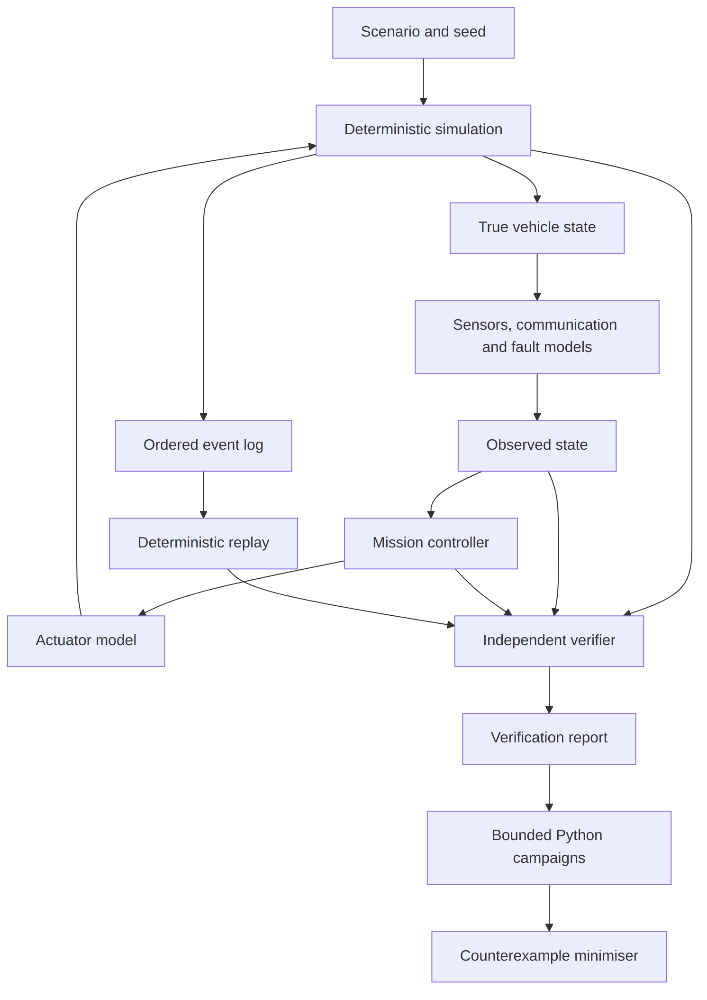

# Autonomous Systems V&V Lab

A Rust and Python laboratory for repeatable autonomous-mission simulation, fault injection and verification.

**Status:** M9 and M9.1 are integrated in `main`. The M10.0 resilient-navigation design was merged through [PR #13](https://github.com/DoArtMonteiro/autonomous-systems-vv-lab/pull/13). The M10 implementation is in draft [PR #15](https://github.com/DoArtMonteiro/autonomous-systems-vv-lab/pull/15) and has not been accepted. The M11 desktop application, the M12 experiment engine, the M14 research and the M13 Discovery Lab were integrated without M10 through PRs [#21](https://github.com/DoArtMonteiro/autonomous-systems-vv-lab/pull/21), [#22](https://github.com/DoArtMonteiro/autonomous-systems-vv-lab/pull/22) and [#23](https://github.com/DoArtMonteiro/autonomous-systems-vv-lab/pull/23). M15 (mission experience and simulation library) is proposed on its own branch, and M16 (geospatial view and Mission Control) is proposed on a branch stacked on it. Every M13 and M14 finding remains exploratory.

The main simulator models a two-dimensional ground vehicle. A separate, idealised six-degree-of-freedom rocket model supports the M8 and M9 research campaigns. Neither model controls real hardware, and the rocket model has no flight-data validation.

[Architecture](docs/architecture.md) · [M9 landing results](docs/m9-powered-landing.md) · [M8 model](docs/m8-rocket-dynamics.md) · [Reproduction](docs/reproducibility.md) · [M9 integration, PR #12](https://github.com/DoArtMonteiro/autonomous-systems-vv-lab/pull/12)

## The problem

A mission can look safe to a controller while the true simulated state violates a constraint. Sensor, communication and actuator faults make that gap harder to inspect. This project separates the controller's observations from the simulator's true state, then records enough evidence to replay a failure and inspect the contract that detected it.

## What is implemented

- A deterministic Rust simulator for two-dimensional ground-vehicle missions, including seeded sensor, communication and actuator faults.
- Safety invariants and finite-trace temporal contracts, evaluated by a verifier separate from the mission controller.
- Ordered event logs, deterministic replay and bounded counterexample minimisation.
- Python campaign runners and a local Mission Control interface using versioned simulation adapters.
- A six-degree-of-freedom rocket dynamics package with fixed-step integration and reference cases.
- Closed-loop powered-landing simulations for M9 and the M9.1 safety-guard follow-up.

The controller uses sensor observations, not the true position. The verifier may use the true state to evaluate safety properties. A passing safety result, mission completion and progress are reported separately.

## Architecture



The rocket package uses a separate adapter. Its M9 landing controller sees noisy sensor observations; the verifier checks the simulated state against predeclared contact and flight invariants. The simulation stops at the model's contact condition. It does not model landing-leg dynamics, bounce, tip-over or real vehicle hardware.

## Engineering decisions

- **Separate observation from truth.** The controller cannot read the true state. The verifier can use it to check invariants independently.
- **Make a failure replayable.** Integer coordinates, fixed time steps, an explicit pseudo-random generator and an ordered event stream reduce platform-dependent variation. Replay checks the recorded inputs and reconstructed outputs.
- **Treat hashes as integrity checks, not signatures.** SHA-256 detects changed inputs and logs. It does not prove who created an artefact.
- **Bound campaigns before execution.** Run, case, artefact-size and time limits constrain campaign work. A failed expectation or a safe trajectory does not by itself mean that the mission completed.
- **Keep results tied to a model.** Rocket campaign findings apply to the idealised model and its assumptions, not to flight hardware.

## Evidence and results

The M9 and M9.1 result document reports **780 M9 runs comparing two policies** and **1,050 M9.1 runs**, with replay checks and predeclared campaign conditions. The campaign scripts are published, but the original raw outputs are not stored in public `main`. Treat the totals as project-reported results; the original outputs are unavailable for direct inspection.

[PR #12](https://github.com/DoArtMonteiro/autonomous-systems-vv-lab/pull/12) merged M9/M9.1 on 29/10/2026. [Its CI run](https://github.com/DoArtMonteiro/autonomous-systems-vv-lab/actions/runs/40852112731) passed Linux and Windows verification, including canonical output checks. The checks are automated CI; they do not establish independent human approval. The M9.1 report also records a failed predeclared hypothesis and a regression, rather than presenting only passing outcomes.

For the M8 model, see the [reference cases and model assumptions](docs/m8-rocket-dynamics.md). For campaign commands and artefacts, see the [reproducibility guide](docs/reproducibility.md).

## Run locally

Requirements: Rust and Cargo as pinned in `rust-toolchain.toml`; Python 3.10 or newer for campaign scripts.

```sh
cargo run -- run scenarios/basic-mission.json --seed 42 --output runs/basic
cargo run -- replay runs/basic/events.json
cargo test
python -m unittest discover -s tests -p "test_*.py"
```

To verify the rocket reference cases and run one landing scenario:

```sh
cargo run --release --manifest-path crates/vv-rocket/Cargo.toml -- verify
cargo run --release --manifest-path crates/vv-rocket/Cargo.toml -- land crates/vv-rocket/landing/altimeter-bias.json --seed 0 --output runs/m9-bias
cargo run --release --manifest-path crates/vv-rocket/Cargo.toml -- replay runs/m9-bias
```

An expected safety violation can make a `run` command exit with code `2`; that is a simulated finding, not a test harness failure. See the scenario's result and report before interpreting the exit code.

### V&V Lab Studio (M11 desktop application)

A Windows 11 application that packages the simulators behind a versioned domain contract (`vv-domain` 1.0): mission preparation, a 3D rocket scene and a 2D ground-vehicle scene, time-synchronised telemetry, requirement and invariant verdicts, controller comparison, replay by recomputation, evidence export and a persistent library. It installs per user and needs no Rust, Python or Node.js at run time. The rocket domain offers the M9 and M9.1 policies and faults only; it refuses the protected rocket seeds (3000 to 3099 and 6000 to 6099) and the M6 held-out ground seeds (101 to 112) before any simulation starts. Domains are separate host executables discovered at start; a benign reference domain shows that a new domain needs no change to the platform or the interface.

```powershell
powershell -ExecutionPolicy Bypass -File desktop\build.ps1   # builds the NSIS installer in desktop\target\release\bundle\nsis
```

See [docs/m11-desktop.md](docs/m11-desktop.md) for the architecture and how to add a domain, and [docs/m11-acceptance.md](docs/m11-acceptance.md) for installation and acceptance. The UI tests (`desktop/studio/tests/ui_smoke.py`, `desktop/studio/tests/m15_journeys.py`) drive the real window. The developer CLI and the local Mission Control remain supported.

### vv-exec experiment engine (M12)

An in-process engine that runs `vv-experiment.v1` specifications (arms, fault grids, Latin hypercube and Saltelli designs) through the canonical `vv-rocket` library, with adaptive scheduling, hashed resumable records, retention by policy, an equivalence gate against the canonical command line and statistics recomputed from the records. On development seeds 7000 to 9399, the example experiment (the M9.1 guarded controller under six conditions) ran 14,400 landings in 7.5 to 10.4 s end to end on 16 threads, over three runs on a shared AMD Ryzen 7 7800X3D machine; full recomputation with `vv-exec verify` took 11.2 s. Peak memory was not re-measured on this branch. Tests check that the records are byte-identical for any worker count.

```sh
cargo build --release --manifest-path exec/Cargo.toml
exec/target/release/vv-exec run exec/examples/m12-dev-throughput.json --output exec/target/m12-dev/throughput --threads 16
exec/target/release/vv-exec verify exec/target/m12-dev/throughput --threads 16
```

See [docs/m12-exec.md](docs/m12-exec.md). Its development-seed verdicts are engine evidence, not evaluation results.

### M15 mission experience and simulation library (proposed)

Studio now opens on a home screen that says what the platform does and starts a first rocket landing in one click. A mission library presents ten curated missions over both domains (a nominal landing, an altimeter that reads 50 m high, the late smaller GNSS bias that breaks G3's R1, a 1 m threshold that removes the hard landing and moves the failure to R5, 1 mm of GPS noise that sends the ground vehicle into a restricted zone, and five more). Each mission is a demonstration shipped and tested by its domain host. A mission player replays the run records in a 3D view of the true state, with labelled readouts (true state, controller estimate, derived), a phase band derived from the engine channel, event markers, the instant where two runs part, the result per run, the reason, and links to the full analysis, the comparison, an editable request and the claim behind the mission in Investigate. Seeds 44000 to 44999 are now refused by Studio, the domain hosts and every `vv-exec` run, not only by investigations; the developer command `vv-rocket land` still has no seed guard of its own.

See [docs/m15-mission-experience.md](docs/m15-mission-experience.md). The usability evidence is scripted checks in the real window, not observations of users. The candidate confirmation protocol for the G3 onset finding is [docs/m15-g3-onset-protocol.md](docs/m15-g3-onset-protocol.md); it awaits the owner and nothing has run on its seeds.

### M16 geospatial view and Mission Control (proposed)

The mission player now has three views of the same replay: Engineering (the M15 3D scene), Geospatial (the landing placed on a real landscape) and Mission Control (an operations layout with domain-specific telemetry, verdicts that appear only from their decisive instant, events with evidence cards and a timeline with the branches of compared runs). Switching view never re-runs or reloads a run; a journey test compares the record hashes before and after. Three landscapes ship with the installer: Cape Canaveral and Spaceport America (USGS lidar terrain and NAIP imagery near the pad, Copernicus DEM GLO-30 and Sentinel-2 L2A beyond it, OpenStreetMap buildings, lidar vegetation) and Santa Maria in the Azores (Copernicus terrain and Sentinel-2 beyond a 2024 orthophoto from the regional government, OpenStreetMap buildings, no vegetation because no open lidar exists there). They are built by `scripts/geo/build_environment.py` and `scripts/geo/build_features.py`. On the map, a credit line below the Sources button carries the short credit of every source whose licence asks for one (it wraps to a second line on a narrow window); the full attribution text and licence of every source are in the Sources panel of the view, in Settings, Environments, and in [desktop/environments/NOTICE.md](desktop/environments/NOTICE.md), which also ships with the installer. Public-domain sources that ask for no credit (the NGA geoid, USGS) appear in the panel only. A tested Rust georeference layer (`desktop/geo`) agrees with PROJ to the micrometre and re-validates every pack, including its geodetic check points, before anything is shown. The simulation still assumes flat ground: the landscape is geographic context, not terrain-aware physics, and Studio makes no network request.

The renderer decision is Three.js for both views: CesiumJS 1.147 fails under the Studio's frozen prototypes and CSP, and in a matched prototype used twice the memory for the same frame times. See [docs/m16-geospatial-mission-control.md](docs/m16-geospatial-mission-control.md) and the evidence in `docs/evidence/m16/`. The usability evidence is scripted checks in the real window, not observations of users.

### M13 Discovery Lab: challenge a safety claim

The Investigate workspace of V&V Lab Studio (formerly the Discovery Lab). Pick a bounded safety claim, press "Challenge this claim", and the bundled engine (`vv-exec investigate`) checks it at its registered conditions, searches its declared envelope for a counterexample, minimises and replicates it on fresh seeds, attributes it with paired counterfactuals, maps where the claim holds, tests mechanism hypotheses declared before the run (at the counterexample and over the whole envelope), and judges each candidate mitigation against the unmitigated system, including regressions, trade-offs and a fresh adversarial re-challenge. `vv-exec investigate-verify` then recomputes every number from scratch; a package that fails, or changed since, has its verdicts withdrawn in the app. Claim verdict, mechanism, mitigation, evidence integrity and evidence grade are separate results.

Flagship result, simulation only, development seeds: the M9.1 criterion G3 holds as registered (GNSS bias from 0 s), but the same bias starting after the first GNSS fix breaks R1 in 30 of 30 fresh runs for magnitudes up to about 12 m. The supported mechanism is that the altimeter residual stays under the rejection threshold, so rule 1 never engages; disabling rejection at the registered conditions breaks G3 in 30 of 30. An independent estimator model with no fitted parameter, written after the coarse 10 to 15 m transition had been seen, predicted the boundary at 11.99 m before the test; the simulator gave 11.89 m on fresh seeds. A 1 m threshold removes the failure inside the envelope with no new safety violation, but 41 paired runs gain other requirement violations and the masked band moves below the 5 m floor instead of disappearing. The same workflow rediscovers and explains the M14 corridor fragility on the ground vehicle.

```sh
cargo build --release --manifest-path exec/Cargo.toml
exec/target/release/vv-exec investigate exec/claims/m13/g3-onset.json --output exec/target/m13/g3 --progress
exec/target/release/vv-exec investigate-verify exec/target/m13/g3
```

See [docs/m13-discovery-lab.md](docs/m13-discovery-lab.md) and [docs/evidence/m13/](docs/evidence/m13/). Exploratory evidence: the hypotheses were written after hand exploration and revised after an independent agent review; a confirmation protocol awaits the owner ([docs/m14-g3-onset-protocol-draft.md](docs/m14-g3-onset-protocol-draft.md)).

### M14 evidence robustness

M14 asks whether the platform's findings hold up: on a second physical domain, on failure mechanisms the method never saw, and under small changes to the assumptions behind a published claim.

- The ground vehicle of M1 to M6 now runs in process in `vv-exec`, byte-identical to `vv-lab run-m4` (39 compared cases, 0 differences). Four rocket-specific assumptions had to leave the shared code to make that possible.
- `vv-exec search` adds a domain-independent falsification search (uniform, Halton, corners-first, robustness-guided adaptive, exhaustive grid) with hashed logs, counterexample minimisation and full recomputation (`vv-exec search-verify`).
- A preregistered benchmark compared the strategies on four held-out problems. The claim that adaptive search generalises to unseen mechanisms is **not supported** (better on 0 of 4, worse on 0 of 4), as the preregistration predicted. The test discriminated little: in three of the four problems failures were common enough that the adaptive strategy's initial uniform draws found them. Where failures were rare, any 5 evaluations, corners or uniform, missed them in 22 of 30 repetitions.
- An exploratory fragility study found a safety claim with no margin (1 mm of GPS noise drops the zone-corridor scenario from 100 to 61 safe runs in 100) and showed that the published M9.1 criterion G3 holds only when the GNSS bias is present from 0 s.

```sh
python scripts/m14_benchmark.py --split development --output-root exec/out/m14-dev
python scripts/m14_fragility.py --output-root exec/out/m14-fragility
```

See [docs/m14-evidence-robustness.md](docs/m14-evidence-robustness.md) (case study), [docs/m14-preregisto.md](docs/m14-preregisto.md) (preregistration) and [docs/evidence/m14/](docs/evidence/m14/). These are simulation results on development and M14-owned held-out seeds; they do not change the status of M10.

## Development timeline

- **08/10/2026:** deterministic mission simulation and replay introduced in [commit `cfadcdb`](https://github.com/DoArtMonteiro/autonomous-systems-vv-lab/commit/cfadcdb).
- **12/10/2026:** temporal contracts and actuator fault injection added in [commit `a22db7d`](https://github.com/DoArtMonteiro/autonomous-systems-vv-lab/commit/a22db7d).
- **23/10/2026:** adversarial campaigns and deterministic failure replay added in [commit `d491b4a`](https://github.com/DoArtMonteiro/autonomous-systems-vv-lab/commit/d491b4a).
- **24/10/2026:** controller-repair findings and the evidence-based replay workbench integrated through [PR #6](https://github.com/DoArtMonteiro/autonomous-systems-vv-lab/pull/6) and [PR #7](https://github.com/DoArtMonteiro/autonomous-systems-vv-lab/pull/7).
- **25/10/2026:** M7 Mission Control and the simulator-adapter contract integrated through [PR #9](https://github.com/DoArtMonteiro/autonomous-systems-vv-lab/pull/9), merged as commit [`ec2a2ab`](https://github.com/DoArtMonteiro/autonomous-systems-vv-lab/commit/ec2a2ab8e237d51c65df96aa7ca99b1c465ec624).
- **25/10/2026:** the six-degree-of-freedom rocket model and reference verification added in [commit `8b04960`](https://github.com/DoArtMonteiro/autonomous-systems-vv-lab/commit/8b04960).
- **29/10/2026:** M9 and M9.1 integrated through [PR #12](https://github.com/DoArtMonteiro/autonomous-systems-vv-lab/pull/12).
- **03/11/2026:** M11, M12, M14 and M13 integrated without M10 through PRs [#21](https://github.com/DoArtMonteiro/autonomous-systems-vv-lab/pull/21), [#22](https://github.com/DoArtMonteiro/autonomous-systems-vv-lab/pull/22) and [#23](https://github.com/DoArtMonteiro/autonomous-systems-vv-lab/pull/23).

Dates above are commit or merge dates, not operational acceptance dates.

## Limits and current status

- The ground-vehicle model is two-dimensional and simulated.
- The rocket model is idealised; no flight data, physical hardware or landing-leg contact model validates it.
- Full M9/M9.1 campaign output is not included in the public repository.
- M10 resilient navigation is not in `main`: its design (M10.0) is merged, and its implementation stays in draft PR #15, which has not been accepted. Do not treat its resilience work as an integrated or evaluated result.
- Mission Control runs locally and is not an operational service.
- M14 has no external tool comparison (S-TaLiRo, Breach, Scenic) and no standards adapter; its preregistration was not blinded.

Further model contracts and campaign reports are linked from the [repository documentation](docs/architecture.md).
