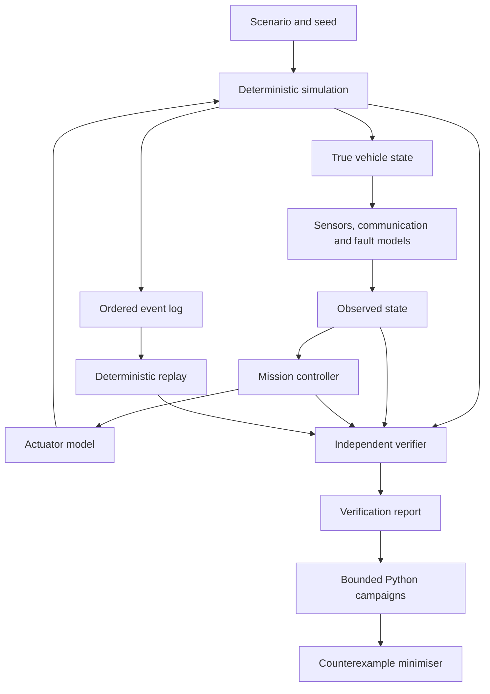

# Autonomous Systems V&V Lab

A Rust and Python laboratory for repeatable autonomous-mission simulation, fault injection and verification.

**Status:** M9 and M9.1 are integrated in `main`. M10.0 is a design package open for review in [PR #13](https://github.com/WhiteBlindness/autonomous-systems-vv-lab/pull/13); its implementation and campaign have not started.

The main simulator models a two-dimensional ground vehicle. A separate, idealised six-degree-of-freedom rocket model supports the M8 and M9 research campaigns. Neither model controls real hardware, and the rocket model has no flight-data validation.

[Architecture](docs/architecture.md) · [M9 landing results](docs/m9-powered-landing.md) · [M8 model](docs/m8-rocket-dynamics.md) · [Reproduction](docs/reproducibility.md) · [M9 integration, PR #12](https://github.com/WhiteBlindness/autonomous-systems-vv-lab/pull/12)

## The problem

A mission can look safe to a controller while the true simulated state violates a constraint. Sensor, communication and actuator faults make that gap harder to inspect. This project separates the controller's observations from the simulator's true state, then records enough evidence to replay a failure and inspect the contract that detected it.

## What is implemented

- A deterministic Rust simulator for two-dimensional ground-vehicle missions, including seeded sensor, communication and actuator faults.
- Safety invariants and finite-trace temporal contracts, evaluated by a verifier separate from the mission controller.
- Ordered event logs, deterministic replay and bounded counterexample minimisation.
- Python campaign runners and a local Mission Control interface using versioned simulation adapters.
- A six-degree-of-freedom rocket dynamics package with fixed-step integration and reference cases.
- Closed-loop powered-landing simulations for M9 and the M9.1 safety-guard follow-up.

The controller uses sensor observations, not the true position. The verifier may use the true state to evaluate safety properties. A passing safety result, mission completion and progress are reported separately.

## Architecture



The rocket package uses a separate adapter. Its M9 landing controller sees noisy sensor observations; the verifier checks the simulated state against predeclared contact and flight invariants. The simulation stops at the model's contact condition. It does not model landing-leg dynamics, bounce, tip-over or real vehicle hardware.

## Engineering decisions

- **Separate observation from truth.** The controller cannot read the true state. The verifier can use it to check invariants independently.
- **Make a failure replayable.** Integer coordinates, fixed time steps, an explicit pseudo-random generator and an ordered event stream reduce platform-dependent variation. Replay checks the recorded inputs and reconstructed outputs.
- **Treat hashes as integrity checks, not signatures.** SHA-256 detects changed inputs and logs. It does not prove who created an artefact.
- **Bound campaigns before execution.** Run, case, artefact-size and time limits constrain campaign work. A failed expectation or a safe trajectory does not by itself mean that the mission completed.
- **Keep results tied to a model.** Rocket campaign findings apply to the idealised model and its assumptions, not to flight hardware.

## Evidence and results

The M9 and M9.1 result document reports **780 M9 runs comparing two policies** and **1,050 M9.1 runs**, with replay checks and predeclared campaign conditions. The campaign scripts are published, but the original raw outputs are not stored in public `main`. Treat the totals as project-reported results; the original outputs are unavailable for direct inspection.

[PR #12](https://github.com/WhiteBlindness/autonomous-systems-vv-lab/pull/12) merged M9/M9.1 on 29/10/2026. [Its CI run](https://github.com/WhiteBlindness/autonomous-systems-vv-lab/actions/runs/40852112731) passed Linux and Windows verification, including canonical output checks. The checks are automated CI; they do not establish independent human approval. The M9.1 report also records a failed predeclared hypothesis and a regression, rather than presenting only passing outcomes.

For the M8 model, see the [reference cases and model assumptions](docs/m8-rocket-dynamics.md). For campaign commands and artefacts, see the [reproducibility guide](docs/reproducibility.md).

## Run locally

Requirements: Rust and Cargo as pinned in `rust-toolchain.toml`; Python 3.10 or newer for campaign scripts.

```sh
cargo run -- run scenarios/basic-mission.json --seed 42 --output runs/basic
cargo run -- replay runs/basic/events.json
cargo test
python -m unittest discover -s tests -p "test_*.py"
```

To verify the rocket reference cases and run one landing scenario:

```sh
cargo run --release --manifest-path crates/vv-rocket/Cargo.toml -- verify
cargo run --release --manifest-path crates/vv-rocket/Cargo.toml -- land crates/vv-rocket/landing/altimeter-bias.json --seed 0 --output runs/m9-bias
cargo run --release --manifest-path crates/vv-rocket/Cargo.toml -- replay runs/m9-bias
```

An expected safety violation can make a `run` command exit with code `2`; that is a simulated finding, not a test harness failure. See the scenario's result and report before interpreting the exit code.

## Development timeline

- **08/10/2026:** deterministic mission simulation and replay introduced in [commit `cfadcdb`](https://github.com/WhiteBlindness/autonomous-systems-vv-lab/commit/cfadcdb).
- **12/10/2026:** temporal contracts and actuator fault injection added in [commit `a22db7d`](https://github.com/WhiteBlindness/autonomous-systems-vv-lab/commit/a22db7d).
- **23/10/2026:** adversarial campaigns and deterministic failure replay added in [commit `d491b4a`](https://github.com/WhiteBlindness/autonomous-systems-vv-lab/commit/d491b4a).
- **24/10/2026:** controller-repair findings and the evidence-based replay workbench integrated through [PR #6](https://github.com/WhiteBlindness/autonomous-systems-vv-lab/pull/6) and [PR #7](https://github.com/WhiteBlindness/autonomous-systems-vv-lab/pull/7).
- **25/10/2026:** M7 Mission Control and the simulator-adapter contract integrated through [PR #9](https://github.com/WhiteBlindness/autonomous-systems-vv-lab/pull/9), merged as commit [`ec2a2ab`](https://github.com/WhiteBlindness/autonomous-systems-vv-lab/commit/ec2a2ab8e237d51c65df96aa7ca99b1c465ec624).
- **25/10/2026:** the six-degree-of-freedom rocket model and reference verification added in [commit `8b04960`](https://github.com/WhiteBlindness/autonomous-systems-vv-lab/commit/8b04960).
- **29/10/2026:** M9 and M9.1 integrated through [PR #12](https://github.com/WhiteBlindness/autonomous-systems-vv-lab/pull/12).

Dates above are commit or merge dates, not operational acceptance dates.

## Limits and current status

- The ground-vehicle model is two-dimensional and simulated.
- The rocket model is idealised; no flight data, physical hardware or landing-leg contact model validates it.
- Full M9/M9.1 campaign output is not included in the public repository.
- M10.0 remains a design package in an open PR. Do not treat its proposed resilience work as implemented.
- Mission Control runs locally and is not an operational service.

Further model contracts and campaign reports are linked from the [repository documentation](docs/architecture.md).
