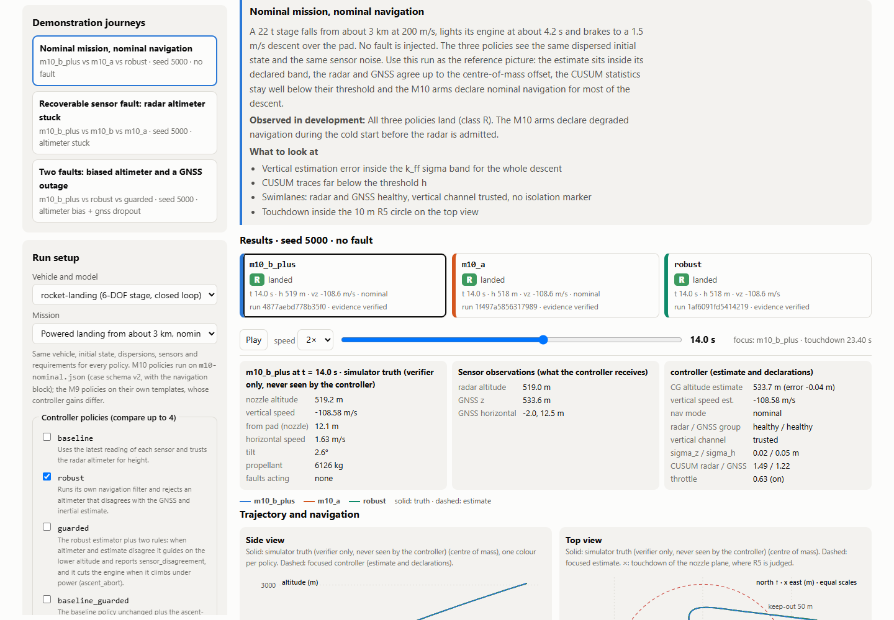
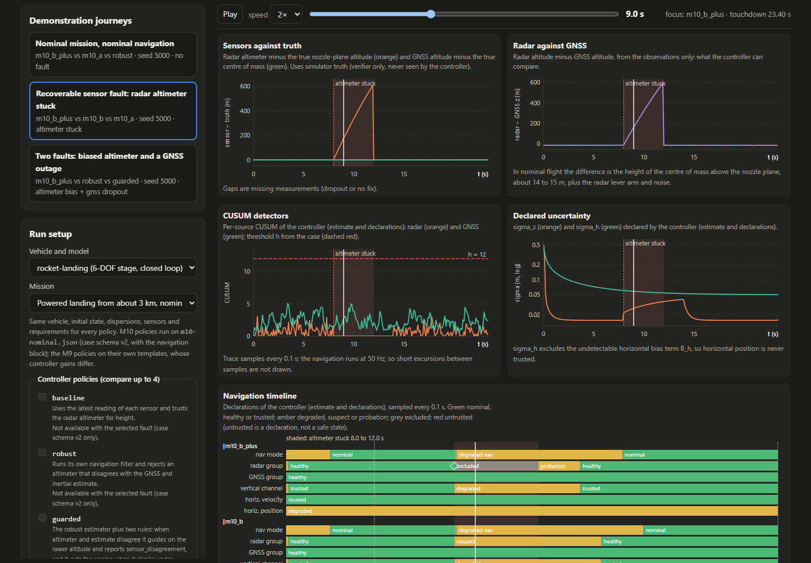
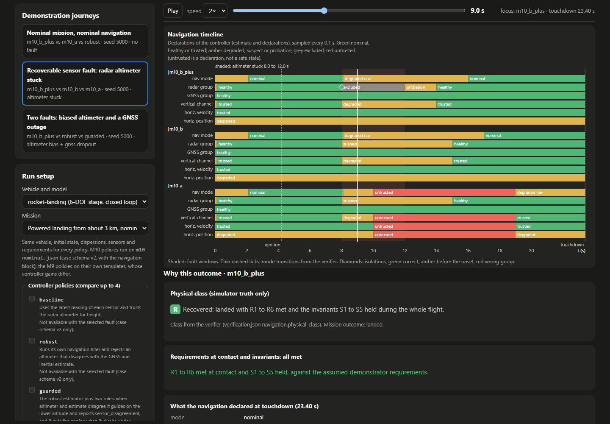
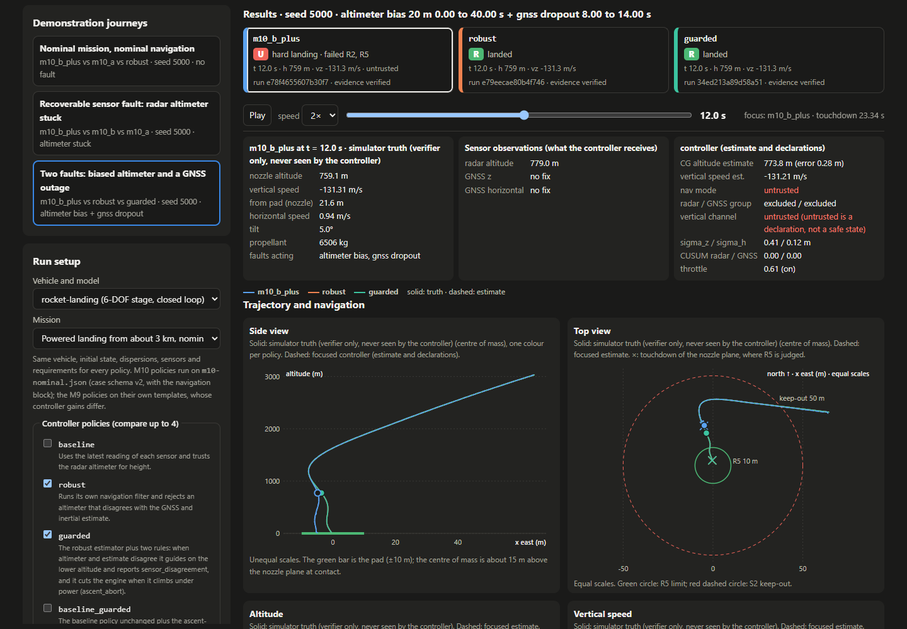
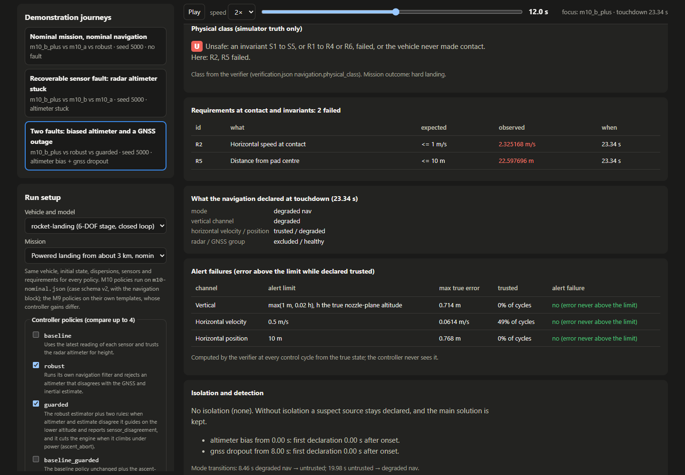
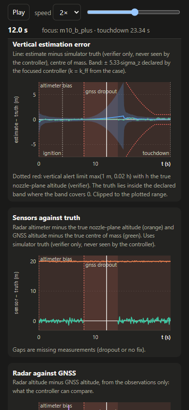

# M10: bancada de navegação no Mission Control

Estado: **ferramenta de engenharia local, configuração de desenvolvimento.** A bancada mostra execuções da navegação resiliente do M10 (`docs/m10-implementation.md`) tal como o simulador as produz. Não é resultado de avaliação: o estimador continua a ser afinado nas sementes de desenvolvimento e a configuração não está congelada. Nada aqui é software de voo, certificado ou validado com dados de voo ou com hardware.

## O que faz

A página `/workbench` do Mission Control permite:

1. **Escolher o caso.** Modelo `rocket-landing` (andar de 22 t, 6-DOF, malha fechada), missão de aterragem propulsiva a partir de cerca de 3 km, até quatro políticas de controlo, zero, uma ou duas falhas (tipo, magnitude e janela) e a semente. As políticas e as falhas vêm da descrição do adaptador (`LandingAdapter.describe()`); uma política nova, por exemplo `m10_c`, aparece sem alterar a página. Uma falha que só existe no esquema de caso v2 desativa as políticas do M9, com a razão; o servidor recusa-as de qualquer modo.
2. **Comparar.** As políticas escolhidas correm uma a seguir à outra, sob o bloqueio único do servidor, com a mesma semente e as mesmas falhas. Todas aparecem sobrepostas nos gráficos, com uma cor por política; uma delas é a execução em foco.
3. **Ver o veículo e a navegação.** Gráficos SVG desenhados pela própria página, a partir do traço, da verificação e do caso de cada execução:
   - vista lateral (posição este contra altitude) e vista de cima (este e norte, escalas iguais) com a plataforma, o círculo de 10 m do R5 e o raio de exclusão de 50 m do S2;
   - altitude e velocidade vertical;
   - erro de estimação vertical com a banda declarada de ±k·σ_z, em que k é `k_ff` do caso (ou 3 se o caso não o tiver, e a página diz qual), e os limites de alerta do verificador;
   - sensores contra a verdade (radar contra a altitude real do plano da tubeira, GNSS contra o centro de massa real) e a diferença entre radar e GNSS só com observações;
   - CUSUM do radar e do GNSS com o limiar `h` do caso;
   - incerteza declarada (σ_z e σ_h);
   - linha temporal por faixas: modo de navegação, saúde dos grupos radar e GNSS, estado dos canais vertical e horizontais, janelas de falha sombreadas, isolamentos com o veredicto, transições de modo, ignição, corte e toque.
4. **Cursor de tempo partilhado.** O cursor, a reprodução (1×, 2×, 5×) ou um clique em qualquer gráfico movem uma linha em todos os gráficos e atualizam o estado do veículo nesse instante: verdade do simulador, observações dos sensores e estimativa e declarações do controlador, em blocos separados.
5. **Porque este resultado.** Calculado da verificação e do traço da execução em foco: a classe física R, T ou U explicada por palavras (do verificador nas políticas M10; derivada pela regra da secção 9.1 nas do M9, que não têm bloco de navegação, com indicação disso); requisitos e invariantes falhados com o valor esperado e o observado; o que a navegação declarava no toque; falhas de alerta por canal (erro acima do limite enquanto declarado `trusted`); veredictos de isolamento com o instante relativo ao início da falha do mesmo grupo; atraso da primeira declaração por falha; transições de modo.
6. **Reproduzir.** O botão "Replay this run" corre `vv-rocket replay` sobre a execução guardada e mostra cada verificação (fontes, hashes, traço, verificação e manifesto recalculados byte a byte).
7. **Exportar evidência.** "Download evidence (zip)" descarrega um pacote limitado (8 MiB) com o pedido, `case.json`, `run.json`, `trace.json`, `verification.json`, a saída de um `vv-rocket replay` feito no momento da exportação, um manifesto com o SHA-256 de cada ficheiro, o SHA-256 do binário e o `source_sha256`, e um `README.txt` com os comandos para reproduzir a partir de um checkout limpo. Os nomes dentro do zip são relativos e as datas são fixas, pelo que a mesma execução exporta os mesmos bytes.

As séries de verdade estão sempre marcadas como "simulator truth (verifier only, never seen by the controller)"; as estimativas e as declarações como "controller". `untrusted` aparece sempre como uma declaração, não como um estado seguro (secção 8.3 de `docs/m10-resilient-navigation.md`).

## Como executar a partir de um checkout limpo

```sh
cargo build --release --manifest-path crates/vv-rocket/Cargo.toml
python scripts/mission_control.py --port 8780
```

Abrir `http://127.0.0.1:8780/workbench` (também há uma ligação em `http://127.0.0.1:8780/`). As execuções ficam em `runs/mission-control/<run_id>`. Para reproduzir um pacote exportado, seguir o `README.txt` dele; em resumo:

```sh
crates/vv-rocket/target/release/vv-rocket replay runs/evidence/<run_id>/run
```

## Percursos de demonstração

Os percursos estão em `scenarios/m10/journeys.json` (esquema `vv-workbench-journeys.v1`): título, narrativa, políticas a comparar, semente, falhas, o que observar e o que foi observado em desenvolvimento. O servidor valida cada percurso contra o adaptador sem correr nada, e os testes verificam a estrutura, não os resultados, porque o estimador continua a mudar. Sementes só de desenvolvimento (5000 a 5099). Os resultados abaixo foram observados com a configuração de desenvolvimento deste commit.

| Percurso | Políticas | Semente | Falhas | Observado |
| --- | --- | --- | --- | --- |
| Missão nominal, navegação nominal | `m10_b_plus`, `m10_a`, `robust` | 5000 | nenhuma | as três aterram (R); B+ declara navegação degradada no arranque a frio e nominal depois de admitir o radar |
| Falha recuperável: altímetro preso | `m10_b_plus`, `m10_b`, `m10_a` | 5000 | `altimeter_stuck` de 8 a 12 s | B+ aterra (R) com um isolamento correto do radar, por paridade das taxas (o CUSUM do radar não chega a `h`); B aterra sem isolar; A toca duro e fora da plataforma (U, R2 e R5) |
| Duas falhas: altímetro enviesado e perda do GNSS | `m10_b_plus`, `robust`, `guarded` | 5000 | `altimeter_bias` 20 m de 0 a 40 s e `gnss_dropout` de 8 a 14 s | B+ declara `untrusted` às 8,46 s, deixa de perseguir a plataforma e toca duro e fora dela (U, R2 e R5), sem falha de alerta vertical; `robust` e `guarded` aterram |

Desvio ao pedido inicial: o segundo percurso devia comparar B+ com `m10_a` e `robust`, mas `altimeter_stuck` só existe no esquema de caso v2 e o adaptador recusa-o para as políticas do M9. Compara por isso B+ com B e A. O terceiro percurso mostra a regressão aberta registada em `docs/m10-implementation.md` (pares `altimeter_bias` com `gnss_dropout`), sem a esconder.

## Rotas e formatos

| Rota | Método | Conteúdo |
| --- | --- | --- |
| `/workbench`, `/workbench.js` | GET | página e script |
| `/api/workbench` | GET | `vv-workbench.v1`: descrição do adaptador de aterragem, percursos, `compare_max` (4) |
| `/api/workbench/compare` | POST | pedido `vv-workbench-compare.v1` `{schema, policies[1..4], seed, faults[0..2]}`; resposta `{schema, runs: [resultado vv-sim-run-result.v3, ...]}` |
| `/api/workbench/replay` | POST | `{run_id}`; resposta `vv-workbench-replay.v1` com o relatório de `vv-rocket replay`, os SHA-256 dos artefactos e o do binário |
| `/api/workbench/evidence/<run_id>` | GET | `application/zip` com `Content-Disposition: attachment` |

O pedido `vv-sim-run-request.v3` do adaptador aceita agora `faults` (lista de 0 a 2 falhas, pela ordem em que o simulador as aplica); a forma antiga `fault` (uma falha ou `null`) continua aceite e dá o mesmo pedido normalizado que uma lista de uma falha. Cada falha é validada como antes e identificada pelo índice nas mensagens; duas falhas do mesmo tipo são recusadas; uma falha só do M10 continua recusada para as políticas do M9. O resultado de cada execução traz também o `case` que o simulador correu. Os `run_id` das execuções de aterragem mudaram com o pedido normalizado; as pastas antigas em `runs/mission-control` ficam órfãs.

## Segurança

As rotas novas têm as mesmas propriedades das existentes:

- o servidor só escuta em `127.0.0.1`, ocupa a porta em exclusivo e recusa pedidos cujo `Host` ou `Origin` não seja ele próprio;
- corpos só em JSON, até 16 KiB, com `Content-Length`;
- uma simulação de cada vez: a comparação, a reprodução e a exportação correm sob o mesmo bloqueio;
- as respostas JSON e os ficheiros de texto gerados para o zip passam pela substituição dos caminhos da pasta de execuções, do binário e do repositório; o zip só tem nomes relativos;
- a Content Security Policy só permite scripts do próprio servidor; a página não carrega nada da rede e constrói o DOM sem `innerHTML`;
- um `run_id` tem de ter 16 caracteres hexadecimais e a pasta tem de conter um pedido de aterragem válido deste adaptador, pelo que uma execução de outro modelo não é exportada;
- **sementes protegidas:** as sementes de avaliação (3000 a 3099) e de reserva (6000 a 6099) são recusadas na fronteira do servidor, antes do adaptador e do simulador, em `/api/workbench/compare`, em `/api/run` para o modelo de aterragem e na reprodução e exportação de uma execução guardada. O adaptador recusa-as também. Os intervalos são os de `scripts/m10_campaign.py`, e um teste verifica que coincidem.

## Verificação

- `tests/test_workbench.py`: validação de várias falhas, guarda das sementes (incluindo que o simulador não é chamado), comparação com recusa prévia de qualquer política inválida, reprodução, conteúdo do zip e hashes do manifesto, reprodução do pacote extraído com `vv-rocket replay`, estrutura dos percursos, ocultação de caminhos, cabeçalho CSP, ausência de `innerHTML` e análise sintática do script com `node --check`. Usa duas execuções reais do simulador e salta se o binário não existir.
- Navegador real: os três percursos foram corridos em Chrome sem consola com erros, com o tema claro e o escuro, e a 390 px de largura sem deslocamento horizontal (`scrollWidth` igual a `innerWidth`). Capturas em `docs/images/m10-workbench/`.








## Limitações

- Configuração de desenvolvimento, não congelada: os resultados dos percursos podem mudar com a afinação. Os testes verificam a estrutura dos percursos, não os resultados.
- O traço tem uma amostra a cada 0,1 s e a navegação corre a 50 Hz: as faixas e o CUSUM mostram o estado amostrado, e excursões curtas entre amostras não aparecem. Os instantes de transição e de isolamento vêm da verificação, por ciclo de controlo.
- O erro vertical é o do centro de massa; o limite de alerta usa a altitude real do plano da tubeira, como o verificador. A vista lateral mostra o centro de massa, cerca de 15 m acima do plano da tubeira no toque.
- A classe física das políticas do M9 é derivada na página pela regra da secção 9.1, porque o verificador só a calcula para as políticas M10.
- O SHA-256 do binário depende da máquina e da cadeia de compilação; a identidade a comparar entre máquinas é o `source_sha256` e os hashes do traço e da verificação.
- O pacote de evidência indica o commit do checkout que o serviu só a título informativo; não prova que a árvore de trabalho estava limpa além do campo `tracked_changes`.
- Mission Control corre localmente e não é um serviço operacional.
