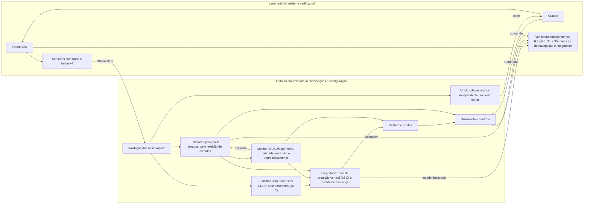

# M10: navegação resiliente e decisão tolerante a falhas (desenho)

Estado: **rascunho de desenho para revisão independente e decisão do proprietário. Não há implementação do M10.** Este documento não altera código, casos, campanhas nem resultados do M9 e do M9.1. As afirmações marcadas "(suposto)" ou "(incerto)" não foram verificadas no repositório nem em dados externos e têm de ser confirmadas ou refutadas antes de serem usadas como requisito.

Nomes fixos: braços **A**, **B**, **B+**, **C** (secção 6.1); conjuntos de sensores **`E0`** (só os sensores existentes), **`E1`** (`E0` mais barómetro) e **`E2`** (`E1` mais Doppler), para não colidirem com os invariantes `S1` a `S5`; modos `Nominal`, `DegradedNav` e `Untrusted` (secção 8).

Convenções: texto em português europeu (Acordo Ortográfico de 1990), vírgula decimal na prosa e ponto decimal dentro de código. Os números do repositório citados aqui foram lidos de `docs/m9-powered-landing.md`, de `crates/vv-rocket/landing/nominal.json`, de `crates/vv-rocket/landing/m91-nominal.json` e do código em `crates/vv-rocket/src`.

## 1. Objetivo, pergunta de investigação e fronteira

**Pergunta.** Uma arquitetura de navegação tolerante a falhas melhora a recuperação e a segurança perante combinações realistas de falhas de sensores, e reconhece de forma fiável quando o estado de navegação deixou de merecer confiança?

A pergunta tem duas metades que não são a mesma coisa e o M10 mede-as em separado:

- **Recuperação**: o veículo toca no solo dentro dos requisitos (`R1` a `R6`, `S1` a `S5`) apesar das falhas.
- **Declaração**: o sistema diz, a tempo, que a navegação já não é fiável quando o erro real excede um limite de alerta. É uma propriedade do estimador e do gestor de modos, avaliada pelo verificador com a verdade. Pode haver declaração correta sem recuperação (não há ação física que salve o veículo) e recuperação sem declaração (sorte).

**O que o M10 é.** Um desenho, e depois uma implementação em Rust, de: um estimador de navegação com covariância, monitorização de falhas (deteção e isolamento), uma medida de integridade, um gestor de modos e um monitor de segurança independente, para uma política nova no mesmo ciclo de controlo. Uma campanha pré-registada compara-a com `baseline`, `robust`, `guarded` e com candidatos mais simples.

**O que o M10 não é.**

- Não altera `baseline`, `robust`, `guarded`, `baseline_guarded`, os traços, os hashes fixados em `tests/reference.rs` e em `m9_demo_traces_are_byte_identical_after_m91`, nem as campanhas M9 e M9.1 nem os seus resultados. `landing/nominal.json` (SHA-256 `58b19ff7a85455d4feb0d9c47e9098b21dcb4660416bbfaf822bf433576f1830`) e `landing/m91-nominal.json` (SHA-256 `69ecad65e9ec4329ffc74a3b985dbb7dc60d5cdaa1e4a9a380f296a76f68114b`) ficam como estão. O M10 usa um modelo de caso próprio (`landing/m10-nominal.json`), congelado por hash antes da avaliação, como o M9.1 fez.
- A definição de `landed` e os limites `R1` a `R6`, `S1` a `S5` não mudam. Qualquer propriedade nova (integridade, falha de alerta, transição de modo insegura) é um invariante ou uma métrica nova, com versão nova do esquema de verificação.
- É um modelo idealizado: sem dinâmica de contacto, sem RCS, terreno plano, sem latência nos sensores existentes, atmosfera exponencial, ruído limitado de Irwin-Hall. Não há validação com dados de voo.
- Não há garantias formais. Os níveis de proteção e os limiares são estatísticos, assumem ruído quase gaussiano e uma única falha de cada vez, e as suas taxas são estimativas condicionais às dispersões e às gamas assumidas.
- Não inclui visão, balizas na plataforma nem terreno relativo (ver as secções 3 e 4).

## 2. O que o M9 e o M9.1 mostraram e porque não chega

Números medidos (campanha M9.1, sementes 2000 a 2029, 30 por célula; ver `docs/m9-powered-landing.md`):

| Cenário | `robust` recuperou | `guarded` recuperou | Leitura |
| --- | --- | --- | --- |
| `altimeter_bias` (+5 a +50 m) | 28 de 30 | 28 de 30 | `guarded` e `robust` iguais |
| `altimeter_bias_low` (-5 a -50 m) | 28 de 30 | **0 de 30** | a regra "menor altitude" escolhe a fonte errada quando a errada lê baixo; `R1` falhado em 30 (11,3 a 30,8 m/s) |
| `gnss_bias` (+5 a +30 m em x e z) | **0 de 30** | 6 de 30 | `guarded` toca no solo com `R1` cumprido em 30 de 30 (1,86 a 2,42 m/s), mas 24 de 30 falham `R5`; `robust` falha `R1` em 30 (11,5 a 25,6 m/s) |
| `gnss_bias_low` | 0 de 30 | 0 de 30 | `R1` falhado em 30 nas duas |
| `gnss_dropout` com `baseline_guarded` | n/a | n/a | G2b falhou: 2 de 30 `no_contact`; a regra de subida só atuou depois do regresso do GNSS (0,98 a 20,23 s depois do fim da janela) |
| nominal | 29 de 30 | 29 de 30 | piso: 1 falha de `R2` sem falha injetada |

Porque não chega, ligado a mecanismos e não só a números:

1. **Ganhos fixos, sem covariância.** `robust` e `guarded` usam ganhos constantes (GNSS 0,15 e 0,25, altímetro 0,1 e 0,004, limiar de resíduo de 3 m durante 5 ciclos; valores de `landing/nominal.json`, não os do fixture de testes do controlador). O filtro não sabe quão incerto está. Depois de uma perda de GNSS aplica o mesmo ganho ao regressar. Não pode produzir um nível de proteção.
2. **Duas fontes de altitude: deteta, não isola.** O M9.1 acusou-o por escrito ("sem terceira fonte de altitude, não sabe qual das duas está errada"). A regra de desempate "menor altitude" é um palpite que depende do sinal da falha. A medição G5 mostra o custo: 0 de 30 contra 28 de 30.
3. **A deteção `G1` (30 de 30, 0 falsos alarmes em 210) é mais fácil do que parece.** O ruído é de Irwin-Hall e está limitado a ±2√3 σ, cerca de ±3,46 σ. A diferença bruta entre o radar e a altitude GNSS nunca excede, só por ruído, 3,46 × (0,1 + 0,5) = 2,08 m. O limiar de 3 m está acima desse limite e as magnitudes das falhas são de pelo menos 5 m. Zero falsos alarmes em 210 execuções é, em parte, uma propriedade do ruído limitado e do limiar, e não prova que um detetor com limiar a poucos desvios-padrão tenha uma taxa de falsos alarmes controlada. O resíduo é calculado contra a altitude filtrada, não contra a amostra bruta, o que acrescenta erro de filtro, e as estatísticas filtradas são quase gaussianas até 3 desvios-padrão (secção 3.8): a folga do ruído limitado vale para amostras brutas e não se transfere para testes filtrados. A conclusão é qualitativa.
4. **O monitor partilhava a causa da falha.** A regra 2 de subida usa a velocidade vertical estimada, que durante a perda de GNSS é a última velocidade GNSS. O sensor em falha alimenta o monitor que o devia vigiar. A lição para o M10: um monitor só vale se usar informação independente da fonte vigiada.
5. **Posição horizontal sem qualquer verificação.** Com `gnss_bias` presente desde o primeiro ciclo, nenhum controlador deste modelo pode cumprir `R5` quando o deslocamento excede 10 m (já previsto no M9.1). O M9.1 não explica porque o `R5` medido fica entre 0,73 e 0,97 vezes a magnitude nas 6 execuções recuperadas ("a razão da atenuação não foi investigada"). O M10 não afirma explicá-lo.
6. **Mudanças de sensor invisíveis ao modo de operação.** Não há conceito de "modo" nem de estado de saúde por sensor com histerese. A decisão é o corte a 15 m, igual em todas as políticas.

Em resumo: o M9.1 mostrou que a deteção de uma inconsistência é fácil quando a magnitude é grande, que a recuperação exige saber qual fonte está errada, e que os ganhos fixos e as regras de desempate não o sabem. O que falta é (i) um estimador que conhece a sua incerteza, (ii) isolamento onde houver redundância suficiente, (iii) uma declaração honesta onde não houver, e (iv) uma decisão que usa a declaração.

## 3. Observabilidade

Esta é a secção central: diz o que nenhum algoritmo pode fazer com os sensores do modelo. Tudo o que vem a seguir é limitado por ela.

### 3.1 Sensores existentes (verificados no código)

| Sensor | Mede | Referencial e ponto | Taxa | Ruído (1 σ) | Viés de falha |
| --- | --- | --- | --- | --- | --- |
| Altímetro radar | `p_base,z` | altitude do plano de saída da tubeira acima do solo plano | cada ciclo (50 Hz) | 0,1 m | `altimeter_bias(_low)`: soma ou subtrai, 5 a 50 m |
| GNSS posição | `r` | centro de massa, referencial local N | 10 Hz | 0,5 m por eixo | `gnss_bias(_low)`: soma ou subtrai `m` a **x e z** (y não); 5 a 30 m |
| GNSS velocidade | `v` | centro de massa | 10 Hz | 0,05 m/s por eixo | nenhum: **a velocidade fica verdadeira** |
| IMU atitude | `q` | corpo para N | cada ciclo | 1e-4 rad | nenhum |
| IMU velocidade angular | `ω_B` | corpo | cada ciclo | 1e-4 rad/s | nenhum |
| IMU força específica | `(impulso + arrasto)/m` em B | corpo | cada ciclo | 0,02 m/s² por eixo | `imu_accel_bias`: constante, **só ao longo de `x_B`**, 0,05 a 0,5 m/s² |

Factos que importam para o desenho (todos lidos em `landing_sensors.rs` e `prng.rs`):

- Sem latência: a observação no passo `k` mede o estado real em `k`.
- O ruído é limitado: o radar nunca se afasta mais de 0,35 m, o GNSS em posição mais de 1,73 m, em velocidade mais de 0,17 m/s, o acelerómetro mais de 0,069 m/s². Um detetor sobre amostras brutas sobrestima os falsos alarmes neste modelo; mas para estatísticas filtradas o protótipo mostra caudas quase gaussianas até 3 desvios-padrão (secção 3.8), pelo que **não se conta com essa folga** nos testes do filtro.
- A força específica medida usa o impulso aplicado no passo anterior mais o arrasto no passo corrente. Nas rampas do acelerador (taxa máxima 1,0 por segundo) isto desfasa a força em cerca de meio ciclo. Analítico (secção 3.8): numa rampa de 0,4 para 0,8 (0,4 s, 845 kN, 26,3 t) a força específica varia cerca de 32 m/s³, o desfasamento de meio ciclo (0,01 s) dá cerca de 0,3 m/s² e, ao fim da rampa, um erro de velocidade de cerca de 0,13 m/s (2,6 desvios-padrão da velocidade GNSS, aplicados de forma coerente): é um **mecanismo de falso alarme** para os testes de recetor. Tem de ser medido no M10.1 antes de dimensionar o ruído de processo.
- Não há viés de giroscópio, nem deriva, nem passeio aleatório do viés do acelerómetro; o viés da IMU é constante e só em `x_B`. Isto é otimista: um modelo de falha mais realista inclui deriva (secção 5).
- O altímetro dá a altitude do plano da tubeira, o estimador trabalha no centro de massa: `h_base = z - s_cm·n_z`, com `n_z` a componente vertical de `x_B` medida pela IMU. Erro da distância `s_cm` (massa de propelente estimada): `ds/dm_p = (s_p - s_cm)/m ≈ -1,7e-4 m/kg` com carga cheia, logo cerca de 0,03 a 0,04 m para os 2% de dispersão de propelente mais o erro de consumo estimado (derivação minha a partir de `landing_model.rs`, não medida). É um erro sistemático pequeno face ao ruído do radar (0,1 m), mas não é zero e entra no orçamento de erros.
- O radar funciona desde os 3000 m. Um radar real tem alcance máximo (suposto: de ordem de quilómetros). O modelo não o tem; isto torna o radar mais forte do que é.
- As altitudes do GNSS e do radar usam o mesmo zero (solo plano em `z = 0`). Num veículo real, a elevação do terreno e a do referencial do GNSS diferem em metros. Aqui a diferença é zero, o que facilita a comparação radar contra GNSS.

### 3.2 O que cada sensor observa, em condições nominais e quando o GNSS deixa de ser fiável

"GNSS não fiável" cobre a perda (sem dados) e a suspeita (dados presentes e desacreditados).

| Grandeza | Nominal | Sem GNSS fiável | Notas |
| --- | --- | --- | --- |
| Posição vertical | radar (direto, 0,1 m, absoluto em relação ao solo), GNSS z (0,5 m, absoluto no referencial), integração da IMU (relativa) | radar e IMU; barómetro se existir | só duas fontes absolutas (radar e barómetro) sem GNSS; deteta-se desacordo, não se isola |
| Velocidade vertical | GNSS vz (0,05 m/s), IMU integrada, derivada do radar | IMU integrada corrigida pelo radar | a derivada do radar numa janela de 0,5 s tem desvio de cerca de 0,14 m/s (estimativa minha: `σ √12 / (T √n)` com `σ = 0,1`, `T = 0,5 s`, `n = 25`) |
| Posição horizontal | só GNSS (x, y) | **não observável**: navegação por estima a partir do último estado fiável | deriva em `σ_p(t)² ≈ σ_p0² + (σ_v0 t)² + (½ b_h t²)²` |
| Velocidade horizontal | GNSS v, IMU integrada | IMU integrada a partir da última velocidade fiável; Doppler se existir | como a atitude é medida, a IMU dá a aceleração horizontal sem modelo de forças |
| Viés do acelerómetro (`x_B`) | observável pela diferença entre a velocidade integrada da IMU e a do GNSS ou a do radar; como `x_B` está quase na vertical, vê-se quase só no canal vertical | continua observável pelo radar, mais devagar | os componentes laterais do viés (que o modelo não injeta) quase não se veem |
| Desvio do barómetro | observável contra radar ou GNSS | só contra o que restar | com desvio desconhecido, um degrau constante do barómetro é absorvido pelo estado |

### 3.3 O que é não observável e o que só o início de uma falha revela

Seja `y(t) = p(t) + δ` a posição medida pelo GNSS, com `δ` um deslocamento constante desconhecido, a velocidade `v` medida sem viés e a IMU independente da posição. Então `p(t) = p0 + ∫v dt` com `p0` desconhecido, e `y(t) = (p0 + δ) + ∫v dt`: só a soma `p0 + δ` é identificável. Conclusão: **um deslocamento horizontal constante da posição GNSS não é observável a partir de fontes de velocidade nem da IMU**, nem de radar, nem de barómetro. É o caso das campanhas do M9 e do M9.1, cujas janelas de `gnss_bias` vão de 0 a 40 s: o deslocamento está presente no primeiro ciclo e o estimador inicializa-se sobre ele; não há início para detetar. Equivale a uma plataforma deslocada.

O que é detetável é o **início** do deslocamento (degrau) quando existe um período fiável anterior, e uma **rampa** se o seu declive for grande o bastante face à incerteza da velocidade integrada. Uma rampa lenta pode nunca ser detetada dentro de um voo de 17 a 23 s. Medições do protótipo (canal horizontal só com GNSS, início aos 8 s, sementes de desenvolvimento) estão na secção 3.8.

O caso do demonstrador (`gnss-bias-guarded.json`, início aos 8 s) é, assim, um caso diferente do da campanha. As duas situações têm de ficar declaradas nos resultados.

### 3.4 Deteção, isolamento e redundância

- Com **duas** fontes de uma mesma grandeza, um desacordo pode ser **detetado** mas não **isolado**: o resíduo `y1 - y2` é igual para a hipótese "1 está errada" e "2 está errada".
- Com **três** fontes independentes e a hipótese de **uma única falha**, o isolamento é possível: a fonte cujo subconjunto restante é consistente é a errada. A capacidade depende de os desvios-padrão serem comparáveis: se uma das três fontes for muito imprecisa (barómetro com desvio de metros), o isolamento só funciona para magnitudes grandes face a essa incerteza.
- Com mais de uma falha simultânea, o isolamento pode atribuir a falha à fonte errada. A hipótese de falha única tem de ser testada, e é-o por pares na campanha.
- **Modo comum e correlação.** A posição e a velocidade do GNSS vêm do mesmo recetor: uma falha do recetor pode corromper as duas de forma coerente (por exemplo, rampa de posição com velocidade consistente). O modelo atual de `gnss_bias` é a exceção otimista: só corrompe a posição, o que a torna detetável por consistência com a velocidade integrada. O altímetro e o barómetro têm causa comum perto do solo (o jato). O barómetro e o GNSS vertical são fisicamente independentes (pressão contra rádio), mas o barómetro tem deriva e erros que dependem da velocidade (secção 4).
- A altitude do GNSS e a do radar **não** são independentes em dois sentidos: usam o mesmo zero (este modelo), e a posição horizontal e vertical do GNSS partilham o recetor. Por isso, **o canal vertical serve de canário do recetor** (só com isolamento, isto é, com terceira fonte em `E1`; em `E0` o canal vertical só sabe que radar e GNSS z discordam): se o isolamento vertical apontar o recetor GNSS como a fonte errada, a posição horizontal do GNSS deve ser tratada como não fiável. Isto é inferência de modo comum e não correção: **não se deve usar a magnitude do viés vertical para corrigir o horizontal**, apesar de `gnss_bias` somar o mesmo valor a x e a z neste simulador. Isso seria ajustar o algoritmo ao modelo de falha injetado.

### 3.5 Deriva da IMU

Com um viés constante `b` não compensado, o erro de posição cresce como `½·b·t²` e o de velocidade como `b·t`. A gama do M9 é 0,05 a 0,5 m/s². Janela de perda de GNSS de 2 a 10 s, caso de interesse (a perda é a falha que obriga a navegar só com a IMU):

| `b` (m/s²) | `t` = 2 s: posição / velocidade | `t` = 5 s | `t` = 10 s |
| --- | --- | --- | --- |
| 0,05 | 0,10 m / 0,10 m/s | 0,63 m / 0,25 m/s | 2,5 m / 0,5 m/s |
| 0,25 | 0,50 m / 0,50 m/s | 3,1 m / 1,25 m/s | 12,5 m / 2,5 m/s |
| 0,5 | 1,0 m / 1,0 m/s | 6,3 m / 2,5 m/s | 25 m / 5,0 m/s |

Entre dois ciclos de GNSS (0,1 s) a deriva é desprezável (0,0025 m no pior caso). Se o viés estiver estimado antes da perda, a deriva é a do erro residual do estimador de viés, bem menor. Como o viés do modelo está ao longo de `x_B` e o guiamento mantém `x_B` perto da vertical (`tilt_max_tan` 0,2 no caso M9), a deriva horizontal é aproximadamente `b·sin(tilt)`: com 0,5 m/s² e inclinação máxima, cerca de 0,1 m/s² (`b_h`). O limite de deriva horizontal por estima, usado em 8.2, é então `½·b_h·t²` em posição e `b_h·t` em velocidade: cerca de 0,2 m e 0,2 m/s a 2 s, 1,2 m e 0,5 m/s a 5 s, 4,9 m e 1,0 m/s a 10 s (analítico, sem o erro de velocidade inicial). A tabela acima é o pior caso para o canal vertical. A atitude não tem viés no modelo; a sua falha (que alteraria a projeção da gravidade e o braço de alavanca do radar) fica fora do âmbito e é uma limitação (secção 12).

### 3.6 Deteção mínima e atraso de deteção, canal vertical (analítico)

Hipóteses: ruído gaussiano, falha em degrau `δ`, teste bilateral a nível `p_fa` por amostra, potência `1 - β`. O limiar em desvios-padrão é `k = Φ⁻¹(1 - p_fa/2)` e o viés mínimo detetável de **uma época** é `MDB = (k + z_β)·σ_d`, com `z_β = Φ⁻¹(1 - β)` unilateral e `σ_d` o desvio-padrão da inovação da fonte contra o resto.

Valores usados: `p_fa = 6,3e-5` por amostra, `k = 4`; `β = 0,1`, `z_β = 1,28`; logo `MDB = 5,28·σ_d`.

Para uma fonte `i` com variância de inovação contra o subfiltro sem ela `S_i = P⁻_i + r_i` (`P⁻_i` a variância prevista da altitude sem `i`, `r_i` a variância de ruído de `i`), a não-centralidade do teste de uma época é `δ/√S_i`, pelo que `MDB_i = 5,28·√S_i`. Isto é válido para fontes sem estado de desvio próprio (radar e GNSS z).

Valores calculados com a covariância do protótipo (secção 3.8), aproximação de uma amostra, ruído gaussiano, valores otimistas porque o protótipo não tem erros não modelados:

| Instante / altitude do perfil de brinquedo | MDB radar (m) | MDB GNSS z (m) |
| --- | --- | --- |
| 4 s / 1186 m | 0,68 | 2,64 |
| 8 s / 583 m | 0,62 | 2,64 |
| 12 s / 192 m | 0,60 | 2,64 |
| 15 s / 38 m | 0,60 | 2,64 |

Para um barómetro com estado de desvio que o filtro aprende, não existe fórmula fechada simples: o teste passa a detetar uma mudança relativa ao desvio aprendido e não um valor absoluto (resultados medidos na secção 3.8).

**Atraso de deteção.** A média sobre `n` amostras independentes reduz `σ_d` por `√n`, logo `n ≈ (MDB/δ)²`. No GNSS, com uma amostra a cada 0,1 s, `δ = 1 m` pede `n ≈ 7`, cerca de 0,7 s; `δ = 0,5 m`, `n ≈ 28`, cerca de 2,8 s. Medido no protótipo (medianas, início aos 8 s): a **separação de soluções** demora 1,8 s e 4,1 s, ou seja **2,6 vezes** a fórmula a 1 m e **1,5 vezes** a 0,5 m. Um **CUSUM por fonte** sobre as inovações normalizadas demora 0,7 s e 2,1 s: acompanha a fórmula (e fica abaixo dela a 0,5 m). Para um CUSUM com folga `k_ref` e limiar `h` a um desvio normalizado `μ = δ/√S_i` acima de `k_ref`, o atraso esperado é de ordem `h/(μ - k_ref)` amostras: com `μ = 1/0,5 = 2`, `k_ref = 0,5` e `h = 12`, 8 amostras, 0,8 s, em linha com os 0,7 s medidos (estimativa minha para a forma, medida para o valor).

**Porque a separação bate o MDB de uma época.** O MDB de 2,64 m do GNSS z é o viés que **uma** época revela. Um teste sequencial acumula: a diferença entre a solução completa e a sem a fonte é uma soma ponderada de todas as inovações da fonte desde o início da falha, pelo que a sua razão sinal-ruído cresce com o número de épocas, e o desvio-padrão dessa diferença (0,015 m a 4 s para o GNSS) é muito inferior ao da inovação (0,5 m). Um viés de 1 m é invisível numa época e visível em cerca de 2 s. O MDB de uma época não é, por isso, um limite do detetor sequencial. A fórmula `n ≈ (MDB/δ)²` dá a ordem de grandeza do detetor sequencial ótimo, que o CUSUM atinge. A separação testa uma diferença de estimativas e não de inovações e é mais lenta do que a fórmula, porque o filtro completo absorve parte do viés e as amostras de separação são correlacionadas.

**Taxa de falsos alarmes do CUSUM, definida por constantes.** Com `k_ref = 0,5` e `h = 12`, a aproximação de Siegmund dá um ARL0 gaussiano de 1,0e+06 amostras por fonte para o teste unilateral e 5,2e+05 para o bilateral. Uma execução do protótipo tem 1644 inovações no filtro de quatro fontes; a probabilidade de falso alarme por execução é da ordem de 1644/5,2e+05 = 0,31%, **se** as inovações forem brancas e gaussianas, o que é um pressuposto e não um facto. Em tempo de execução só entram duas constantes (`k_ref`, `h`) por fonte; nenhuma função transcendente.

Limite honesto do método: a fórmula assume ruído gaussiano e independente, estacionário. O ruído do simulador é limitado e as covariâncias reais incluem erros não modelados (secção 3.1).

### 3.7 O que continua não observável com todos os sensores propostos

- **Posição horizontal em relação à plataforma**, quando o recetor GNSS tem um viés constante desde o início. Os sensores existentes, o barómetro e o Doppler (secção 4) não a observam. Observa-a um sensor relativo à plataforma (câmara com marcas, baliza, terreno relativo), fora do âmbito do M10 como linha de base. Fica como opção com custo na secção 4.4.
- **Viés comum a todas as fontes de altitude no mesmo sentido** (por exemplo, plataforma a cota diferente do assumido por todas as fontes). Não é observável, por definição.
- **Falhas simultâneas de duas fontes de altitude com a terceira fraca**: deteta-se, isola-se mal (secção 5).

### 3.8 Protótipo de viabilidade, canal vertical, sementes de desenvolvimento

Isto é um **brinquedo** em `spikes/m10-nav-feasibility/feasibility.py`: não é a implementação do M10 e **não é evidência para nenhuma hipótese do M10**. Serve para verificar ordens de grandeza das secções 3.3 e 3.6 e para ver se o desenho (filtro sem rejeição, CUSUM por fonte, isolamento por paridade, separação de soluções só para o nível de proteção) funciona de todo.

Comando exato:

```sh
python spikes/m10-nav-feasibility/feasibility.py > resumo.json
```

Máquina: Windows-11-10.0.26300-SP0; AMD64 Family 25 Model 97 Stepping 2, AuthenticAMD; Python 3.14.6. Duração de uma execução: cerca de 25 s. Duas execuções completas deram o mesmo JSON exceto os campos `cost` e `timing_s`. `random.Random` (Mersenne Twister) com as sementes 9000 a 9099 (**bloco do protótipo, não de avaliação**); o ruído é o de Irwin-Hall do repositório, mas o gerador não é o SplitMix64.

**Decisões de modelação do protótipo:**

- O filtro não tem passeio aleatório do viés do acelerómetro, porque o viés verdadeiro é constante: modelo e verdade concordam. O NEES é 3,60 / 3,78 / 3,99 / 4,13 aos 2 / 8 / 12 / 16 s, **dentro** do intervalo de 95% (3,45 a 4,55) nos quatro instantes. Um filtro com um passeio aleatório do viés que a verdade não tem dá um NEES médio abaixo da dimensão (3,1 a 3,6, medido numa variante intermédia): é a incoerência entre o ruído de processo e a verdade que desloca o NEES, e não o ruído limitado, que, sendo de média nula, não pode deslocar a média.
- O ruído de Irwin-Hall com quatro uniformes é limitado a `±2√3 σ` por construção, e o recorte do código a esse valor **não atua** (é uma no-op). A cauda bilateral bruta a 3 desvios-padrão é 4,3e-4, contra 2,7e-3 da gaussiana, mas as estatísticas **filtradas** do protótipo (a separação) são quase gaussianas até 3 desvios-padrão: 2,7e-3 medido contra 2,7e-3. Só abaixo disso o ruído limitado dá folga, e só em estatísticas que não passaram por um filtro (a inovação do radar sozinho: 3,2e-4 a 3 desvios-padrão). **Não se conta com a folga do ruído limitado para testes filtrados.**
- Detetor **CUSUM por fonte** sobre as inovações normalizadas (colunas "CUSUM"), com os atrasos ao lado das linhas de separação.
- Isolamento por **paridade no domínio das medidas** (radar menos GNSS z, radar menos barómetro compensado, GNSS z menos barómetro compensado), sob a hipótese de falha única; com duas fontes só se deteta. A regra "maior separação normalizada" fica na tabela como a regra **rejeitada**, mais a variante com piso de `σ_Δ` a 0,5 `σ_0`.
- No canal horizontal os tampões enchem-se com o histórico completo (os alarmes antes do início contam como falsos alarmes); contar só com as 20 amostras posteriores ao início impõe um piso artificial de 1,9 s ao atraso da janela.

Modelo: descida de 2000 m com 230 m/s até -1,5 m/s, desaceleração constante de 13,22 m/s², 865 ciclos de 0,02 s. Radar 0,1 m a 50 Hz; GNSS z 0,5 m e vz 0,05 m/s a 10 Hz; acelerómetro 0,02 m/s²; barómetro proposto a 25 Hz, ruído 0,5 m, desvio inicial `N(0, 2²)` m, deriva 0,05 m/√s (**a variante otimista da secção 4.1: sem erro estático, escala, latência nem jato**). Viés do acelerómetro nominal `N(0, 0,05²)` m/s², constante. Filtro de Kalman linear de 4 estados (altitude, velocidade, viés do acelerómetro, desvio do barómetro), forma de Joseph, **sem rejeição de medidas**, mais três subfiltros (sem radar, sem GNSS, sem barómetro). Sem rejeição, a covariância não depende dos dados: é calculada uma vez por filtro e verificada contra o filtro de covariância completa (diferença máxima 0 m). O detetor "E1" usa o filtro completo (radar, GNSS e barómetro) e o "E0" o filtro sem barómetro. O nível de proteção por separação (`K_ff = 5,33`, `K_fa = 4`, `K_md = 3`) e `AL_v(h) = max(1 m, 0,02 h)` são os da secção 8.

Nominal (100 execuções, sementes 9000 a 9099):

| Medida | Resultado |
| --- | --- |
| Execuções com alarme de separação (qualquer subfiltro) para k = 2,0 / 2,5 / 3,0 / 3,5 / 4,0 | 98 / 79 / 33 / 7 / 0 de 100 |
| Fração de amostras de separação acima de k = 2,0 / 3,0 / 3,5 / 4,0 (empírica; teoria gaussiana) | 4,6e-2 (4,6e-2) / 2,7e-3 (2,7e-3) / 1,8e-4 (4,7e-4) / 0 (6,3e-5) |
| Execuções com alarme do CUSUM, E1 / E0 (k_ref 0,5, h 12) | 0 / 0 de 100; limite superior unilateral de 95% (Clopper-Pearson) 2,95% |
| NIS médio do radar (1 grau de liberdade; passos só com radar) | 0,999 |
| NEES médio (4 estados) aos 2 / 8 / 12 / 16 s | 3,60 / 3,78 / 3,99 / 4,13; intervalo de 95% para a média de 100 execuções: 3,45 a 4,55 |
| Amostras com erro real acima do nível de proteção | 0 em 86 500 |
| Amostras com nível de proteção acima de `AL_v(h)` | 0 em 86 500 |

Leitura: com 100 execuções, zero falsos alarmes só exclui taxas acima de cerca de 3% por execução (regra aproximada: 3/n). O NEES está agora dentro do intervalo de confiança nos quatro instantes: o filtro está calibrado no modelo ideal. As frações de separação acima de 3 desvios-padrão ficam em cima da teoria gaussiana. **Atenção a um mecanismo de falso alarme que o brinquedo não tem:** durante uma rampa do acelerador de 0,4 para 0,8 (taxa máxima 1,0 por segundo, 845 kN, 26,3 t), a força específica varia 32,1 m/s³; o desfasamento de meio ciclo do sensor (secção 3.1) dá um erro de aceleração de 0,32 m/s² e, ao fim dos 0,4 s da rampa, um erro de velocidade de 0,13 m/s (analítico). Isso são 2,6 desvios-padrão da velocidade GNSS (0,05 m/s) **aplicados de forma coerente**: um teste de recetor (velocidade GNSS contra IMU) e um CUSUM com `k_ref = 0,5` acumulam-no. O modelo de processo do M10.2 tem de incluir este desfasamento (a atualização temporal usa o impulso do passo anterior, como o sensor), ou o ruído de processo do canal de velocidade tem de o absorver.

Falhas em degrau, canal vertical, 100 sementes por célula, início aos 8 s (583 m no perfil de brinquedo). Colunas: CUSUM E1 = execuções com alarme depois do início e atraso mediano / p90 em s; CUSUM E0 = atraso mediano sem barómetro; Separação = detetadas e atraso mediano; Paridade = correto / errado / não isolado (de 100); NIS = isolamento por NIS mínimo do subfiltro correto, de entre as detetadas pela separação; erro final = mediana do erro absoluto do filtro completo e, depois da reconfiguração pelo subfiltro apontado pela paridade (ou sem reconfiguração se não isolou), mediana / máximo, em m. Ocorreram 0 alarmes do CUSUM antes do início em todas as células.

| Fonte | Viés (m) | CUSUM E1 | CUSUM E0 | Separação | Paridade | NIS | Erro final, completo | Erro final, reconfigurado |
| --- | --- | --- | --- | --- | --- | --- | --- | --- |
| radar | 0,5 | 100; 0,04 / 0,06 | 0,04 | 100; 0,20 | 6 / 0 / 94 | 100 de 100 | 0,52 | 0,52 / 0,55 |
| radar | 1,0 | 100; 0,02 / 0,02 | 0,02 | 100; 0,10 | 79 / 0 / 21 | 100 de 100 | 1,04 | 0,05 / 1,07 |
| radar | 5,0 | 100; 0,00 / 0,00 | 0,00 | 100; 0,00 | 100 / 0 / 0 | 100 de 100 | 5,20 | 0,04 / 0,16 |
| radar | 30,0 | 100; 0,00 / 0,00 | 0,00 | 100; 0,00 | 100 / 0 / 0 | 100 de 100 | 31,19 | 0,04 / 0,16 |
| GNSS z | 0,5 | 100; 2,10 / 3,60 | 2,10 | 100; 4,06 | 10 / 0 / 90 | 57 de 100 | 0,01 | 0,01 / 0,03 |
| GNSS z | 1,0 | 100; 0,70 / 1,00 | 0,70 | 100; 1,80 | 55 / 0 / 45 | 99 de 100 | 0,01 | 0,01 / 0,03 |
| GNSS z | 3,0 | 100; 0,20 / 0,20 | 0,20 | 100; 0,50 | 100 / 0 / 0 | 100 de 100 | 0,02 | 0,01 / 0,03 |
| GNSS z | 10,0 | 100; 0,00 / 0,00 | 0,00 | 100; 0,10 | 100 / 0 / 0 | 100 de 100 | 0,08 | 0,01 / 0,03 |
| barómetro | 0,5 | 52; 0,84 / 2,04 | n/a | 70; 1,48 | 4 / 0 / 96 | 34 de 70 | 0,01 | 0,01 / 0,03 |
| barómetro | 1,0 | 100; 0,32 / 0,44 | n/a | 100; 0,56 | 57 / 0 / 43 | 100 de 100 | 0,01 | 0,01 / 0,03 |
| barómetro | 10,0 | 100; 0,00 / 0,00 | n/a | 100; 0,04 | 100 / 0 / 0 | 100 de 100 | 0,01 | 0,01 / 0,03 |

(O quadro completo, com as magnitudes 2, 3, 5 e 10 m, o início aos 15 s e todas as colunas, incluindo a regra "maior separação normalizada" com e sem piso, está no JSON.) Observações:

- **Detetar não é isolar.** O CUSUM deteta todas as falhas de radar e de GNSS z de 0,5 m ou mais, com atrasos de 0,02 / 0,02 s (radar 1 m) a 2,1 / 3,6 s (GNSS z 0,5 m). O isolamento por paridade, com o barómetro otimista, funciona a 100% a partir de 2 m (radar e GNSS z), mas a 0,5 m e a 1 m deixa uma parte importante das execuções "não isoladas" (radar 1 m: 21 de 100; GNSS z 1 m: 45 de 100; barómetro 1 m: 43 de 100) e **nunca isola de forma errada** (zero erradas em todas as células de início a meio de voo). "Não isolado" é o resultado honesto: o estimador mantém a deteção e declara.
- **A regra "maior separação normalizada" falha** (rejeitada): 0 e 1 de 100 corretas para o radar e para o GNSS z de 5 m, porque a separação do barómetro tem `σ_Δ` de cerca de 0,001 m e a sua razão normalizada é sempre a maior. A variante com piso (`σ_Δ` não inferior a 0,5 `σ_0`) reduz o favorecimento do barómetro (barómetro de 5 m: 35 de 100 em vez de 100) mas continua a não escolher o radar nem o GNSS z (0 e 1 de 100 a 5 m). **Nenhuma ordenação por separação normalizada é usada para isolar**; a separação fica para o nível de proteção.
- O estimador fica **dominado pelo radar**: um viés de 30 m no GNSS z desloca a altitude estimada apenas 0,24 m, enquanto um viés de 30 m no radar a desloca 31,2 m. Num filtro de Kalman sem rejeição o modo de falha de `robust` com `gnss_bias` (rejeitar o radar correto) não aparece, e o que importa passa a ser a falha do radar, a fonte dominante. Esta é a razão do passo de admissão do radar no arranque a frio (secção 8.4).
- A detetabilidade do **barómetro** com viés de 0,5 m cai para 52 de 100 (CUSUM) porque o filtro aprende um desvio de 0,5 m como se fosse calibração.
- Com o início aos 15 s (38 m), as células de GNSS z de 0,5 m e 1 m têm deteção parcial por CUSUM (69 e 100 de 100) e por separação (2 e 65), porque o fim do voo chega antes da deteção.
- O erro final de uma reconfiguração com o subfiltro certo é de poucos centímetros no modelo ideal; esse valor é otimista (sem erros do braço de alavanca, sem desfasamento da força específica). O que se retira não é o número, mas que o erro depois da reconfiguração depende da fonte restante e não do viés removido.
- **Falhas de alerta no brinquedo.** Com `AL_v(h) = max(1 m, 0,02 h)` e `T_g = 0,5 s`, o brinquedo dá 0 execuções com falha de alerta para B+ (sem nível de proteção) e 0 para C (com nível de proteção) em 4200 execuções de falha. O CUSUM deteta tão depressa que o erro nunca excede `AL` durante 0,5 s sem declaração, e o nível de proteção nunca excede `AL` (0 amostras em 86 500). **O brinquedo não distingue B+ de C**: não prova que o nível de proteção compre algo. A justificação de C tem de vir da campanha em Rust (célula de pares e falhas lentas), e a regra de ablation (secção 6) pode muito bem concluir que B+ chega.

Arranque a frio (altitude inicial com incerteza de 50 m, falha presente desde o instante 0, o caso das janelas de 0 a 40 s do M9), 100 sementes por célula. Colunas: CUSUM E1 / E0 = execuções com alarme (qualquer fonte); paridade = correto / errado / não isolado, **só com o prior do desvio do barómetro** (sem período saudável anterior não há estimativa certificada, ver a nota); NIS e Sep. = isolamento correto (de entre as detetadas) pelo NIS e pela maior separação normalizada, regras rejeitadas.

| Fonte | Viés (m) | CUSUM E1 | CUSUM E0 | Paridade | NIS | Sep. | Erro final, completo | Erro final, reconfigurado |
| --- | --- | --- | --- | --- | --- | --- | --- | --- |
| radar | 5 | 100 | 100 | 33 / 0 / 67 | 73 | 93 | 4,96 | 4,96 / 4,99 |
| radar | 10 | 100 | 100 | 100 / 0 / 0 | 95 | 100 | 9,92 | 0,04 / 0,16 |
| radar | 30 | 100 | 100 | 100 / 0 / 0 | 100 | 100 | 29,77 | 0,04 / 0,16 |
| GNSS z | 5 | 100 | 100 | 34 / 0 / 66 | 69 | 92 | 0,04 | 0,03 / 0,07 |
| GNSS z | 10 | 100 | 100 | 100 / 0 / 0 | 98 | 100 | 0,08 | 0,01 / 0,03 |
| GNSS z | 30 | 100 | 100 | 100 / 0 / 0 | 100 | 100 | 0,23 | 0,01 / 0,03 |
| barómetro | 5 | 0 | n/a | 0 / 0 / 100 | 4 | 8 | 0,01 | 0,01 / 0,03 |
| barómetro | 10 | 0 | n/a | 0 / 0 / 100 | 81 | 87 | 0,01 | 0,01 / 0,03 |
| barómetro | 30 | 100 | n/a | 100 / 0 / 0 | 100 | 100 | 0,01 | 0,01 / 0,03 |

Leitura, por conjunto de sensores (E0 sem barómetro; E1 com o barómetro **otimista** de 2 m):

- **E0, a frio**: o CUSUM deteta que radar e GNSS z discordam em 100 de 100 execuções, mas **não sabe qual está errado**. O isolamento a frio só existe em E1.
- **E1, a frio, barómetro otimista**: radar ou GNSS z de 10 m são isolados em 100 de 100 pela paridade; de 5 m em 33 e 34 de 100 (radar e GNSS z; **nenhuma errada**, o resto não isolado); de 30 m em 100 e 100 de 100. As regras de NIS e de maior separação normalizada (rejeitadas) dão para 5 m 73 e 69 de 100 (NIS) e 93 e 92 de 100 (separação), mas à custa de não distinguirem "não sei" de "sei": a paridade com limiar isola menos e não erra. A capacidade de isolar 5 m depende por inteiro do desvio inicial assumido para o barómetro (2 m, a variante **otimista**); com `σ_b0 ≥ 5 m` desapareceria (aritmética, não medido), e a secção 4.1 mostra que a variante pessimista é pior do que isso.
- Um barómetro com desvio de 5 ou 10 m desde 0 s **não é detetado** (0 de 100 pelo CUSUM): o estado de desvio absorve-o. Só 30 m é detetado (100 de 100).
- **Nota sobre a paridade a frio.** Numa primeira versão do mesmo script a paridade usava a estimativa do desvio do barómetro aprendida pelo filtro 2 s antes da deteção. Com o radar enviesado desde 0 s essa estimativa fica contaminada pela própria falha (o filtro, dominado pelo radar, atribui ao barómetro o desvio simétrico) e o isolamento deu **errado** em 97 de 100 execuções para o radar de 5 m (medido nessa versão intermédia; o código atual, com `cold = True`, usa só o prior). Conclusão de desenho: o desvio do barómetro só pode entrar na paridade como estimativa se vier de um intervalo **certificado** sem alarmes; sem esse intervalo, só o prior.

Canal horizontal só com GNSS (brinquedo adicional; início aos 8 s; 100 sementes; velocidade e IMU como testemunhas). Três testes sobre as inovações normalizadas: **uma época** (inovação isolada acima de 4 desvios-padrão); **janela** (soma de 20 inovações acima de 4√20; o histórico completo preenche a janela, e por isso o atraso já não tem o piso de 1,9 s); **CUSUM** (k_ref 0,5, h 12). Falsos alarmes nominais: 0, 0 e 0 de 100 respetivamente.

| Falha | Valor | Uma época (n de 100; atraso mediano, s) | Janela de 20 | CUSUM | Deslocamento no fim se nunca detetada (m) |
| --- | --- | --- | --- | --- | --- |
| degrau de posição (m) | 1,0 | 25; 0,5 | 100; 0,9 | 100; 0,7 | 1,00 |
| degrau de posição (m) | 3,0 | 100; 0,0 | 100; 0,3 | 100; 0,2 | 3,00 |
| rampa só de posição (m/s) | 0,03 | 0 | 7; 8,8 | 2; 7,3 | 0,28 |
| rampa só de posição (m/s) | 0,05 | 0 | 25; 7,3 | 19; 7,8 | 0,46 |
| rampa só de posição (m/s) | 0,10 | 1; 7,3 | 99; 6,0 | 99; 6,5 | 0,93 |
| rampa só de posição (m/s) | 0,30 | 100; 5,7 | 100; 2,6 | 100; 2,9 | 2,78 |
| rampa coerente, posição e velocidade (m/s) | 0,10 | 10; 0,3 | 96; 1,1 | 85; 1,0 | 0,93 |
| rampa coerente (m/s) | 0,30 | 100; 0,0 | 100; 0,3 | 100; 0,2 | 2,78 |

Leitura: com início a meio do voo, degraus de 1 m a 3 m e rampas de 0,1 m/s ou mais são detetados pelo CUSUM e pela janela; rampas de 0,05 m/s ou menos são detetadas em no máximo 25 de 100 execuções, mas o deslocamento que acumulam até ao fim é inferior a 0,5 m. A rampa coerente (recetor com velocidade consistente com a posição) é detetada porque a IMU, neste modelo, é uma testemunha da velocidade com viés pequeno e estimado; o resultado degrada-se quando o viés da IMU for maior ou não estiver estimado, e uma deriva coerente lenta que o estado de viés absorva é indistinguível de um viés do acelerómetro (analítico, não simulado). **Nada disto se aplica a um deslocamento presente desde o instante 0**, que é o caso do M9.

Custo (Python 3.14.6, medido em volta de execuções completas; ordem de grandeza, não é o custo em Rust): 0,57 µs por ciclo e por filtro no caminho de estado com ganhos pré-calculados; 64 µs por ciclo e 33 µs por atualização escalar no filtro de covariância completa (forma de Joseph, 4 estados). O custo real do filtro de covariância é o segundo número, porque no M10 as perdas de dados e as exclusões alteram a covariância.

## 4. Modelos de sensores propostos

Os sensores existentes (secção 3.1) não mudam. Os candidatos novos entram no esquema `vv-rocket-landing.v2` (uma versão nova, ver a secção 7) e têm de ter uma justificação física por escrito antes de qualquer campanha.

**Regras contra sensores escolhidos para melhorar os resultados.** (i) Um sensor entra no modelo porque é fisicamente plausível, com parâmetros fixados antes da campanha de avaliação. (ii) Cada sensor tem uma variante otimista e uma pessimista, e ambas são executadas. (iii) Os resultados são apresentados por conjunto de sensores, incluindo o conjunto `E0` (só os sensores existentes, a configuração primária). (iv) Os parâmetros dos sensores nunca são ajustados depois de ver resultados. (v) Um sensor que não melhora uma métrica pré-registada na variante pessimista é abandonado e o abandono é reportado. (vi) Fica rejeitado um terceiro altímetro radar com ruído independente de 0,1 m (rejeitado pelo proprietário e, além disso, com causa comum com o primeiro perto do jato) e qualquer sensor que meça a verdade (detetor de contacto, referência de plataforma perfeita).

### 4.1 Barómetro (candidato, conjunto `E1`)

Altitude de pressão: o sensor devolve uma altitude calibrada no solo da plataforma. Modelo proposto da medida:

```
z_b = (1 + κ)·z + b0 + b_rw(t) + e_din(v) + e_jato(h, u) + w(t - τ_b)
```

Os valores são **supostos** e há duas variantes, ambas calculadas na porta de decisão (`spikes/m10-nav-feasibility/baro_gate.py`):

| Termo | Origem física | Otimista | Pessimista |
| --- | --- | --- | --- |
| `w` | ruído de leitura | `σ = 0,5 m`, branco, 25 Hz (média de 1 s: 0,1 m) | igual |
| `b0` | calibração no solo (pressão e temperatura locais) | `N(0, 2²)` m, constante no voo; só prior, sem aprendizagem | igual |
| `b_rw` | deriva do sensor e da atmosfera | passeio aleatório 0,05 m/√s | igual |
| `κ` | erro de escala da atmosfera (gradiente de temperatura): `h` não é só `ln(p0/p)` | uniforme em ±0,2% | uniforme em ±0,5% (a 2000 m são ±10 m) |
| `e_din(v)` | erro de posição da fonte de pressão estática: `Δp = c_p·½ρ v²` dá `Δh = c_p·v²/(2g)` | `c_p` em ±0,5% (a 230 m/s, ±13,5 m) | `c_p` em ±3% (a 230 m/s, ±81 m; a 50 m/s, ±3,8 m) |
| `e_jato(h, u)` | perturbação da pressão estática junto ao solo pelo jato (recirculação, efeito de solo), cresce com o acelerador `u` e com a proximidade do solo | `-A·u·exp(-h/h_g)` com `A ≤ 3 m`, `h_g = 15 m` | `A ≤ 10 m`, `h_g = 30 m` (1 hPa vale cerca de 8,3 m a nível do mar) |
| `τ_b` | latência do sensor e do filtro de pressão, nominal 0,04 s, **compensada** pelo filtro | incerteza da compensação ±0,005 s | ±0,02 s (a 60 m/s, 1,2 m) |

**Porquê `c_p` de vários por cento na variante pessimista.** O veículo desce base primeiro (tubeira para baixo) em escoamento separado na esteira; as portas de pressão estática ficam em escoamento perturbado e o seu coeficiente de pressão varia com o número de Mach e com a atitude em várias percentagens da pressão dinâmica. ±0,5% é o valor de uma sonda calibrada em escoamento limpo e era demasiado otimista para esta geometria (suposto; sem dados, e é por isso que a variante pessimista é executada). A latência entra como **incerteza da compensação** (`Δτ·v`), não como `τ` bruto: o filtro conhece a latência nominal e atrasa-se a si próprio; o que fica é o erro dessa estimativa. Usar o `τ` bruto de 0,04 s (9 m a 230 m/s) sobrestimaria o erro.

A modelação evita `ln` e `pow` no caminho de determinismo: o sensor emite diretamente a altitude de pressão (calculada pelo próprio modelo do sensor com os operadores permitidos). Só o cálculo do próprio modelo físico do jato usa `exp` do crate, que é permitida.

**Independência.** A pressão e o rádio (radar e GNSS) são fisicamente independentes: um viés do radar não afeta o barómetro e vice-versa. O barómetro não é independente do jato nem da velocidade (os termos `e_din` e `e_jato`), e tem deriva própria. Perto do solo a causa comum com o radar é o jato. A velocidade mostra o problema central do barómetro: **o erro dinâmico e a latência crescem com a velocidade, o jato cresce perto do solo, e o jato é exatamente onde a velocidade é pequena**.

**Porta de decisão M10.0, calculada.** Orçamento de erro do barómetro (RSS dos termos, cada termo limitado com a sua amplitude máxima como 1 σ, convenção conservadora da revisão; pior caso = soma das amplitudes máximas, com `b0`, ruído e deriva a 3 σ; acelerador junto do solo 0,5) ao longo de uma descida **aproximada do M9** (integrador 1D local, ignição estimada a cerca de 1330 m; não é o simulador Rust): se um barómetro é a terceira fonte de altitude, uma falha de magnitude `m` só é isolável onde `m / RSS ≥ 3`.

| Altitude (m) | Velocidade (m/s) | Otimista: RSS / pior caso (m) | Pessimista: RSS / pior caso (m) | Pessimista com `b0` aprendido (σ 0,3 m): RSS / pior caso (m) |
| --- | --- | --- | --- | --- |
| 3000 | 200 | 12,0 / 24,0 | 63,1 / 87,0 | 63,1 / 81,9 |
| 2000 | 220 | 13,1 / 24,2 | 74,6 / 95,0 | 74,6 / 89,8 |
| 1000 | 198 | 10,4 / 19,7 | 60,0 / 75,4 | 60,0 / 70,3 |
| 500 | 140 | 5,5 / 13,4 | 30,1 / 41,9 | 30,1 / 36,8 |
| 200 | 88 | 2,9 / 9,6 | 12,2 / 21,5 | 12,1 / 16,4 |
| 100 | 62 | 2,3 / 8,3 | 6,4 / 14,7 | 6,1 / 9,6 |
| 50 | 44 | 2,1 / 7,6 | 3,8 / 11,8 | 3,3 / 6,7 |
| 38 | 38 | 2,1 / 7,5 | 3,4 / 11,4 | 2,8 / 6,3 |
| 10 | 20 | 2,2 / 7,8 | 4,2 / 11,4 | 3,7 / 6,3 |

**Validação do cálculo.** Com o conjunto antigo (`c_p` 0,5%, `τ` bruto 0,04 s, `A` 10 m, `h_g` 30 m) e o perfil de brinquedo, o script dá RSS de 19,2 m a 2000 m, 6,5 m a 500 m, 3,0 m a 100 m, 2,7 m a 50 m, 4,2 m a 10 m, que reproduz os valores da revisão independente (19 a 20 m, 7 m, 3,0 m, 2,6 m a 38-50 m, 4,2 m).

**Banda de altitude com margem ≥ 3 (critério estatístico: `m / RSS ≥ 3`)** e a janela **útil**, acima de `h_commit(m) = m / 0,21` (a altitude abaixo da qual uma correção de `m` deixa de ser absorvível pelo acelerador: com ignição a 0,75 da desaceleração disponível e um máximo aceitável de 0,95, uma correção até 21% da altitude ainda cabe; estimativa minha que ignora a latência do acelerador e a massa; a secção 8.3 define `h_commit` para os modos):

| Falha `m` (m) | `h_commit(m)` (m) | Otimista | Pessimista | Pessimista com `b0` aprendido |
| --- | --- | --- | --- | --- |
| 5 | 24 | nenhuma; acima de `h_commit`: nenhuma | nenhuma; acima de `h_commit`: nenhuma | nenhuma; acima de `h_commit`: nenhuma |
| 10 | 48 | 5 a 257 m; acima de `h_commit`: 48 a 257 m | 29 a 31 m; acima de `h_commit`: nenhuma | 14 a 51 m; acima de `h_commit`: 48 a 51 m |
| 20 | 95 | 5 a 622 m; acima de `h_commit`: 95 a 622 m | 5 a 104 m; acima de `h_commit`: 95 a 104 m | 5 a 109 m; acima de `h_commit`: 95 a 109 m |
| 30 | 143 | 5 a 961 m; acima de `h_commit`: 143 a 961 m | 5 a 161 m; acima de `h_commit`: 143 a 161 m | 5 a 164 m; acima de `h_commit`: 143 a 164 m |

Com o critério de pior caso (`m ≥` soma das amplitudes máximas):

| Falha `m` (m) | Otimista | Pessimista | Pessimista com `b0` aprendido |
| --- | --- | --- | --- |
| 5 | nenhuma | nenhuma | nenhuma |
| 10 | 5 a 230 m | nenhuma | 5 a 106 m |
| 20 | 5 a 1023 m | 5 a 178 m | 5 a 252 m |
| 30 | 5 a 3000 m | 5 a 324 m | 5 a 399 m |

Sensibilidade ao coeficiente estático, janela útil: c_p 1%: 48 a 112 m (10 m), 95 a 292 m (20 m); c_p 5%: nenhuma (10 m), nenhuma (20 m).

**Conclusão, dita sem rodeios.**

- **Falhas de 5 m: nenhuma banda de isolamento em nenhuma variante, nenhum critério.** O barómetro não isola 5 m em altitude nenhuma, nem com o desvio de calibração aprendido.
- **Falhas de 10 m: só a variante otimista dá janela útil** (de 48 a 257 m). Na variante pessimista a banda estatística é de 29 a 31 m, **abaixo** de `h_commit(10 m)` = 48 m: não há janela útil, nem pelo critério de pior caso. Com `b0` aprendido a janela útil é de 48 a 51 m, ou seja, 3 m de altitude (menos de 0,1 s).
- **Falhas de 20 e 30 m**: na variante pessimista só se isolam abaixo de 104 m e 161 m; a janela útil é de 95 a 104 m e 143 a 161 m, cerca de 9 e 18 m de altitude, 0,15 a 0,3 s a 60 a 70 m/s. Com a variante otimista é de centenas de metros.
- **O barómetro pode não isolar falhas de 10 m ou menos na janela útil**, e isso depende da variante: é um resultado do modelo suposto do sensor, não da física. O conjunto `E1` fica **condicional**: só corre se o proprietário aceitar a variante otimista como hipótese de trabalho com esta ressalva à vista, e os resultados com `E1` são apresentados por variante.

**O que muda no resto do documento.** As afirmações que assentavam no barómetro de 2 m, sem erro estático, escala, latência nem jato, ficam restringidas à variante otimista de `E1`: o isolamento a frio de 5 m (69 a 93 de 100 pelas regras de NIS e de separação, 33 a 34 de 100 por paridade e sem erradas, secção 3.8), a linha 1 do quadro da secção 5, a segunda parte de H-H (canário do recetor) e a versão com terceira fonte do critério de recuperação vertical (P2 é a versão `E0`). Em `E0` (sem barómetro, a **configuração primária** do pré-registo) não existe terceira fonte: deteta-se, declara-se, e o desempate só pode vir de um prior (secção 8.5).

Modos de falha do barómetro: desvio (degrau) de calibração, deriva, escala errada, entupimento ou congelamento (valor preso), saturação, perturbação do jato.

### 4.2 Velocímetro Doppler (candidato, conjunto `E2`, só se aprovado)

Os aterradores planetários usam radares Doppler de feixes múltiplos porque medem a velocidade em relação ao solo de forma independente do GNSS.

```
v_dop = (1 + s)·R(q)·(v + ω × r_ant) + n_d(t)      (componentes de B ou N, com braço de alavanca r_ant)
```

| Parâmetro | Valor proposto (suposto) |
| --- | --- |
| Taxa | 10 Hz (ou o mesmo do GNSS) |
| Ruído `n_d` | 0,05 a 0,1 m/s por eixo |
| Erro de escala `s` | ±0,1% a ±0,5%: a 200 m/s, 0,2 a 1 m/s (erro dominante a alta velocidade) |
| Janela de validade | abaixo de uma altitude de aquisição `h_aq` (suposto: 1000 a 2000 m) e acima de um mínimo (poeira e jato) |
| Viés | desalinhamento dos feixes: escala e rotação constantes |
| Falhas | perda de captura, saltos de escala, ruído aumentado perto do solo |

**Avaliação honesta.** O Doppler mede velocidade, não posição. Não observa um deslocamento constante da posição (secção 3.3). Não corrige nenhuma das falhas medidas no M9.1: `altimeter_bias_low`, `gnss_bias` e `gnss_bias_low` são falhas de posição ou de altitude. O ganho único que lhe encontro é o de fornecer uma terceira fonte de velocidade independente do recetor GNSS, para falhas de modo comum do recetor que corrompem posição e velocidade de forma coerente (secção 3.4); e o de reduzir a dependência da IMU durante perdas de GNSS mais longas (a deriva da secção 3.5 para `b` alto). No protótipo, a IMU já deteta degraus de velocidade de 0,3 m/s ou mais, o que reduz a necessidade do Doppler para degraus. Para deriva coerente lenta, a IMU absorve e o Doppler ajudaria. **Recomendação: não incluir o Doppler na linha de base `E1`; incluí-lo só como conjunto opcional `E2`, avaliado nas células de falha coerente do recetor, e abandoná-lo se não ajudar nessas células.**

### 4.3 Resumo da independência

| Par | Independentes? | Nota |
| --- | --- | --- |
| radar contra GNSS z | sim no hardware, **não** no zero (mesmo `z = 0` neste modelo) | o desacordo real de cota do terreno é omitido |
| radar contra barómetro | sim, exceto jato | causa comum perto do solo |
| GNSS posição contra GNSS velocidade | **não** (mesmo recetor) | falha de recetor corrompe os dois |
| GNSS contra IMU | sim | a IMU não mede posição; a velocidade integrada deriva com o viés |
| GNSS velocidade contra Doppler | sim | só em `E2` |
| barómetro contra IMU | sim | a IMU só liga altitudes, não as fixa |

### 4.4 O que fica não observável, e a opção da posição relativa à plataforma

A posição horizontal em relação à plataforma, com um deslocamento constante do GNSS desde o início, é não observável com todos os sensores acima (secção 3.7). A opção é um sensor relativo à plataforma (câmara com marcas, baliza de rádio, terreno relativo), que daria um ponto fixo horizontal abaixo de uma altitude de aquisição. Custo: modelo do sensor com visibilidade, iluminação, oclusão por jato e poeira; novas falhas; novo código de medição horizontal; e dificuldade de justificar parâmetros sem dados. **Proposta: fora do âmbito do M10. Decisão do proprietário (secção 13).** Sem ele, a afirmação máxima do M10 sobre a posição horizontal é a declaração de que não está verificada, nunca a sua garantia.

## 5. Taxonomia de falhas

As colunas "deteção", "isolamento" e "recuperação" são previsões fundamentadas (em 3 e no protótipo), não resultados. Prioridades: **C** campanha (célula própria e participa nos pares), **T** teste dirigido (casos fixos ou varrimento), **F** fora do âmbito. Os tipos existentes cabem no esquema `v1` (um de cada tipo, no máximo; combinações de pares dos tipos existentes já são válidas). Os tipos novos precisam do esquema `v2` (secção 7).

| # | Falha | Modelo e parâmetros | Deteção | Isolamento | Recuperação | Prior. |
| --- | --- | --- | --- | --- | --- | --- |
| 1 | Viés de altitude do GNSS | existente: `z += m`, `m` em ±[5, 30] m, janela 0 a 40 s | sim, se houver fonte absoluta independente (radar): protótipo 5 m em 0 s | só com terceira fonte (barómetro, `E1`) ou por prior; a frio 5 m com o barómetro otimista: 33 a 34 de 100 por paridade, sem erradas (3.8); barómetro pessimista: sem janela útil (4.1) | alta no canal vertical (o radar domina); o horizontal fica comprometido (linha 2) | C |
| 2 | Viés horizontal do GNSS | novo: `x += m` (e `y`), sem `z`; `m` em ±[5, 30] m; desde 0 s e com início a meio | desde 0 s: **não** observável; início a meio: degrau ≥ 3 m em 1 época, 1 m em 2 s | n/a (um grupo só); canário do recetor se z também falhar | `R5` não recuperável desde 0 s; toque suave fora da plataforma sim | C (controlo negativo) |
| 3 | Perda de dados | existente: `gnss_dropout`, `altimeter_dropout`, 2 a 10 s | trivial (dado em falta) | n/a | `robust` 28 a 29 de 30; `baseline` 6 a 7 de 30; deriva da IMU da secção 3.5 | C |
| 4 | Recuperação intermitente | novo: 2 a 5 janelas curtas (0,2 a 2 s) de perda, intervalos de 0,5 a 3 s | sim | n/a | risco de oscilação de readmissão; depende da histerese | T |
| 5 | Deriva do barómetro | novo: rampa `r` em ±[0,05, 0,5] m/s, ou escala `κ` | lenta: baixa abaixo de 0,1 m/s por época (análogo da rampa) | sim se radar e GNSS bons | alta (pouco peso) | C (só `E1`) |
| 6 | Desvio do barómetro | novo: degrau de ±[2, 20] m; transitório do jato | grande: sim; pequeno: absorvido pelo estado | sim | alta | C (só `E1`) |
| 7 | Viés e deriva da IMU | existente: constante 0,05 a 0,5 m/s² em `x_B`; novo: rampa 0,01 a 0,1 m/s² por segundo, passeio aleatório | sim no canal vertical (estado de viés); deriva rápida mais difícil | n/a (grandeza própria) | alta se radar bom; sem radar e GNSS, tabela 3.5 | C |
| 8 | Atraso de medida | novo: `τ` de 0,02 a 0,2 s no radar, GNSS ou barómetro | **a 230 m/s, 0,1 s são 23 m**: aparece como resíduo proporcional a `v`, não constante | possível por correlação do resíduo com `v` (requer estado de atraso ou teste) | só com modelo de atraso; senão degrada tudo | T |
| 9 | Valor preso (congelado) | novo: repete a última amostra durante 1 a 10 s | por igualdade exata de amostras consecutivas (impossível com ruído) ou por resíduo crescente | sim se a fonte tem alternativas | análoga à perda de dados | T |
| 10 | Pontos fora (outliers) | novo: probabilidade 1e-3 a 1e-2 por amostra, amplitude 5 a 50 σ, num sensor | por NIS de uma amostra | sim, rejeição da amostra | alta | C (barata) |
| 11 | Falhas correlacionadas | novo: recetor GNSS com posição e velocidade coerentes (rampa `ρ` 0,1 a 3 m/s); jato com radar e barómetro degradados juntos | coerente: detetável pela IMU como testemunha enquanto o viés da IMU for pequeno; jato: baixa | não isolável se os dois parecem coerentes | baixa | C (recetor), T (jato) |
| 12 | Falhas simultâneas | pares de tipos prioritários, janelas com sobreposição de pelo menos 1 s | depende do par | **a hipótese de falha única não vale**: pode isolar a fonte errada | depende | C (pares) |
| 13 | Falhas junto de fronteiras de decisão | início da falha dentro de ±0,5 s da ignição, do compromisso, do corte a 15 m, de limiares de histerese; magnitude junto do limite de alerta | n/a | n/a | o pior caso para oscilação de modo | T (varrimentos) |
| 14 | Falsa deteção, isolamento errado | taxa em execuções nominais e com ruído aumentado; isolamento incorreto em pares | medida | medida | n/a | C |
| 15 | Sem estimativa segura | altitude: radar contra GNSS com barómetro inútil; horizontal: sem fonte | sim (desacordo) | **não** | nenhuma ação física salva; declarar | C |

**Estratégia de amostragem das combinações.** Não é uma cobertura exaustiva: o espaço de faltas é infinito e o modelo é simplificado. O plano é: (a) as células de uma falha para todos os tipos prioritários; (b) **seis pares pré-registados** (secção 10.3), com o sinal de cada viés sorteado por semente e sobreposição forçada de pelo menos 1 s; os pares com o desvio do barómetro só existem em `E1`; (c) varrimentos dirigidos junto das fronteiras de decisão (secção 10.3). Combinações de três ou mais falhas ficam fora de âmbito e a afirmação do M10 limita-se a "pares". Uma execução em que uma das duas falhas não atuou (`acted: false`, regra do M9) conta como erro de sorteio, não como resultado.

## 6. Arquiteturas candidatas

Contexto de desenho. A atitude é medida diretamente pela IMU (1e-4 rad). Dado `R(q_med)`, as equações de translação são lineares:

```
p' = v
v' = R(q_med)·(f_med - b_B) + g          (f_med: força específica medida; b_B: viés no corpo)
altímetro:   h_base = p_z - s_cm·n_z     (linear em p, com n_z medido)
GNSS:        y = p + b_gnss (+ ruído);   y_v = v (+ ruído)
barómetro:   z_b = p_z + b_baro (+ ...)
```

O sistema é **linear de variação no tempo** com a atitude como entrada conhecida (medida). Portanto um **filtro de Kalman linear de variação no tempo (LTV)** é exato a menos do ruído de atitude (entra no ruído de processo: erro de aceleração `|f|·1e-4 ≤ 3e-3 m/s²`, desprezável face a 0,02). **Não é preciso um EKF** (não há não-linearidade no filtro) **nem um filtro de erro de estado (ESKF)** (não há estado de atitude a linearizar). Estados propostos: posição (3), velocidade (3), viés do acelerómetro (1, ao longo de `x_B`; ver a decisão do proprietário), desvio do barómetro (1, só em `E1`): 8 estados. A atualização usa medidas escalares em sequência (os ruídos são independentes), o que evita inversões de matrizes.

Aritmética permitida: `+ - * /`, `sqrt` e `exp` do crate. Sem funções transcendentes em tempo de execução: os limiares do qui-quadrado são constantes pré-calculadas (por exemplo, 1 grau de liberdade: 10,83 a 1e-3, 15,14 a 1e-4, 19,51 a 1e-5, 23,93 a 1e-6; comparam-se quadrados, sem `sqrt`); a simetrização `P = ½(P + Pᵀ)` e a forma de Joseph mantêm a covariância válida; um piso nas diagonais e a verificação de diagonais positivas disparam uma reinicialização com covariância inflada e uma bandeira.

### 6.1 Os braços

Os nomes dos braços são fixos e usados em todo o documento (e no pré-registo):

- **A**: ganho fixo + votação 2 em 3. **Braço de comparação**, não um perdedor pré-comprometido: o resultado de A é medido e reportado como for.
- **B**: Kalman LTV com rejeição por NIS de uma época (o filtro simples convencional, o que um engenheiro escreveria primeiro).
- **B+**: Kalman LTV **sem rejeição de medidas** + CUSUM por fonte + isolamento por paridade + gestor de modos. **Sem nível de proteção.**
- **C**: B+ mais um **nível de proteção vertical por separação de soluções** (subfiltros por grupo de fontes).
- D (IMM ou banco de hipóteses) e E (M-estimação de Huber) ficam como alternativas descartadas por escrito, não corridas.

| | A | B | B+ | C | D: IMM | E: Huber |
| --- | --- | --- | --- | --- | --- | --- |
| Estrutura | filtro complementar IMU+GNSS+radar estendido, votação 2 em 3 por resíduos | um filtro de 8 estados, **rejeição por NIS de uma época**, forma de Joseph | um filtro de 8 estados **sem rejeição**; CUSUM por fonte; paridade; exclusão explícita e reinicialização (6.4) | B+ mais um subfiltro por grupo de fontes (radar, recetor GNSS, barómetro em `E1`) | `K` filtros com mistura | filtro único com pesos de Huber |
| Deteta | desacordo por limiar | inovação anómala de uma época | teste sequencial por fonte (CUSUM) | igual a B+ (a separação **não** deteta) | probabilidade de modelo | outliers (amostras) |
| Isola | só votação, sem consistência | rejeitando a fonte da inovação anómala | paridade no domínio das medidas, hipótese de falha única; com duas fontes só deteta | igual a B+ | probabilidade de hipótese | não |
| Nível de proteção | não | só do `P` do filtro (sem falhas) | só do `P` do filtro (sem falhas) | sim, só vertical: `PL_v = max(K_ff σ_0, max_i(K_fa σ_Δi + K_md σ_i))` | possível | não |
| Modos de falha | votação não é correção; uma fonte dominante e viesada vence | a rejeição depende dos dados: as medidas aceites diferem entre filtros; um viés lento é absorvido | deteção lenta de vieses pequenos; reprocessamento limitado; hipótese de falha única | B+ mais: falha dupla; custo `n_grupos + 1` filtros | probabilidades de transição difíceis | não deteta viés constante |
| Parâmetros livres | cerca de 12 (ganhos e limiares) | `Q`, `K_fa` da inovação, limiar de rejeição | `Q`, `k_ref`, `h` por fonte, limiar de paridade, janela de certificação | B+ mais `K_md`, `K_ff`, `AL`, dwell | matriz `K×K`, magnitudes | limiar de Huber |
| Cálculo por ciclo (ordem de grandeza, estimativa minha) | dezenas de flops | cerca de 1 a 1,6 kflop (8 estados, 2,7 atualizações escalares) | cerca de 1,2 a 1,8 kflop, mais reprocessamento limitado a 25 ciclos por ciclo | cerca de 4 a 6,5 kflop (3 a 4 filtros) | `K`-vezes B mais mistura | 1,5-vezes B |
| Memória | desprezável | 8 + 36 duplos | B mais um anel de 6 s de IMU e medidas, 12 instantâneos | 3 a 4 × (8 + 36) duplos mais o anel, cerca de 1,6 kB mais o anel | `K` × B | igual a B |
| Determinismo | trivial | sequência fixa de atualizações, sem inversão | igual, o anel e o reprocessamento são de tamanho fixo | igual, filtros em ordem fixa | mistura com normalizações | iteração com número fixo de passos |
| Testabilidade | simples, mas sem garantias | NEES e NIS testáveis; o falso alarme depende dos dados | NEES exato (o conjunto de medidas não depende dos dados); falso alarme por constantes (ARL0) | + calibração de `P_i - P_0` | difícil de calibrar | simples |

Em tempo de relógio, o custo de B, B+ e C face ao ciclo de 20 ms é desprezável e face ao custo atual por execução do simulador (14,7 s para 1050 execuções, medido depois da revisão, ou seja cerca de 14 ms por execução com 4 tarefas) não deverá passar de 1,2 a 2 vezes (estimativa minha, a medir no M10.2).

### 6.2 Porque o estimador principal não rejeita medidas

A separação de soluções assume que o filtro completo (`x_0, P_0`) e o subfiltro sem o grupo `i` (`x_i, P_i`) processam **conjuntos de medidas encaixados**: o do subfiltro é um subconjunto do do filtro completo, o mesmo modelo, o mesmo ruído de processo. Nessas condições, `cov(x_0 - x_i) = P_i - P_0` e os limiares de separação (`σ_Δ = √(P_i - P_0)`) e os níveis de proteção têm significado. Com **rejeição por NIS no filtro principal**, as medidas aceites dependem dos dados e diferem entre o filtro principal e cada subfiltro (um rejeita uma amostra que o outro aceita); os conjuntos deixam de ser encaixados, `cov(x_0 - x_i) ≠ P_i - P_0` e os limiares de separação e os níveis de proteção ficam **por especificar**. Decisão (D1): o filtro principal **não tem rejeição por amostra**. Uma fonte só sai por **exclusão explícita decidida pelo monitor** (6.3), seguida de uma regra documentada de reinicialização e reprocessamento (6.4). B, o filtro simples convencional, mantém a rejeição por NIS de uma época **por ser o braço de comparação**: B contra B+ testa a deteção sequencial contra a rejeição de uma época.

### 6.3 Deteção e isolamento

- **Deteção (D2): teste sequencial por fonte.** CUSUM bilateral sobre as inovações normalizadas de cada fonte (radar, GNSS z, GNSS vz, barómetro), com a folga `k_ref` e o limiar `h` precalculados. A taxa de falsos alarmes fica fixada por constantes (ARL0 por Siegmund; secção 3.6), e não pela cauda de uma única época. No protótipo: `k_ref = 0,5`, `h = 12`, 0 de 100 execuções nominais com alarme, atraso de 0,7 s para 1 m de GNSS z (secção 3.8). Os valores finais saem das sementes de desenvolvimento.
- **Isolamento (D2): paridade no domínio das medidas**, sob a hipótese de falha única. Em `E1`, três resíduos independentes de `z` (radar menos GNSS z; radar menos barómetro compensado do desvio `b_baro`; GNSS z menos barómetro compensado), cada um normalizado pelo seu desvio-padrão (que inclui a incerteza do desvio do barómetro: só o prior sem intervalo certificado, ver 3.8). A fonte `i` é a falhada quando o resíduo que **não** a envolve é consistente (abaixo de 3 desvios-padrão) e os outros dois são inconsistentes (de pelo menos 3). Qualquer outro padrão é "não isolado", e a política trata o resultado como detetado, não isolado (secção 8.5). Com **duas** fontes de altitude (`E0`), só se deteta.
- **Nunca se ordena por separação normalizada por `σ_Δ`.** A separação do subfiltro sem barómetro tem `σ_Δ` de cerca de 1 mm: a razão normalizada é sempre a maior e aponta para a fonte errada (medido, secção 3.8). Se uma separação normalizada for usada para alguma coisa, `σ_Δ` tem um piso fixado como fração de `σ_0` (a variante de 0,5 `σ_0` mostrou-se insuficiente para isolar; por isso não é usada para isolar).

### 6.4 Exclusão, reinicialização e reprocessamento

Quando o monitor exclui o grupo `s` (alarme do CUSUM mais isolamento por paridade, ou o grupo definido pela regra de ambiguidade de 8.5):

1. o instante provável do início é o último instante em que o CUSUM de `s` esteve a zero (a estimativa padrão do instante de mudança), `t̂_0`;
2. o filtro principal é reposto no instantâneo **certificado** mais recente anterior a `t̂_0` menos 1 s (instantâneos de estado e covariância a cada 0,5 s num anel de 12; certificado = todos os CUSUM abaixo de metade de `h` nesse instante);
3. o anel de IMU e de medidas desde esse instante é reprocessado **sem `s`**, no máximo 25 ciclos por ciclo de controlo (o custo por ciclo é limitado, Q1), com o estado `Degraded` declarado até o reprocessamento alcançar o presente;
4. `s` passa a `Excluded`; segue a máquina de readmissão de 8.3;
5. em C, o banco de subfiltros é reiniciado do mesmo instantâneo sem `s`; o nível de proteção deixa de ser calculável (e o estado vertical não pode ser `Trusted`) enquanto restar menos de duas fontes de altitude, porque não existe subfiltro alternativo.

Se não houver instantâneo certificado (falha desde 0 s), aplica-se a regra de arranque a frio de 8.4.

### 6.5 Nível de proteção vertical por separação (só C)

O nível de proteção `PL_v = max(K_ff σ_0, max_i(K_fa σ_Δi + K_md σ_i))` com `K_ff = 5,33`, `K_fa = 4`, `K_md = 3` (protótipo; valores finais do desenvolvimento) é comparado com `AL_v(ĥ)`, calculado com a altitude **estimada** `ĥ` (o controlador não conhece a verdadeira); o verificador avalia a falha de alerta com `AL_v(h)` na altitude verdadeira. **Só serve o nível de proteção e a sua comparação com o limite de alerta; não deteta nem isola.** A hipótese de falha única e o conjunto encaixado de medidas (6.2) são as condições. Em `E0`, com duas fontes de altitude, cada subfiltro tem uma fonte mais a IMU, e o nível de proteção existe (cada subfiltro tem uma fonte de altitude), mas é grande: é a declaração honesta.

### 6.6 Escolha e ablations

**Arquitetura de referência: B+** (KF sem rejeição + CUSUM por fonte + isolamento por paridade + gestor de modos). É a que se constrói em qualquer caso, e é a ela que se aplica a família primária (secção 10). **Extensão condicional: C** (B+ mais o nível de proteção vertical por separação de soluções). O argumento a priori a favor de C é um só: em `Nominal`, `PL_v ≤ AL_v` dá um limite de integridade que inclui o efeito de uma falha não detetada, o que `K_ff σ_z` de B+ não dá. Esse argumento é legítimo mas não está demonstrado: o protótipo dá 0 falhas de alerta para B+ e para C em 4 200 execuções com falha e não distingue as duas. Por isso C só é construída (M10.3) se B+ deixar uma lacuna de integridade mensurável nas sementes de desenvolvimento, e só fica se passar a P4. D tem a mesma capacidade mas mais parâmetros difíceis de calibrar com 100 sementes por célula. E não resolve o viés constante, que é o modo de falha dominante.

**Ablations, com o que cada uma testa** (pré-registadas, secção 10):

1. **C contra B+: o que justifica a complexidade extra** (o nível de proteção e os subfiltros). Métrica única: a taxa de falhas de alerta verticais (I1, secção 9), emparelhada por semente e agrupada nas seis células de pares (hipótese H-C, teste primário P4). Se C não superar B+ por pelo menos 3 pontos percentuais agrupados, C não é adotada e a conclusão é reportada.
2. **B+ contra B**: deteção sequencial contra rejeição de uma época, na recuperação das células de falha única verticais e nos falsos alarmes. **Reportado**, fora da lista primária.
3. **`guarded`** (a base atual): não inferioridade nas nove células do M9 (P3) e comparação nas células com viés de altitude de qualquer sinal (reportada).
4. **A** (ganho fixo mais votação) é **um braço de comparação, não um perdedor pré-comprometido**: as diferenças emparelhadas A contra C são reportadas nas mesmas células, sem hipótese que presuma o resultado.

## 7. Arquitetura proposta



**Separação estrita entre verdade e observação.** Só o simulador (sensores, atuador, dinâmica) e o verificador veem o estado real. Os componentes do lado do controlador (validação, estimador, subfiltros, monitor, integridade, gestor, guiamento, monitor de segurança) recebem `Observation` e a configuração conhecida (`ControllerConfig`) e nada mais. O verificador lê o que o controlador declarou (confiança, modo, níveis de proteção) apenas para **comparar** com a verdade; o controlador nunca lê o veredicto. As declarações do controlador não entram em nenhum veredicto dos requisitos nem dos invariantes existentes, tal como as bandeiras `controller_flags` do M9.1.

**Interfaces (tipos e mensagens).**

```
NavIn      { altimeter: Option<f64>, gnss: Option<Gnss{pos, vel}>, baro: Option<f64>,
             doppler: Option<[f64;3]>, imu: Imu }                      // novos campos Option
GroupHealth{ Healthy | Suspect | Excluded | Probation }                // por grupo: radar, gnss, baro
NavSol     { pos, vel, acc_bias, baro_bias, sigma_pos, sigma_vel, source: Full | Without(Group) }
Integrity  { pl_vertical (só C), pl_horizontal_vel, hp_status: Verified|Unverified,
             status: Trusted | Degraded | Untrusted, flags }
Mode       { Nominal | DegradedNav | Untrusted }
```

Os campos novos de `Estimate` (e da amostra de traço) são `Option` e só se serializam quando a política os produz, como o M9.1 fez, para que os traços de `baseline`, `robust` e `guarded` mantenham os bytes. Os campos do verificador novos (esquema `vv-rocket-landing-verification.v3`, aditivo) incluem erro de estimação por ciclo, NEES e NIS recalculados com a verdade, e a contagem de falhas de alerta.

**Tempo dentro da ordem de eventos existente.** A ordem total por passo `k` do M9 não muda: abrir janelas de falha, **se `k` é ciclo de controlo: observar, estimar, comandar**, atuador, integração RK4, fim do propelente e contacto, registo. Dentro do passo "estimar e comandar", a sequência passa a ser fixa e total:

1. validar a observação (não finito, fora de gama, saturação: o dado passa a ausente com bandeira);
2. atualização temporal do filtro principal (e, em C, dos subfiltros) com a IMU;
3. atualizações de medidas por ordem fixa, só dos grupos não `Excluded`: radar, GNSS posição `x, y, z`, GNSS velocidade `x, y, z`, barómetro, Doppler;
4. monitor: CUSUM por fonte, paridade, decisões de exclusão (com reinicialização e reprocessamento, 6.4) e janela de readmissão;
5. integridade (em C, nível de proteção vertical);
6. gestor de modos (com dwell e histerese);
7. guiamento e controlo (lei dependente do modo);
8. monitor de segurança independente (só pode cortar).

**Onde vive no crate.** Ficheiros novos `nav_filter.rs`, `nav_fdi.rs`, `nav_integrity.rs`, `nav_mode.rs` e `nav_types.rs` (ou menos, agrupados); mais `nav_verify.rs` no lado do verificador. `math.rs` só tem `Vec3` e `Quat`: **falta um tipo de matriz simétrica de tamanho fixo** (const generics, só biblioteca padrão) como entregável do M10.1. Os ficheiros novos entram em `source_sha256` (`lib.rs`), com a consequência já conhecida (as execuções guardadas deixam de passar `replay` com o binário novo; os hashes dos traços mantêm-se). **O teste de isolamento do controlador**, `the_controller_sees_only_observations_and_its_configuration` em `tests/landing.rs`, verifica hoje a lista exata de importações de `landing_controller.rs` e a ausência de palavras como `State`, `Vehicle`, `dynamics`. Cada módulo `nav_*` do lado do controlador tem de ficar sujeito ao mesmo teste, com a sua lista de importações (`landing_types`, `math`, `model::G0`). Atenção ao nome `State`: qualquer identificador que o contenha (por exemplo, `NavState`) faz o teste falhar; usar `NavX` ou `Solution`.

## 8. Gestão de modos e decisão

### 8.1 O que "seguro" pode significar neste aterrador

Fisicamente, o acelerador mínimo (0,4 × 845 kN = 338 kN) excede o peso a qualquer massa do voo (no máximo 30 t, cerca de 294 kN): o veículo **não pode pairar** com o motor aceso; se parar acima do solo, sobe. O corte é irreversível e não há reacendimento (`S4`), nem RCS. Em consequência:

- Não existe um estado seguro de "esperar" nem de "arremeter". "Abortar" significa cortar e cair, o que a regra de subida do M9.1 já faz, e o resultado é uma queda de uma altura que o monitor limita.
- Um erro de altitude de `Δh` no fim da queima dá, em primeira aproximação, uma velocidade de contacto `v_c = √(v_t² + 2·a·Δh)` com `a` a desaceleração líquida disponível (estimativa minha, ignora a dinâmica do acelerador). O limite de `R1` (3 m/s) tolera `Δh = (9 - 2,25)/(2·a) = 6,75/(2a)`. Com o acelerador mínimo no fim, `a ≈ 338 kN/26,3 t − 9,81 ≈ 3 m/s²` e `Δh ≈ 1,1 m`. Com o acelerador na referência de atitude do caso (0,6: `a ≈ 0,6·845 kN/26,3 t − 9,81 ≈ 9,5 m/s²`) a tolerância desce para `Δh ≈ 0,36 m`. **O erro de altitude tolerado no fim da queima é, portanto, de cerca de 0,4 a 1,1 m** (0,36 m com o acelerador de referência, 1,11 m com o acelerador mínimo; aproximação de primeira ordem, não medida no simulador), o que só o radar (0,1 m) garante. Sem o radar fiável, a altitude fina não está disponível e a recuperação é, em geral, impossível. O desempate probabilístico em metros não ajuda: qualquer escolha errada de dezenas de metros falha `R1`.

Portanto, "seguro" no M10 significa, por ordem: (1) evitar agravar (não perseguir uma posição horizontal duvidosa; não reacender; não hesitar), (2) declarar a perda de confiança com antecedência, (3) priorizar um **toque vertical suave fora da plataforma** quando a confiança horizontal é insuficiente, (4) aceitar o corte do M9.1 como último recurso. Não promete mais.

### 8.2 Lei lateral degradada

Quando a posição horizontal não está verificada (recetor suspeito, ou deslocamento não observável), a lei lateral que persegue a plataforma pode levar o veículo para a posição errada com velocidade lateral que depois não se anula. Em `DegradedNav` e em `Untrusted` a lei lateral deixa de perseguir a posição GNSS e passa a:

1. **estimar a posição por navegação por estima**: a última posição horizontal **fiável** (a do último instantâneo certificado, 6.4) em relação à plataforma, propagada só com a IMU (atitude medida, força específica medida, viés estimado); o limite de deriva é o da secção 3.5: `½·b_h·t²` em posição e `b_h·t` em velocidade, com `b_h ≈ b·sin(inclinação) ≈ 0,1 m/s²` para `b = 0,5 m/s²` e inclinação máxima de 0,2 (`tilt_max_tan`): cerca de 0,2 m e 0,2 m/s a 2 s, 1,2 m e 0,5 m/s a 5 s, 4,9 m e 1,0 m/s a 10 s (analítico; mais o erro de velocidade inicial); com o viés já estimado antes da perda, bem menos;
2. **só usar a velocidade GNSS depois de um teste de consistência com a IMU**: a velocidade e a posição GNSS vêm do mesmo recetor, por isso a velocidade não é uma testemunha independente da posição se o recetor avariou. O teste compara a variação da velocidade GNSS numa janela de 1 s com o integral da aceleração medida pela IMU; só se a diferença ficar dentro de 4 desvios-padrão combinados (incluindo a incerteza do viés) é que a velocidade GNSS entra na lei; senão a lei usa só a velocidade por estima;
3. **anular a velocidade horizontal** (por estima, ou GNSS depois do teste), sem perseguir a plataforma; um termo de posição fraco em direção à plataforma, com a posição por estima, só enquanto o limite de deriva da alínea 1 for inferior a um quarto da distância à plataforma (valor inicial a afinar nas sementes de desenvolvimento), e nunca com a posição GNSS suspeita.

O custo é `R5` e possivelmente `S2`; o ganho **visado** (não garantido) é `R1` a `R4` e `S1` a `S5`. O `S2` (50 m) precisa de conhecimento horizontal que o modo degradado só tem enquanto a deriva da alínea 1 for pequena: a proteção de `S2` passa a ser uma aposta no prior (dispersões iniciais de ±30 m mais a deriva). A campanha mede-o; não o garante. Uma lei lateral só de velocidade tem custo: a deriva da IMU da secção 3.5 e a perda da correção da posição inicial dispersa.

Atenção a um risco: o M9.1 já faz isto implicitamente em `gnss_bias` (24 de 30 tocam fora da plataforma com `R1` cumprido). O M10 torna-o deliberado e declarado. **Limite desta lei:** nas células com `gnss_bias` desde 0 s não existe posição horizontal fiável anterior (a primeira medida já contém o deslocamento); a estima parte então da posição GNSS inicial, o termo de posição fraco da alínea 3 fica desligado e a lei só anula a velocidade.

### 8.3 Modos, entradas e saídas

Parâmetros simbólicos; os valores iniciais saem das sementes de desenvolvimento e ficam congelados por hash antes da avaliação.

| Modo | Entrada | Efeito |
| --- | --- | --- |
| `Nominal` | todos os grupos `Healthy`; estado vertical `Trusted` (em C: `PL_v ≤ AL_v(h)`; em B e B+: sem exclusão e `K_ff σ_z ≤ AL_v(h)`); `PL_hv ≤ AL_hv`; `hp_status` pode ser `Unverified` com etiqueta explícita | guiamento do M9 (persegue a plataforma se o recetor está `Healthy` e o canário vertical está limpo) |
| `DegradedNav` | um grupo `Suspect`, `Excluded` ou `Probation`, ou (em C) `PL_v > AL_v(h)` durante `n_in` ciclos seguidos | lei lateral degradada (8.2), limite de inclinação reduzido, ganhos conservadores; navegação com a solução sem o grupo excluído |
| `Untrusted` | nenhuma solução consistente (nenhum subconjunto passa), ou os dois grupos de altitude `Excluded` ou em desacordo sem isolamento por `T_max` (valor inicial 2 s), ou (em C) `PL_v > AL_v(h)` durante `T_max` | só lei vertical, **sem perseguição lateral**; mantém as regras de corte; declara `Untrusted` |

**`Untrusted` não é um estado seguro.** É uma declaração de que a navegação já não merece confiança. O veículo continua a travar porque o acelerador mínimo excede o peso (8.1); a lei vertical continua a mandar para o alvo de -1,5 m/s e as regras de corte (subida, 15 m) continuam ativas. O nome `SafeAbort` foi evitado de propósito: sugeriria uma segurança que o modelo não dá.

**Critérios de `Suspect` e de `Excluded` por grupo** (valores iniciais; `h` é o limiar do CUSUM):

- `Healthy → Suspect`: o CUSUM de uma fonte do grupo ultrapassa `h/2`; ou um resíduo de paridade que envolve o grupo ultrapassa 2 desvios-padrão em duas janelas seguidas de 1 s; ou o grupo está sem dados há mais de 0,2 s.
- `Suspect → Healthy`: o CUSUM abaixo de `h/4` e a paridade abaixo de 2 desvios-padrão durante 1 s (histerese).
- `Suspect → Excluded`: alarme do CUSUM (acima de `h`) com isolamento por paridade, ou sem dados há mais de 0,5 s, ou o grupo apontado pela regra de ambiguidade de 8.5. A exclusão dispara a reinicialização e o reprocessamento de 6.4.
- `Excluded → Probation → Healthy`: ver a readmissão abaixo.

**`h_commit`.** `h_commit = Δ_ref / 0,21`, com `Δ_ref = 10 m` (a magnitude mais baixa do intervalo de `altimeter_bias` que o desenho tenta isolar e a escala de `R5`), isto é, cerca de **48 m, valor inicial 50 m**. Derivação (estimativa minha): com ignição a 0,75 da desaceleração disponível e um máximo aceitável de 0,95, o acelerador absorve uma correção de altitude até `(1 − 0,75/0,95) = 21%` da altitude; abaixo de `Δ_ref/0,21` uma correção de `Δ_ref` já não cabe. O valor final confirma-se no M10.4.

Critérios de entrada e saída, com histerese e permanência (valores de projeto a decidir, secção 10):

- `Nominal` para `DegradedNav`: uma das condições durante `n_in` ciclos de controlo seguidos (valor inicial: 3 ciclos, 60 ms).
- `DegradedNav` para `Nominal`: **todas** as condições de `Nominal` durante `T_hold` seguidos (valor inicial: 2 s) e (em C) `PL_v < ρ·AL_v` com `ρ = 0,8`. Entrar é rápido e sair é lento, para evitar oscilação.
- `DegradedNav` para `Untrusted`: sem solução consistente durante `n_safe` ciclos, ou `PL_v > AL_v(h)` durante `T_max`.
- `Untrusted` acima de `h_commit`: pode regressar a `DegradedNav` depois de `T_safe` com a condição resolvida (valor inicial: 5 s).
- **Abaixo de `h_commit`** nenhuma transição melhora o modo (nem para `Nominal` nem a partir de `Untrusted`): só se agrava. Perto do solo, trocas de lei fazem mais mal do que a incerteza. Não há um `h_lock` separado: `h_commit` cobre-o.
- Máximo de transições por execução limitado por `T_voo / T_hold` (propriedade testável).

**Readmissão depois de falhas transitórias.** Cada grupo tem uma máquina de estados `Healthy → Suspect → Excluded → Probation → Healthy`. `Probation`: o grupo volta a entrar no filtro com covariância inflada depois de `m` épocas seguidas (por exemplo, 10) com o CUSUM do grupo (calculado fora do filtro principal, contra a solução sem o grupo) abaixo de `h/4`, sem salto brusco no estado. Uma perda de dados de 2 a 10 s deixa o grupo `Excluded` até à readmissão.

**Decisão em função dos níveis de proteção e dos limites de alerta.** `AL_v(h)`, `AL_hv`, `AL_h` são limites de projeto derivados dos requisitos. Proposta inicial (incerta, a rever com um varrimento de sensibilidade nas sementes de desenvolvimento): `AL_v(h) = max(1 m, 0,02·h)` com `h` a altitude **verdadeira** na avaliação, `AL_hv = 0,5 m/s` (metade de `R2`), `AL_h = 10 m` (`R5`). A posição horizontal não tem subfiltro alternativo (um grupo só), por isso o seu nível de proteção inclui um termo de viés não detetável: `PL_h = K_ff σ_h + B_h`, com `B_h` o maior viés assumido não detetável. Com `B_h` de 30 m (a gama do M9) `PL_h > AL_h` sempre: a posição horizontal **nunca é `Trusted`**, e essa é a declaração honesta, "posição horizontal não verificada". O valor de `B_h` é uma decisão do proprietário (secção 13).

**Composição com o corte a 15 m.** A regra "velocidade vertical estimada positiva abaixo de 15 m corta o motor" existe em todas as políticas e fica como último recurso. O gestor de modos só pode **acrescentar** condições de corte, nunca anular o corte nem reacender.

### 8.4 Arranque a frio e células com falha desde 0 s

As células `altimeter_bias` e `altimeter_bias_low` do M9 têm a janela de falha aberta desde `t = 0`. Num filtro de Kalman o radar domina (σ = 0,1 m contra 0,5 m): um viés de 30 m no radar desloca a estimativa 29 m (secção 3.8). Por isso o estimador **não admite o radar à cabeça**. A regra de arranque, copiada da de `robust` (`landing_controller.rs`, `update_robust`: inicializa na primeira medida GNSS):

1. **inicializar na primeira medida GNSS** (posição e velocidade) com a covariância do ruído do GNSS;
2. o grupo radar começa em `Probation` e é **admitido depois de uma janela de consistência**: `N_adm` ciclos seguidos (valor de partida: 5, como `altimeter_rejection_cycles` de `robust`, alargável a 25) em que `|radar − altitude prevista da base| ≤ g_adm` (valor de partida: 3 m, como `altimeter_residual_threshold_m` de `robust`);
3. depois de admitido, o radar entra no filtro **sem rejeição** (D1) e passa a ser vigiado pelo CUSUM.

**Previsão pré-registada para as células com falha desde 0 s.** Com viés ≥ 5 m (a gama do M9) e `g_adm = 3 m`, o radar nunca é admitido: o estimador fica GNSS + IMU, que é exatamente o que `robust` faz depois de rejeitar o radar. Prevê-se, portanto, que C recupere em `altimeter_bias` e em `altimeter_bias_low` **aproximadamente o que `robust` recupera** (28 de 30 nas duas, 93%; a previsão para C é de 80% a 100%, e fica registada como "**sem vantagem de recuperação sobre `robust`**"), com a diferença de que C **declara** (radar `Excluded`, estado `Degraded`, nível de proteção vertical de GNSS + IMU). A vantagem sobre `guarded` em `altimeter_bias_low` (0 de 30) vem de a regra "menor altitude" ter sido substituída pela regra de arranque, que é um **prior** (confiar no GNSS), não de isolamento. O espelho, `gnss_bias_low` desde 0 s, é previsto **falhar** como em `robust` (0 de 30): o prior de arranque estaria errado, e C só declara. **O mesmo vale para `gnss_bias` desde 0 s** (a janela da campanha do M9 é 0 a 40 s): com o GNSS z enviesado de 5 m ou mais o radar nunca é admitido, a solução vertical é GNSS + IMU com o viés, e prevê-se a falha de `R1` como em `robust` (0 de 30 aterram). É uma **regressão prevista face a `guarded`** (6 de 30), que acertava nesta célula pela regra "menor altitude", abandonada por perder 28 execuções em `altimeter_bias_low`. Em `E0`, com duas fontes discordantes desde o início, nenhuma regra sem prior resolve a ambiguidade; C declara (estado diferente de `Trusted`) e não recupera. Isto fica escrito antes da campanha para que uma recuperação boa em `altimeter_bias_low` não seja lida como prova de isolamento.

**Critério de saída do M10.0.** Antes do pré-registo, uma execução Rust de viabilidade da regra de arranque contra `robust` nas células `altimeter_bias` e `altimeter_bias_low` do M9.1. A regra não tem parâmetros livres (os valores acima são os de `robust`); a execução é uma **comparação em células já publicadas** (sementes 2000 a 2029, resultados já conhecidos), **não uma afinação**: nenhum parâmetro é escolhido com os resultados de 2000 a 2029, e qualquer ajuste faz-se nas sementes de desenvolvimento 5000 a 5099. Aceita-se se a regra reproduzir as recuperações de `robust` dentro de 2 execuções em 30 nas duas células; senão regista-se e a previsão acima é revista **antes** do pré-registo.

### 8.5 Desempate quando há ambiguidade

Quando duas fontes de altitude discordam e nada as separa (isolamento "não isolado", ou `E0` sem terceira fonte), qualquer regra fixa é uma aposta num sinal de falha (a regra "menor altitude" do `guarded` perdeu 28 execuções). Opções: (a) uma probabilidade a priori de falha por fonte (decisão do proprietário), escolhendo a máxima posteriori e reportando as falhas dos dois sentidos com simetria (`altimeter_bias` e `altimeter_bias_low` ao mesmo tempo); (b) manter a solução principal, passar a `DegradedNav`/`Untrusted` e declarar. **O padrão pré-registado é (b)**; (a) é uma opção do proprietário. A regra de arranque de 8.4 é a única exceção, e é um prior declarado.

### 8.6 Monitor de segurança independente

O monitor de segurança é de sentido único (só corta): mantém a regra do M9.1 de subida mantida durante 1 s. A sua velocidade vertical **não pode depender da fonte vigiada** (uma lição de G2b: a velocidade estimada durante a perda de GNSS era a última velocidade GNSS). Define o seu próprio estimador de velocidade vertical por integração da IMU (força específica medida, atitude medida, gravidade conhecida), corrigido por uma fonte escolhida **pelo grupo excluído**:

| Grupo excluído ou suspeito | Correção da velocidade vertical do monitor |
| --- | --- |
| nenhum | velocidade vertical do GNSS e derivada do radar (janela de 0,5 s), com alarme de desacordo |
| radar | **só** velocidade vertical do GNSS (o radar excluído não pode corrigir a IMU) |
| recetor GNSS | **só** derivada do radar (janela de 0,5 s, desvio de cerca de 0,14 m/s) |
| radar e GNSS | só a IMU com o último viés estimado; deriva `b·t` limitada pela tabela 3.5; o corte por subida só atua com a velocidade acima do limite mais a margem da deriva |
| barómetro (`E1`) | como "nenhum"; o barómetro não corrige o monitor |

## 9. Requisitos e matriz de verificação

Identificadores novos: `N` navegação, `F` gestão de falhas, `MD` segurança de modos (não `M`, que colide com os marcos), `Q` qualidade de software, `I` integridade (avaliada com a verdade). Os `R1` a `R6` e `S1` a `S5` não mudam. Tipos de evidência: **O** observação de simulação, **E** estimativa estatística, **P** propriedade testada, **G** garantia formal (nenhuma).

**Canais.** A integridade é avaliada **por canal**: vertical (`v`), velocidade horizontal (`hv`) e posição horizontal (`hp`), cada uma com o seu limite de alerta e o seu estado declarado. `hp` é apresentada à parte: com `B_h = 30 m` nunca é `Trusted` (8.3), o que é a declaração honesta e não uma conquista.

**Semântica das janelas (fixada).** Há **falha de alerta** num canal numa execução quando existe um intervalo de pelo menos `T_g` (0,5 s) de ciclos consecutivos em que o erro verdadeiro desse canal excede o limite de alerta **enquanto o estado declarado desse canal é `Trusted`**. O limite vertical é `AL_v(h)` calculado com a altitude **verdadeira** `h`; `AL_hv = 0,5 m/s`; `AL_h = 10 m`. **Estado declarado de cada braço** (para que a comparação de falhas de alerta seja definida em todos): B é `Trusted` enquanto nenhuma fonte foi rejeitada nos últimos `T_hold` e `K_ff σ_z ≤ AL_v(h)` (B não tem nível de proteção de separação, só o `P` do filtro); B+ é `Trusted` enquanto nenhum grupo está `Suspect`/`Excluded` e `K_ff σ_z ≤ AL_v(h)`; C acrescenta `PL_v ≤ AL_v(h)`; A é `Trusted` enquanto a votação 2 em 3 concorda; `baseline`, `robust` e `guarded` declaram `Trusted` sempre, exceto `guarded` quando alguma das suas três bandeiras está ativa (as bandeiras do M9.1).

| Id | Requisito | Métrica | Limite | Método | Evid. |
| --- | --- | --- | --- | --- | --- |
| N1 | erro de posição vertical e de velocidade em voo nominal | RMS e percentil 95 por fase | reportado | verificador com a verdade, sementes de avaliação | O |
| N2 | consistência do NEES | média temporal do NEES por semente e média sobre as sementes | não otimista: média ≤ limite superior do intervalo de 95% da qui-quadrado; conservador permitido e reportado | verificador | E |
| N3 | consistência do NIS por sensor | média do NIS por sensor e fração de amostras acima do limiar | reportado com intervalo | verificador | E |
| N4 | erro horizontal e `R5` com recetor saudável | erro da posição horizontal no contacto | reportado | verificador | O |
| F1 | atraso de deteção por classe de falha | mediana e p90 do atraso | reportado; comparar com o analítico da secção 3.6 | verificador, execuções com falha em degrau | E |
| F2 | falsos alarmes | transições espúrias: uma mudança de modo ou bandeira **fora de qualquer janela de falha injetada mais `T_hold` mais 1 s de `Probation`** (nas células de perda de dados, as transições dentro da janela e da readmissão são legítimas) | limite superior unilateral de 95% (Clopper-Pearson) agrupado nas células sem falha de sensor e nas de perda de dados fora das janelas, objetivo ≤ 2% (H-F2); por célula, reportado | campanha | E |
| F3 | isolamento correto, incorreto e não isolado | contagens separadas | reportado por par de fontes | verificador compara a fonte isolada com a falha injetada | E |
| F4 | falha de deteção | execuções com falha atuada e nenhum alarme | reportado | campanha | E |
| F5 | recuperação | `landed` com `S1` a `S5`; e, à parte, **toque suave fora da plataforma** (`R1` a `R4`, `R6`, `S1` a `S5` cumpridos, `R5` falhado) | reportado; comparações emparelhadas | campanha | E |
| F6 | readmissão depois de falha transitória | tempo até `Healthy`; número de readmissões espúrias | reportado | verificador e testes dirigidos | O |
| I1v | falha de alerta vertical (integridade) | execuções com falha de alerta no canal `v` (definição acima) | **limite superior unilateral de 95% agrupado ≤ 5%** nas 7 células de falha única detetável (P1); por célula, limite superior de 95% reportado, com a marca "acima de 10%" apenas como sinalização | verificador com a verdade, invariante novo | E |
| I1hv | falha de alerta, velocidade horizontal | idem no canal `hv` | reportado por célula | verificador | E |
| I1hp | falha de alerta, posição horizontal | idem no canal `hp` | reportado; nunca `Trusted`, por construção | verificador | O |
| I2v, I2hv | declaração desnecessária | fração do tempo com estado declarado ≠ `Trusted` e erro verdadeiro < `AL/2`, por canal | reportado | verificador | O |
| I3 | excedência do nível de proteção | **contagem por execução** de ciclos com erro verdadeiro > `PL`; número de execuções com pelo menos um ciclo, com limite superior de Clopper-Pearson **sobre execuções** | reportado; não é uma taxa por ciclo | verificador | E |
| MD1 | nenhuma transição de modo insegura | transições que melhoram o modo abaixo de `h_commit`, ou para `Nominal` com `PL > AL` ou sem dwell | zero, sob propriedade e em todas as execuções | teste de propriedade (sequências pseudoaleatórias fixas) e verificador | P, O |
| MD2 | número de transições limitado | transições por execução | ≤ `T_voo / T_hold` | teste de propriedade e verificador | P, O |
| MD3 | decisões só de observações | importações e identificadores dos módulos `nav_*` | zero referências à verdade | teste de código-fonte (como no M9) | P |
| Q1 | tempo limitado por ciclo | número de operações do ciclo tem um limite constante e independente dos dados (o reprocessamento está limitado a 25 ciclos por ciclo) | sem laços de duração ilimitada | revisão e teste de contagem | P |
| Q2 | memória limitada | sem alocação no ciclo; tamanho fixo (anel de 6 s incluído) | zero alocações | revisão | P |
| Q3 | entradas hostis | observações não finitas, fora de gama, ficheiros de caso malformados | rejeição ou tratamento como ausente, sem pânico | testes com entradas adversas | P |
| Q4 | reprodução | `replay` recalcula estimativa, modos e integridade | igual byte a byte | `vv-rocket replay` | P |
| Q5 | M9 inalterado | traços M9 e M9.1 | iguais byte a byte; hashes fixados | testes de regressão existentes e retrospetiva | P |
| R/S | `R1` a `R6`, `S1` a `S5` | como no M9 | como no M9 | verificador existente | O |

**Limite de I1 e de H-I1.** Há **um** limite: 5%, limite superior unilateral de 95%, **agrupado** nas sete células de falha única detetável (P1, secção 10.5). Por célula reporta-se o limite superior; uma célula acima de 10% é sinalizada, e a sinalização não é um critério de hipótese. A exigência por célula com 100 execuções (zero falhas dá 3,6% bilateral) mal deixaria margem.

Garantia formal: **nenhuma** para nenhum requisito. As taxas são estimativas condicionais às dispersões e às gamas assumidas.

## 10. Pré-registo (rascunho)

Este rascunho fixa a forma da avaliação, não os números finais. Os números marcados "[ajustar]" são provisórios e só se fixam, por hash, depois da fase de desenvolvimento e antes de qualquer execução de avaliação. **Âmbito:** os blocos de sementes desta secção valem para o crate `vv-rocket`; o `vv-lab` usa outros blocos (por exemplo 42, 1337, 2026) e não é afetado.

### 10.1 Sementes e congelação

Sementes já usadas e portanto **proibidas** para avaliação: 0 a 40 (afinação do M9), 1000 a 1029 (campanha M9), 2000 a 2029 (campanha M9.1), 9000 a 9099 (protótipo deste documento).

| Bloco | Sementes | Uso |
| --- | --- | --- |
| teste, CI e demonstrações | **4000 a 4009** (pré-registado, disjunto dos outros) | testes de integração, CI, traços de demonstração; nunca avaliação |
| desenvolvimento | 5000 a 5099 | afinação de ruídos de processo, limiares, `AL`, dwell, regra de arranque (sob o protocolo de 10.4) |
| avaliação | 3000 a 3099 | 100 sementes por célula, nunca executadas |
| reserva | 6000 a 6099 | só se um erro de código invalidar a avaliação; divulgada, e a primeira avaliação não é reutilizada |
| protótipo | 9000 a 9099 | `spikes/m10-nav-feasibility`; não são sementes de avaliação |

**Regra de proteção da avaliação.** O futuro script de campanha do M10 **recusa qualquer semente de avaliação** (3000 a 3099, e 6000 a 6099 depois de divulgada) a menos que receba `--evaluation` **e** os hashes de congelação coincidam. A CI, os testes e as demonstrações nunca passam `--evaluation`; um teste de CI verifica que o script termina com erro quando recebe uma semente de avaliação sem a opção.

**Congelação.** Antes da avaliação, um commit regista o SHA-256 de `landing/m10-nominal.json` e dos ficheiros de casos de cada família. A congelação cobre o **modelo de caso**, os **limiares** (`K_fa`, `K_md`, `K_ff`, `k_ref`, `h`, limiar de paridade, `AL`, dwell, `h_commit`, `N_adm`, `g_adm`) e os **parâmetros dos modelos de sensor** (barómetro, Doppler se existir). Os limiares vivem **no JSON do caso**, como no M9.1, e por isso entram no mesmo hash. O script recusa-se a correr se algum hash diferir. Nenhum limiar, requisito, gama ou hipótese é ajustado depois de ver os resultados da avaliação.

### 10.2 Braços (configurações comparadas)

| Braço | Estimador | Sensores |
| --- | --- | --- |
| `baseline`, `robust`, `guarded` | existentes | `E0` |
| A | ganho fixo + votação (comparação, sem resultado presumido) | `E0` |
| B | Kalman LTV + rejeição por NIS de uma época | `E0`, `E1` |
| B+ | Kalman LTV sem rejeição + CUSUM + paridade + gestor de modos, sem nível de proteção | `E0`, `E1` |
| C | B+ mais nível de proteção vertical por separação de soluções | `E0`, `E1` |

Conjuntos de sensores (renomeados para não colidirem com os invariantes `S1` a `S5`): **`E0`** só os sensores existentes; **`E1`** `E0` mais barómetro; **`E2`** `E1` mais Doppler. **`E0` é a configuração primária do pré-registo.** `E1` é condicional à porta do barómetro (secção 4.1, resultado: janela útil nula para 5 e 10 m na variante pessimista) e corre por variante do sensor; `E2` só nas células de falha coerente do recetor, se aprovado.

### 10.3 Células, tamanho e chunks (`E0`)

Objetivo: o que a pergunta precisa, cerca de 15 000 execuções ou menos. Cortes: sem células de pares para `baseline` nem `robust` (as falhas únicas já os falham ou já foram medidas); `baseline` só no nominal; `guarded` fora dos varrimentos (não tem parâmetros a varrer); A só entra nas células de pares cujas duas falhas componentes ele recupera em pelo menos 50% nas sementes de desenvolvimento (a contagem abaixo é o limite superior).

| Família | Células | Braços | Sementes | Execuções |
| --- | --- | --- | --- | --- |
| F1: nominal e as 10 falhas existentes | 11 | `robust`, `guarded`, A, B, B+, C (6), mais `baseline` só no nominal | 100 | 6 700 |
| F2: falhas novas de uma só falha (viés horizontal desde 0 s, viés horizontal a meio de voo, recetor coerente, deriva da IMU, valor preso do radar, outliers, atraso do radar) | 7 | `guarded`, A, B, B+, C (5) | 100 | 3 500 |
| F3: pares (6 células pré-registadas, abaixo) | 6 | `guarded`, A, B, B+, C (5) | 100 | 3 000 |
| F5: varrimentos dirigidos (4 famílias × 7 pontos) | 28 | B+, C | 30 | 1 680 |
| **Total `E0`** | | | | **14 880** |

**Pares pré-registados (F3), sinal de cada viés sorteado por semente:** (1) `altimeter_bias` e `gnss_dropout`; (2) `altimeter_bias_low` e `gnss_dropout`; (3) `gnss_bias` e `altimeter_dropout`; (4) `altimeter_bias` e `imu_accel_bias`; (5) `gnss_bias_low` e `imu_accel_bias`; (6) `altimeter_bias` e `gnss_bias` (duas fontes de altitude em falha: viola a hipótese de falha única, previsto isolar mal). Sobreposição forçada de pelo menos 1 s; uma execução em que uma das duas falhas não atuou (`acted: false`, regra do M9) conta como erro de sorteio, não como resultado.

**Varrimentos (F5):** início de `altimeter_bias`, início de `gnss_bias` (sete pontos em redor da ignição, de `h_commit` e do corte a 15 m); magnitude de `altimeter_bias` a meio de voo de 0,5 a 5 m (junto do MDB); taxa da rampa de deriva do radar de 0,03 a 0,3 m/s.

**`E1`, condicional** (corre só se o proprietário aceitar a porta, por variante otimista e pessimista): células de barómetro (desvio, deriva, jato) × B+, C × 2 variantes × 100 = 1 200, mais as quatro células verticais de viés × B+, C × 2 variantes × 100 = 1 600; **2 800**, ou seja 17 680 no máximo.

**Chunks por família**, cada um sob um teto de execuções, bytes, tempo e tarefas do mesmo tipo do de `scripts/m9_campaign.py` (`MAX_RUNS`, `MAX_ARTIFACT_BYTES`, `MAX_TIME_BUDGET_SECONDS`, `MAX_JOBS`); o teto de execuções por chunk do M10 fixa-se no M10.1 (partida: 2 500; o do M9 é 1000):

| Chunk | Conteúdo | Execuções |
| --- | --- | --- |
| F1a | `baseline` (nominal), `robust`, `guarded` | 2 300 |
| F1b | A, B | 2 200 |
| F1c | B+, C | 2 200 |
| F2a | `guarded`, A, B | 2 100 |
| F2b | B+, C | 1 400 |
| F3a | `guarded`, A, B | 1 800 |
| F3b | B+, C | 1 200 |
| F5 | B+, C | 1 680 |

**Agregação pré-registada.** Um script de agregação único lê os oito `summary.json`, verifica que cada chunk tem o conjunto completo de sementes, os mesmos hashes de congelação e nenhuma execução com `acted: false` por contar, junta por (célula, braço, semente) e só então calcula os critérios primários. Um chunk em falta ou incompleto torna os critérios que dele dependem **não avaliáveis**. O resumo agregado inclui o hash de cada `summary.json` dos chunks.

**Estimativa de cálculo** (a partir da taxa medida, a confirmar no M10.2). Medida do M9.1 depois da revisão: 1050 execuções com reprodução em 14,7 s com `--jobs 4` na máquina do proprietário, ou seja 71 execuções por segundo, cerca de 14 ms por execução. 14 880 execuções são 208 s, cerca de 3,5 minutos; com o banco de filtros a custar 1,2 a 2 vezes mais, entre 4 e 7 minutos; com `E1` (17 680), entre 5 e 8,5 minutos. As repetições de desenvolvimento dominam: uma avaliação da campanha de desenvolvimento (11 células de F1 × 100 sementes × 1 braço = 1 100 execuções) leva cerca de 15 a 30 s, e o protocolo de 10.4 prevê 30 avaliações por braço, quatro braços afinados: 120 avaliações, 30 a 60 minutos.

**Artefactos.** A campanha M9 ocupou cerca de 290 MB para 780 execuções (0,37 MB por execução, com traços completos). Proposta: guardar por execução só `run.json` e `verification.json` (resumos) e o **hash do traço**, que a reprodução recalcula a partir de `case.json` e da semente e compara. **Traço completo** só (i) da amostra pré-registada: as execuções das sementes 3000 a 3004 de cada célula e braço (5%, cerca de 744 execuções, cerca de 275 MB), e (ii) das execuções com falha de requisito, de invariante ou de integridade, **até 50 por célula e braço**, com um teto de 1 GiB por chunk como no M9.1. A regra de retenção fica escrita antes da avaliação; o tamanho dos resumos não está medido e mede-se no M10.1.

### 10.4 Protocolo de afinação por braço (justiça da ablation)

Cada braço com parâmetros afináveis (A, B, B+, C) é afinado com **o mesmo protocolo**, para que a comparação não favoreça o braço com mais esforço:

- as mesmas sementes de desenvolvimento (5000 a 5099) e o mesmo conjunto de células de desenvolvimento (as 11 de F1);
- a mesma métrica de afinação: média, sobre as células de F1, da taxa de recuperação (`landed` com `S1` a `S5`), sujeita à restrição de, no nominal, no máximo 2 de 100 transições espúrias;
- o mesmo orçamento de iterações: 30 avaliações da campanha de desenvolvimento por braço, com um procedimento de pesquisa fixado antes (pesquisa aleatória com semente explícita sobre os espaços de parâmetros listados no ficheiro de congelação);
- o número de parâmetros afinados de cada braço é reportado (A tem cerca de 12, B+ cerca de 8, C cerca de 12), porque o mesmo orçamento não dá a mesma liberdade;
- depois da afinação, tudo congela por hash. Os parâmetros de `baseline`, `robust` e `guarded` são os do M9 e do M9.1; não são reafinados.

### 10.5 Hipóteses e pontos finais

**Uma família primária fechada, enumerada pelo nome, com correção de Holm sobre exatamente esta lista (alfa familiar 0,05):** P1, P2, P3 e P4. Tudo o resto é **reportado**, sem valores-p. Os limiares numéricos são provisórios [ajustar]. O sentido do falhanço está declarado.

**Braço a que a família se aplica.** P1 a P3 aplicam-se a **B+**, a arquitetura de referência, que é construída em qualquer caso (secção 6.6). C só entra na família pela P4. Se C for construída e passar a P4, os resultados de P1 a P3 de C são **reportados** ao lado dos de B+, sem novo teste. Assim a família não depende de uma arquitetura que pode não chegar a existir.

- **P1 (integridade vertical).** A taxa de falhas de alerta verticais (I1v) de B+ em `E0`, agrupada nas 7 células de falha única detetável (`altimeter_bias`, `altimeter_bias_low`, `gnss_bias`, `gnss_bias_low`, `imu_accel_bias`, valor preso do radar, atraso do radar; 700 execuções), contra um limite absoluto de **5%**: teste binomial exato unilateral de que a taxa é inferior a 5%. Suportada se o número de falhas for de no máximo 25 em 700 com alfa 0,05, 23 com 0,025, 22 com 0,0167 ou 0,0125 (o limiar depende do degrau de Holm). Sem falhas, o limite superior é de 0,43%. **Falsificada** se o número exceder o limiar do degrau. Aviso: as sete células partilham as mesmas 100 sementes (as mesmas dispersões), por isso as 700 execuções não são independentes e o limite agrupado é otimista; a taxa por célula é reportada.
- **P2 (recuperação em `altimeter_bias_low`, versão `E0`).** O critério de recuperação vertical com terceira fonte dependeria do barómetro (`E1`). Em `E0` a previsão pré-registada de 8.4 é que B+ (como C) recupere aproximadamente o que `robust` recupera, por prior e não por isolamento. P2: teste binomial exato unilateral de que a taxa de recuperação (`landed` com `S1` a `S5`) de B+ em `altimeter_bias_low` é superior a **80%**, 100 execuções. Suportada com pelo menos 87 de 100 (alfa 0,05), 89 (0,025 ou 0,0167) ou 90 (0,0125). **Falsificada** se ficar abaixo. A declaração (estado ≠ `Trusted` com o radar `Excluded`) é **reportada**; a recuperação em `gnss_bias_low` (esperada falhar) também. Se o proprietário preferir, P2 pode ser formulada como declaração em vez de recuperação, mas o `E0` consegue recuperar por prior, e esconder isso seria pior.
- **P3 (não inferioridade a `guarded`).** B+ contra `guarded` em **oito das nove células do M9** (nominal e as falhas do M9 exceto `gnss_bias`; 800 pares emparelhados por semente), `E0`. `gnss_bias` fica fora do teste porque a secção 8.4 prevê nela uma regressão pelo mecanismo, antes de qualquer execução do M10; o seu resultado e o intervalo exato são **reportados** à parte, como regressão prevista. Com `b` = pares em que só `guarded` recupera e `c` = pares em que só B+ recupera, a diferença `(b − c)/800` tem de ter limite superior conservador abaixo de uma margem de **3 pontos percentuais** (limite de Clopper-Pearson superior de `b/900` menos limite inferior de `c/900`, cada um com a cauda do degrau de Holm dividida por dois). Exemplos com cauda de 0,0125 para cada limite: `b = c = 15`: limite superior 2,0 pp, não inferior; `b = c = 40`: 3,2 pp, **não** demonstra (com 40 discordâncias para cada lado o desenho não tem poder para 3 pp). **Aviso de agrupamento**: o agrupamento deixa que ganhos numa célula (por exemplo `altimeter_bias_low`, em que `guarded` recupera 0 de 30) mascarem regressões noutra. Por isso as diferenças por célula são **reportadas** com o intervalo exato, e uma regressão de mais de 10 pontos numa célula é sinalizada nos resultados, sem ser critério.
- **P4 (H-C: o que justifica o nível de proteção).** C contra B+ numa **única** métrica: a falha de alerta vertical (I1v) por execução, emparelhada por semente e agrupada nas seis células de pares (F3; 600 pares), `E0`. McNemar exato bilateral sobre os pares discordantes ao alfa do degrau de Holm, **e** diferença agrupada a favor de C de pelo menos **3 pontos percentuais**. **Falsificada** (e C não é adotada; B+ fica) se qualquer das duas falhar. Poder (McNemar exato, aritmética de `power_thresholds.py`, discordâncias supostas: só B+ falha em 3,5% dos pares e só C em 0,5% para 3 pp; 5,5% e 0,5% para 5 pp; 7% e 1% para 6 pp): **por célula** (100 pares) o poder a alfa 0,0125 é de 0,02 (3 pp), 0,13 (5 pp) e 0,21 (6 pp); a alfa 0,05, 0,09, 0,35, 0,44. **Agrupado** (600 pares) é de 0,90, 1,00 e 1,00 a alfa 0,0125. Com 300 pares efetivos (por as células partilharem sementes) é de 0,47 (3 pp) e 0,88 (5 pp) a 0,0125. Para uma diferença de 10 pontos (20% contra 10%) o poder por célula é de 0,71. A objeção da revisão fica confirmada: comparar proporções independentes de 90% e 80% com 100 por célula a alfa 0,0056 tem poder de 0,17, e o agrupamento é necessário.

**Reportados (sem valores-p e fora da família primária):**

- **H-N2 (declaração em `gnss_bias`).** Em `gnss_bias` (x e z, desde 0 s), B+ declara a navegação não fiável (estado diferente de `Trusted`) em pelo menos 96 de 100 execuções (o limiar efetivo de 90% sob a regra de Clopper-Pearson, ver 10.6). O toque suave de F5 (`R1` a `R4`, `R6`, `S1` a `S5`, com `R5` falhado) **não** é previsto nesta célula: a secção 8.4 prevê a falha de `R1`, e a contagem é reportada. O toque suave fora da plataforma avalia-se nas células de pares com viés horizontal que começa a meio do voo, onde existe uma posição certificada anterior.
- **H-I1 (integridade por célula).** O limite superior de 95% da taxa de falhas de alerta (I1v) por célula de falha única detetável; sinaliza-se uma célula acima de 10%. O critério é P1.
- **H-F2 (falsos alarmes).** Transições espúrias (F2: fora de qualquer janela injetada mais `T_hold` mais 1 s) agrupadas nas células nominal, `thrust_loss`, `ignition_delay`, `gimbal_stuck` e, fora das janelas, `gnss_dropout` e `altimeter_dropout` (600 execuções de C): suportada se o limite superior unilateral de 95% for de no máximo 2%, isto é, no máximo 6 em 600. Por célula, 0 de 100 dá 3,0% unilateral (3,6% bilateral): o objetivo de "no máximo 2 de 100" **não é suportável** com 100 execuções por célula.
- **H-H (controlo negativo, previsão de que a deteção falha).** Num viés horizontal do GNSS desde o instante 0 e de magnitude ≥ 10 m **sem** viés vertical, C não o deteta: **suportada com no máximo 10 deteções em 100; falsificada com mais de 20 em 100; 11 a 20 de 100: inconclusiva.** Uma deteção forte apontaria uma fuga de informação ou um erro, já que o deslocamento é não observável. Em `gnss_bias` (x e z), a deteção por canário do recetor é uma previsão separada que só se aplica a `E1` (variante otimista), porque em `E0` o canário vertical só sabe que radar e GNSS z discordam.
- **H-MD (segurança de modos).** Nenhuma transição insegura nem excesso de transições (MD1, MD2) em nenhuma execução (propriedade, não estatística).
- **B+ contra B** (deteção sequencial contra rejeição de uma época): diferenças emparelhadas de recuperação nas células verticais de F1 e de transições espúrias, reportadas por célula e agrupadas.
- **A contra C**: diferenças emparelhadas nas mesmas células. A é um braço de comparação; nenhuma hipótese presume o seu resultado.

### 10.6 Tratamento estatístico

- Contagens com intervalos exatos de Clopper-Pearson a 95% por célula. Comparações emparelhadas (mesmo caso: dispersões, magnitude, janela) por McNemar exato (teste binomial bilateral sobre os pares discordantes). Correção de Holm sobre a lista fechada de **quatro** testes primários (P1 a P4). **Não se usam valores-p fora desta lista**; não há formulações do tipo "qualquer um dos pares" ou "qualquer de duas métricas"; cada hipótese tem um conjunto de células e uma métrica fixados.
- **Limiares efetivos sob a regra do Clopper-Pearson** (intervalo bilateral de 95%, 100 execuções): "pelo menos 80 de 100" só fica **suportado** com 89 de 100 (o limite inferior de 88 de 100 é 79,98%, uma fração abaixo de 80%); "pelo menos 90 de 100" só com 96; "pelo menos 95%" só com 100 de 100. "No máximo 5% (limite superior)" só com 0 de 100; "no máximo 10%" só com 4 de 100; "no máximo 20%" só com 11 de 100. Os limiares em "[ajustar]" são lidos através disto; entre o limiar nominal e o efetivo o resultado é **inconclusivo**, não falhado.
- Todos os resultados são **condicionais às dispersões e às gamas assumidas**, que não são os de um veículo real. Não há extrapolação para fiabilidade.
- As células que partilham sementes não são independentes; os limites agrupados tratam as execuções como independentes e são otimistas, o que fica escrito ao lado de cada resultado agrupado.
- Resultados nas execuções com `acted: false` ou sem reprodução verificada contam como erro de execução, não como resultado (regra do M9).
- Cada resultado é classificado como **suportado**, **não suportado** ou **inconclusivo** (o intervalo de Clopper-Pearson contém o limiar de decisão), e **não avaliável** se a célula tem menos execuções do que as planeadas. Os resultados inconclusivos e as hipóteses falhadas são reportados com o mesmo destaque que os suportados.

### 10.7 Testes negativos que podem falsificar o benefício

1. Viés horizontal desde 0 s (H-H): previsto não detetável. Uma deteção forte aponta fuga ou erro.
2. Variante pessimista dos sensores novos (erro estático do barómetro, latência, jato): se C melhorar só na variante otimista, o benefício é do modelo do sensor e não da arquitetura.
3. Simetria de sinal: `altimeter_bias` e `altimeter_bias_low` (e as de GNSS) devem dar resultados estatisticamente simétricos em C para falhas a meio de voo. A regra de arranque a frio é um prior com assimetria declarada (8.4): `gnss_bias_low` desde 0 s é previsto falhar. Uma assimetria na meio de voo como a do `guarded` indica regra dependente do sinal.
4. Pares que violam a hipótese de falha única (viés do radar e viés do GNSS; viés do radar e desvio do barómetro): previsto isolar mal; mede-se a taxa de isolamento errado.
5. Execuções nominais com 1% de outliers: testam falsos alarmes e oscilação de modo.
6. Permutação das sementes de ruído dos sensores: o resultado de C não pode depender de uma ligação com a verdade.
7. Remoção do monitor (CUSUM e paridade) em C (ablation): confirma que o benefício vem da deteção e do isolamento e não da forma do filtro.

## 11. Roteiro

Esforço em dias de trabalho de uma pessoa; estimativa grosseira, incerta (±50%).

| Marco | Entregáveis | Critérios de saída medidos | Esforço |
| --- | --- | --- | --- |
| M10.0 desenho e porta de decisão | este documento revisto; decisões do proprietário (secção 13); porta analítica do barómetro (`baro_gate.py`); modelos de sensor e de falha escritos; execução Rust de viabilidade da regra de arranque a frio contra `robust` | revisão independente sem bloqueios; **(i) a execução Rust da regra de arranque a frio de 8.4 reproduz as recuperações de `robust` nas células `altimeter_bias` e `altimeter_bias_low` do M9.1 (dentro de 2 em 30), em células já publicadas e sem afinação; (ii) veredicto da porta do barómetro registado por escrito (resultado atual: janela útil nula para 5 e 10 m na variante pessimista, `E1` condicional)**; hashes dos modelos escolhidos; lista de requisitos e de hipóteses primárias congelada | 4 a 6 |
| M10.1 fundações | tipo de matriz simétrica; esquema `v2` (barómetro, falhas novas, latência); verificador `v3` com erro de estimação, NEES, NIS, falhas de alerta; teste de isolamento estendido aos módulos `nav_*`; script de campanha com a recusa das sementes de avaliação | traços M9 e M9.1 iguais byte a byte; testes unitários dos sensores novos; teste de CI da recusa; `cargo fmt`, `clippy`, `test`, `build --release` e as campanhas do README passam | 5 a 8 |
| M10.2 estimadores B e B+ | filtro LTV sem rejeição (B+) e com NIS (B); CUSUM, paridade, reprocessamento; modo de desenvolvimento; ferramentas de campanha e de agregação por chunks | NEES médio nas sementes 5000 a 5099 dentro do intervalo; NIS por sensor; falsos alarmes do CUSUM nominais; custo por ciclo medido | 6 a 8 |
| M10.3 separação e modos | subfiltros e nível de proteção vertical (C), gestor de modos, lei lateral degradada, monitor de segurança | testes de propriedade de MD1 e MD2; isolamento e atraso em degraus sintéticos coerentes com o analítico (ordem de grandeza) | 6 a 9 |
| M10.4 desenvolvimento e congelação | campanha de desenvolvimento nas sementes 5000 a 5099 com o protocolo de 10.4; escolha de limiares, `AL`, dwell, `h_commit`; entradas hostis; ficheiros de hash | limiares congelados por hash num commit; relatório de desenvolvimento; nenhuma semente de avaliação tocada | 4 a 6 |
| M10.5 avaliação e revisão | oito chunks de avaliação nas sementes 3000 a 3099 com `--evaluation`; agregação; revisão independente; resultados | hipóteses primárias classificadas; resultados fiéis às contagens; revisão sem bloqueios; M9 intacto | 4 a 6 |

**Portas do proprietário** (três): **no fim do M10.0** (aprovação do desenho, das decisões e dos critérios de saída acima), **antes da congelação** (valores numéricos do pré-registo, no fim do M10.4) e **antes da avaliação** (confirmação de que as sementes de avaliação não foram tocadas e de que os hashes coincidem). A passagem de B+ a C só se faz depois do M10.2 e é decisão do proprietário com base no relatório de desenvolvimento.

## 12. Registo de riscos e limitações científicas

| Risco | Prob. | Impacto | Mitigação | Residual |
| --- | --- | --- | --- | --- |
| Idealização do modelo (sem latência, terreno plano, sem alcance do radar, zeros iguais) faz o radar e a comparação radar contra GNSS parecerem melhores | alta | alto | declarar nos resultados; variantes pessimistas dos sensores; latência e cota do terreno no esquema `v2` como opção | resultados continuam condicionais ao modelo |
| Independência dos sensores assumida (barómetro, Doppler) sem dados | média | alto | variantes otimista e pessimista; porta analítica do barómetro; abandono se não ajudar | modelo de sensor continua suposto |
| Hipótese de falha única | alta | alto | pares na campanha; medir isolamento errado | triplas fora de âmbito |
| Fuga de afinação (afinar nas sementes de avaliação) | média | muito alto | blocos de sementes disjuntos, congelação por hash, script que recusa as sementes de avaliação sem `--evaluation` e sem hashes iguais, protocolo de afinação igual para todos os braços | disciplina do processo |
| Poder estatístico com 30 sementes por célula | alta (M9.1) | médio | 100 sementes por célula nas células primárias, Clopper-Pearson, Holm; cálculo barato | diferenças de poucos pontos continuam não interpretáveis |
| Custo de cálculo e de artefactos | média | médio | resumos em vez de traços completos, tetos de execuções e tempo, `--jobs` | decisão do formato |
| Regressão da evidência do M9 | baixa | muito alto | traços e hashes fixados; teste de identidade; mudanças aditivas com `Option` | custa disciplina em cada mudança de estrutura |
| Ruído limitado e não gaussiano torna os limiares gaussianos conservadores | certa | baixo | reportar a diferença empírica; calibrar na fase de desenvolvimento | limiares podem ser pessimistas |
| O NEES do protótipo está calibrado (3,6 a 4,1 contra 4), mas só porque modelo e verdade coincidem; num filtro com erros não modelados (braço de alavanca, desfasamento da força específica) o NEES sobe | média | médio | reportar o NEES em cada fase; só aceitar um desvio se reportado e com impacto medido | |
| Desfasamento da força específica da IMU (meio ciclo nas rampas do acelerador) cria erro de velocidade não modelado | média (incerto) | médio | medir no M10.1; ruído de processo; teste dirigido | |
| Viés da IMU só em `x_B` e constante (otimista) | alta | médio | falhas de deriva e de passeio aleatório no esquema `v2` | |
| Um gestor de modos novo introduz oscilação ou transições inseguras | média | alto | histerese, dwell, `h_commit`, testes de propriedade, MD1 e MD2 | |
| O canário do recetor leva a tratar como falha uma falha só de altitude | média | médio | medir falsos positivos de canário nas falhas de altímetro e do barómetro | |
| A atitude não é considerada falhável; uma falha de atitude invalida a projeção da gravidade e o braço de alavanca | baixa no modelo | alto | limitação declarada; fora de âmbito | |
| O barómetro não tem janela útil para falhas de 10 m ou menos na variante pessimista (calculado, 4.1) | alta | médio | `E0` é a configuração primária; `E1` condicional e por variante | os resultados de `E1` dependem do modelo suposto do sensor |
| Comparações com `guarded` afetadas por caudas diferentes do nominal (piso de 29 de 30 sem falha) | média | baixo | comparação emparelhada; reportar o piso | |
| Ajuste de resultados: usar um sensor novo ou um limiar para fazer células ficarem verdes | média | muito alto | regras da secção 4; relatório por conjunto de sensores; resultados negativos reportados | |
| Os testes agrupados (P1, P3, P4) mascaram células más e tratam execuções que partilham sementes como independentes | alta | médio | resultados por célula sempre reportados; sinalização de regressões acima de 10 pontos; poder com amostra efetiva menor calculado (10.5) | os limites agrupados são otimistas |
| A regra de arranque a frio é um prior (confiar no GNSS): recupera `altimeter_bias_low` e falha `gnss_bias_low` desde 0 s | certa | médio | previsão escrita antes da campanha (8.4); declaração reportada; critério de saída do M10.0 | uma boa recuperação não é prova de isolamento |
| Reprocessamento depois de uma exclusão (6.4) atrasa a convergência e pode introduzir um transitório | média | médio | limite de 25 ciclos por ciclo, estado `Degraded` declarado durante o reprocessamento, teste dirigido | |

## Revisão independente

O estudo foi escrito por um autor e contestado por três revisores que não o escreveram: um de estimação, deteção e isolamento de falhas e integridade; um de metodologia, estatística e âmbito; e um terceiro que verificou a revisão. O arquiteto responsável tomou as decisões de desenho a partir das duas primeiras revisões, e não fez nenhuma média de opiniões: cada desacordo foi resolvido com cálculo, código ou evidência do protótipo.

**Achados que mudaram o desenho.**

- **Filtro principal sem rejeição de medidas.** Com rejeição, os conjuntos de medidas do filtro principal e dos subfiltros deixam de estar encaixados, e `cov(x_0 − x_i) = P_i − P_0` deixa de valer. Os limiares de separação e os níveis de proteção ficariam por definir. Decisão: sem rejeição no filtro principal; a remoção de uma fonte só acontece por exclusão explícita (secção 6.2).
- **Deteção e isolamento mais simples do que a separação de soluções.** Por fonte, um CUSUM deteta 1 m no GNSS z em 0,7 s (mediana), contra 1,8 s pela separação. O isolamento por paridade de medidas não precisa de subfiltros. Ordenar por separação normalizada falha, porque `σ_Δ` do subfiltro sem barómetro é cerca de 1 mm. Decisão: CUSUM por fonte e isolamento por paridade; a separação de soluções fica só para o nível de proteção vertical (secção 6.3).
- **Arranque a frio.** O filtro de Kalman é dominado pelo radar (30 m de viés no radar deslocam a estimativa 31 m). Admitido desde 0 s, o radar enviesado arrastaria a estimativa, e a rejeição por NIS rejeitaria o GNSS correto. Decisão: inicializar no GNSS e admitir o radar depois de uma janela de consistência, como faz `robust`. As consequências ficam pré-registadas, incluindo as falhas previstas (secção 8.4).
- **Barómetro.** Com erro estático de vários por cento da pressão dinâmica, incerteza na latência e perturbação do jato perto do solo, a variante pessimista não tem nenhuma faixa útil de isolamento para falhas de 10 m ou menos (`baro_gate.py`). Decisão: `E0` (só os sensores existentes) é a configuração primária; `E1` depende da porta do barómetro.
- **Lei lateral degradada.** Usava a velocidade do recetor suspeito e abandonava a última posição certificada. Decisão: navegação inercial a partir dessa posição; a velocidade GNSS só depois de um teste de consistência com a IMU (secção 8.2).
- **Plano estatístico.** O primeiro rascunho não tinha uma família fechada, tinha hipóteses do tipo "qualquer uma de" e não tinha poder para o efeito declarado. Decisão: uma família primária fechada (P1 a P4) com correção de Holm, limiares efetivos sob a regra de Clopper-Pearson, poder calculado em `power_thresholds.py` e agrupamento onde o poder por célula é insuficiente. Acrescentou-se um bloco de sementes para testes, CI e demonstrações (4000 a 4009), e o script recusa sementes de avaliação sem `--evaluation` e sem os hashes congelados. Isto fecha o caminho de fuga que o M9 e o M9.1 tiveram.
- **Campanha.** Passou de cerca de 36 350 para 14 880 execuções (`E0`), em 8 blocos. Ficaram de fora células que não respondem à pergunta.

**Achados da verificação da revisão, corrigidos depois dela.**

- Doze valores da secção 3.8 tinham ficado corrompidos por um erro de substituição e foram repostos a partir da saída do protótipo.
- A regra de arranque contradizia a expectativa em `gnss_bias`. Com o GNSS enviesado desde 0 s, o radar nunca é admitido e `R1` falha, como em `robust`. Isto fica declarado como regressão prevista face a `guarded` (6 de 30). `gnss_bias` sai do teste de não inferioridade P3, e o motivo é o mecanismo, escrito antes de qualquer execução do M10; o resultado é reportado à parte. H-N2 passa a medir só a declaração nessa célula.
- A família primária estava ligada a C, que só é construída se B+ deixar uma lacuna. Decisão: P1 a P3 aplicam-se a B+, a arquitetura de referência; C entra pela P4.
- O limite de alerta no gestor de modos usa a altitude estimada; o verificador usa a verdadeira.
- A tolerância de altitude de `R1` no fim da queima é de cerca de 0,4 a 1,1 m, conforme o acelerador. O valor 0,46 m tinha sido obtido por cálculo inverso e foi substituído.

**Confirmado pelos revisores.** Todos os números das secções 3.8, 4.1 e 10.5 reproduzem-se a partir dos scripts. Os limiares efetivos e as figuras de poder foram recalculados de forma independente. A separação entre verdade e observação respeita a regra do repositório. Os blocos de sementes são disjuntos de todos os anteriores do `vv-rocket`. Nada no plano altera traços, políticas, esquemas ou veredictos do M9 e do M9.1.

**Fica por resolver antes da congelação (M10.4), não antes da aprovação.**

- Os valores de poder com 300 pares e os limiares de P1 nos degraus de Holm estão no texto, mas o script ainda não os calcula.
- A P3 assenta em limites e não produz um valor-p; tem de ser especificada para entrar na ordenação de Holm, ou passar a um procedimento de sequência fixa.
- Os tamanhos dos resumos por execução ainda não foram medidos.
- O teto de execuções por bloco tem de subir de 1000 para 2500, com justificação.

**O que não está demonstrado.** Nada neste documento é evidência das hipóteses do M10. O protótipo é um canal vertical de brinquedo, com sementes de desenvolvimento próprias. Não distingue B+ de C. Não usa o simulador do M8 nem o modelo de falhas do M9. Não há garantias formais.

## Decisão do proprietário

### Estado da porta de aprovação (29/10/2026)

**Aprovado pelo proprietário:** B+ como arquitetura experimental de referência; `E0` como configuração inicial de sensores; C como extensão condicional (decisão 14). Tudo o resto está **por decidir**. O M10 completo não começa antes de as 16 decisões estarem fechadas. Isto inclui o M10.0, com a execução Rust do arranque a frio, e não há código do M10 em `crates/vv-rocket` nem uso das sementes 3000 a 3099.

Três princípios valem para todo o registo:

- **Uma regressão prevista não é aceite como segura.** Uma falha prevista de `R1` é uma aterragem dura. Escrevê-la antes da campanha só impede que o resultado seja reinterpretado depois; não a torna aceitável.
- **`Untrusted` não é um estado fisicamente seguro.** É uma declaração do controlador sobre a sua navegação. O veículo continua a travar, porque o acelerador mínimo excede o peso, e pode tocar duro ou fora da plataforma. Nenhum resultado `Untrusted` conta como "seguro" em nenhuma tabela.
- **C só é adotada depois de uma experiência que a possa reprovar** (decisão 12). O argumento a priori a favor de C não basta.

Formato de cada entrada: recomendação, alternativas, implicações científicas, riscos.

### 1. Âmbito e linguagem dos resultados

- **Recomendação.** Reportar três contagens separadas por célula: **recuperação** (`landed` com `S1` a `S5`), **contenção** (`S1` a `S5` cumpridos) e **declaração** (estado diferente de `Trusted` antes de o erro verdadeiro exceder o limite de alerta). O toque suave fora da plataforma (`R1` a `R4`, `R6`, `S1` a `S5`, com `R5` falhado) é uma **classificação de análise**. Não é `landed`, não é um sucesso da missão e não é "seguro": o veículo tocou fora da plataforma.
- **Alternativas.** (a) Contar o toque suave fora da plataforma como recuperação parcial. (b) Reportar só `landed`.
- **Implicações científicas.** A pergunta de investigação tem duas metades, recuperar e reconhecer quando não se pode. Cada uma precisa da sua contagem. Juntá-las esconde o resultado de uma atrás do outro.
- **Riscos.** (a) torna os resultados mais favoráveis do que são. (b) apaga a parte do reconhecimento.

### 2. Barómetro (`E1`)

- **Recomendação.** Manter fora até à porta analítica do M10.0. A porta usa a variante **pessimista**: erro estático de 3% da pressão dinâmica, incerteza na compensação da latência e perturbação do jato perto do solo. `E1` só entra se houver uma faixa acima de `h_commit` com margem de isolamento de pelo menos 3 para falhas de 10 m. Com os parâmetros atuais **não há** essa faixa (`baro_gate.py`), por isso o resultado previsto é o abandono.
- **Alternativas.** (a) Usar a variante otimista. (b) Incluir o barómetro só para deteção, sem isolamento. (c) Abandoná-lo já.
- **Implicações científicas.** Sem o barómetro, a altitude tem duas fontes. O `E0` deteta desacordo mas não isola, o que limita P2 e as células de falha desde 0 s.
- **Riscos.** (a) cria uma terceira fonte que não existe fisicamente a 200 m/s: é a falha "sensor acrescentado para dar bons resultados". (b) parece pouco útil, porque deteção já existe com duas fontes.

### 3. Velocímetro Doppler (`E2`)

- **Recomendação.** Excluir da linha de base. Manter como conjunto opcional, só para as células de falha coerente do recetor (posição e velocidade corrompidas juntas), e só num marco posterior.
- **Alternativas.** (a) Incluí-lo já. (b) Excluí-lo por completo.
- **Implicações científicas.** Mede velocidade e não posição. Não corrige nenhuma das falhas medidas no M9 e M9.1, nem observa um viés constante de posição.
- **Riscos.** Mais um modelo de sensor com parâmetros assumidos e sem dados, para um benefício que só aparece em falhas raras.

### 4. Sensor relativo à plataforma

- **Recomendação.** Fora do âmbito do M10. Declarar que a posição horizontal desde um deslocamento constante fica **não verificada**.
- **Alternativas.** Um marco próprio (visão ou farol na plataforma), com o seu modelo e o seu custo.
- **Implicações científicas.** É o único sensor que torna observável o viés horizontal constante. Sem ele, `R5` com `gnss_bias` grande é impossível para qualquer arquitetura, e o M10 não pode afirmar nada sobre isso.
- **Riscos.** Um modelo de visão idealizado exageraria a capacidade. Deixá-lo de fora limita o resultado, mas de forma honesta.

### 5. Posição horizontal e `B_h`

- **Recomendação.** `hp_status` fica `Unverified` por construção, com `B_h` = 30 m (o máximo da gama de `gnss_bias`). Daí resulta `PL_h > AL_h` sempre, e a posição horizontal nunca é declarada `Trusted`.
- **Alternativas.** Um `B_h` menor (por exemplo, 10 m), o que deixa a posição horizontal ser `Trusted` em parte do voo.
- **Implicações científicas.** É a declaração correta para uma grandeza não observável. Um `B_h` menor é uma suposição sobre a falha, não uma medida.
- **Riscos.** Com `Unverified` permanente, a lei lateral nunca usa plenamente a posição GNSS para corrigir o deslocamento inicial. Isto pode piorar `R5` em casos nominais e tem de ser medido, comparando com `guarded` no nominal.

### 6. Limites de alerta e fatores

- **Recomendação.** `AL_v(h) = max(1 m, 0,02·h)`, `AL_hv` = 0,5 m/s, `AL_h` = 10 m como valores de partida, e `K_ff`, `K_fa`, `K_md` do protótipo. Os valores finais saem de um varrimento de sensibilidade só nas sementes 5000 a 5099, com uma métrica fixada antes, e ficam congelados por hash no modelo de caso.
- **Alternativas.** Fixar os valores já, sem varrimento. Derivá-los de uma especificação externa (não existe nenhuma para este veículo).
- **Implicações científicas.** Os limites de alerta definem o que é "falha de alerta". Mudá-los depois de ver os resultados de avaliação invalidaria P1 e P4.
- **Riscos.** Limites largos tornam P1 trivial. Limites apertados dão declarações desnecessárias (I2). O varrimento tem de reportar as duas consequências.

### 7. Desempate com ambiguidade

- **Recomendação.** Por omissão, declarar (`DegradedNav` ou `Untrusted`) e manter a solução principal. Uma regra com probabilidade a priori por fonte entra **só como braço reportado**, avaliado com os dois sinais de falha ao mesmo tempo (`altimeter_bias` e `altimeter_bias_low`, `gnss_bias` e `gnss_bias_low`).
- **Alternativas.** (a) A regra "menor altitude" do `guarded`. (b) Máximo a posteriori com um prior escolhido pelo proprietário.
- **Implicações científicas.** Com duas fontes e nada que as separe, qualquer regra fixa é uma aposta no sinal da falha. O M9.1 mostrou-o: a regra "menor altitude" ganhou em `gnss_bias` e perdeu 28 de 30 em `altimeter_bias_low`. Um prior não é isolamento e tem de ser descrito como tal.
- **Riscos.** Declarar sem recuperar dá regressões previstas (decisão 15). Usar um prior dá resultados que dependem do sinal da falha injetada, o que uma campanha só com sinais positivos esconderia.

### 8. Semântica de `Untrusted`

- **Recomendação.** `Untrusted` significa "o controlador declara que a sua navegação vertical não é fiável". Efeito: lei vertical sem perseguição lateral, regras de corte mantidas, nenhuma alteração para melhor abaixo de `h_commit`. **Não é um estado seguro.** O veículo continua a travar (338 kN de acelerador mínimo contra cerca de 294 kN de peso) e pode tocar duro.
  - Os resultados de execuções `Untrusted` são classificados pelos mesmos `R1` a `R6` e `S1` a `S5` de qualquer outra execução.
  - A eficácia de `Untrusted` mede-se em duas partes: a antecedência da declaração face ao erro verdadeiro, e o que acontece depois no estado real (contenção, velocidade de contacto).
- **Alternativas.** (a) Chamar-lhe "modo seguro". (b) Um modo de terminação, cortar já, que transforma toda a declaração em queda livre.
- **Implicações científicas.** Neste aterrador não existe estado seguro físico: não pode pairar, não reacende, não tem RCS. O que o M10 pode afirmar é declaração e não agravamento, não segurança.
- **Riscos.** (a) é exatamente a sobreafirmação que o proprietário proibiu. (b) é pior do que continuar a travar na maior parte dos casos, e só se justifica com uma subida, que o M9.1 já trata.

### 9. Estado de viés do acelerómetro

- **Recomendação.** Um estado escalar ao longo de `x_B` (8 estados no total), que é o eixo das falhas `imu_accel_bias` do M9.
- **Alternativas.** Três eixos (10 estados).
- **Implicações científicas.** As componentes laterais do viés são mal observáveis com a atitude quase vertical. Estimá-las acrescenta covariância sem informação.
- **Riscos.** Um viés lateral real não é modelado, e passa para a deriva da navegação inercial. Fica declarado como limitação.

### 10. Esquemas

- **Recomendação.** `vv-rocket-landing.v2`, com falhas e sensores novos e latência, e `vv-rocket-landing-verification.v3`, aditivo. Os campos novos são `Option` e só se serializam nas políticas novas, para que os traços de `baseline`, `robust`, `guarded` e `baseline_guarded` mantenham os bytes.
- **Alternativas.** Estender os esquemas atuais sem nova versão.
- **Implicações científicas.** O `source_sha256` muda, e as execuções guardadas do M9 e do M9.1 deixam de passar `replay` com o binário novo, como já aconteceu depois da revisão. Os hashes dos traços e os veredictos históricos não mudam. As pastas históricas ficam intactas como registo.
- **Riscos.** Uma versão nova é trabalho de compatibilidade. Sem versão nova, um ficheiro antigo seria lido com outro significado.

### 11. Sementes e orçamento

- **Recomendação.** Blocos 4000 a 4009 (testes, CI, demonstrações), 5000 a 5099 (desenvolvimento), 3000 a 3099 (avaliação) e 6000 a 6099 (reserva). 100 sementes por célula. O script recusa as sementes de avaliação sem `--evaluation` e sem os hashes congelados; CI e testes nunca passam a opção.
- **Alternativas.** 30 sementes por célula, como no M9, ou 200.
- **Implicações científicas.** Com 30 por célula, P4 e P1 não têm poder (secção 10.5). Com 100 e agrupamento, o poder da P4 é de cerca de 0,90 para 3 pontos percentuais.
- **Riscos.** As células partilham sementes, por isso o agrupamento sobrestima o número efetivo de execuções. O poder com 300 pares efetivos cai para cerca de 0,47.

### 12. Faseamento e experiência de adoção de C

- **Recomendação.** Construir B e B+ (M10.2). C só é construída se uma **experiência de lacuna** nas sementes 5000 a 5099 a justificar, e só é adotada se passar a P4 na avaliação.
  - A experiência de lacuna é pré-escrita antes de correr. Métrica: execuções com falha de alerta vertical (I1v) de B+. Células: as seis células de pares e as de falha única detetável. Critério: limite superior de 95% de I1v de B+ acima de 5% agrupado, ou pelo menos uma falha de alerta numa célula de pares em que a hipótese de falha única é violada.
  - Sem lacuna, C não é construída e o relatório diz que a complexidade não se justificou.
  - Com lacuna, C é construída com o mesmo orçamento de afinação de B+. Tem de **reduzir essa mesma métrica nas mesmas células** de desenvolvimento antes da congelação, e depois passar a P4 com sementes novas.
  - Inclui um controlo negativo: um par de falhas que viola a hipótese de falha única em que se prevê que C **também** falhe, para confirmar que a P4 não mede só sorte.
- **Alternativas.** (a) Implementar C logo. (b) Nunca construir C.
- **Implicações científicas.** O protótipo não distingue B+ de C. A única justificação a priori de C, o limite de integridade sob falha não detetada, é exatamente o que a experiência mede. Adotar C sem ela seria escolher complexidade por ser sofisticada.
- **Riscos.** A experiência de lacuna usa sementes de desenvolvimento, por isso há o risco de afinar B+ para não ter lacuna. Mitigação: B+ é congelado por hash antes da experiência de lacuna.

### 13. Hipóteses e limiares

- **Recomendação.** A família primária P1 a P4 da secção 10.5, aplicada a B+ (P4 a C contra B+). Os limiares provisórios são revistos uma vez, nas sementes de desenvolvimento, e congelados no fim do M10.4, antes de qualquer semente de avaliação.
  - Antes da congelação: especificar a P3 com um valor-p (ou passar a um procedimento de sequência fixa) e completar `power_thresholds.py` com os valores de 300 pares e dos degraus de Holm.
- **Alternativas.** Congelar os limiares já. Só reportar, sem família.
- **Implicações científicas.** Com uma família fechada e correção de Holm, um resultado positivo vale como teste. Sem família, cada número é exploratório.
- **Riscos.** Limiares provisórios revistos com dados de desenvolvimento podem ficar ajustados a esses dados. A reserva 6000 a 6099 serve para repetir a avaliação se houver suspeita.

### 14. Arquitetura (**aprovada**)

- **Decisão do proprietário.** B+ como arquitetura experimental de referência, `E0` como configuração inicial, C como extensão condicional à decisão 12.
- **Implicações científicas e riscos.** Estão na secção 6.6. A família primária aplica-se a B+.

### 15. Regressões previstas

- **Recomendação.** As células `gnss_bias` e `gnss_bias_low` com falha desde 0 s ficam registadas como **falhas previstas, não aceites como seguras**:
  - Os seus resultados são reportados com o intervalo exato, ao lado de `guarded` e `robust`, e contam como falhas em todas as tabelas.
  - A exclusão de `gnss_bias` da P3 só impede que a não inferioridade seja decidida por uma célula cujo resultado se conhece pelo mecanismo. Não torna a regressão aceitável: o relatório mostra-a como o primeiro custo de B+ face a `guarded`.
  - A previsão de declaração (H-N2) é um critério separado. Declarar a perda de confiança antes de uma aterragem dura **não** compensa a aterragem dura.
  - Uma mitigação, o braço com prior da decisão 7, é avaliada e reportada nas mesmas células, para mostrar quanto da regressão é recuperável e a que custo no sinal oposto.
- **Alternativas.** (a) Aceitar a regressão como custo de projeto. (b) Manter a regra "menor altitude" do `guarded` dentro de B+, o que recupera `gnss_bias` e perde `altimeter_bias_low`. (c) Incluir `gnss_bias` na P3, o que provavelmente reprova a P3 pelo mecanismo.
- **Implicações científicas.** Em `E0` com falha desde 0 s, duas fontes discordam e nada as separa. Nenhuma arquitetura sem prior recupera as duas direções. A regressão é uma propriedade do problema, não um erro de B+, mas continua a ser uma aterragem dura.
- **Riscos.** (a) é a aceitação automática que o proprietário recusou. (b) esconde a mesma aposta noutra célula. (c) é honesto mas torna a P3 inútil. A decisão é do proprietário.

### 16. Limites da campanha

- **Recomendação.** 14 880 execuções em `E0`, em 8 blocos de no máximo 2 300. O teto por bloco sobe de 1000 para 2500. Guardam-se resumos e hashes de todos os traços. Traços completos só para uma amostra pré-registada e para as falhas, até um teto de artefactos por bloco. A regra de escolha das falhas a guardar é fixada antes.
- **Alternativas.** Manter o teto de 1000 com mais blocos. Guardar todos os traços.
- **Implicações científicas.** A reprodução independente continua possível para qualquer execução: o caso, a semente e o hash do traço chegam para a regenerar e comparar.
- **Riscos.** Sem os traços completos guardados, uma análise posterior exige reexecução. O tamanho dos resumos ainda não foi medido.

### Porta de aprovação

O M10.0 começa só quando as decisões 1 a 13, 15 e 16 estiverem aprovadas, ou alteradas pelo proprietário, e registadas neste documento com a data. A decisão 14 já está aprovada. Até lá não se escreve código do M10 em `crates/vv-rocket`, não se executa a experiência de arranque a frio em Rust e não se usa nenhuma semente de avaliação (3000 a 3099).
