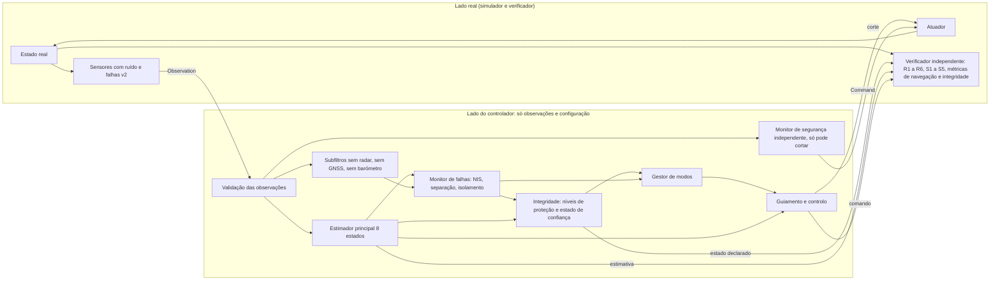

# M10: navegação resiliente e decisão tolerante a falhas (desenho)

Estado: **rascunho de desenho para revisão independente e decisão do proprietário. Não há implementação do M10.** Este documento não altera código, casos, campanhas nem resultados do M9 e do M9.1. As afirmações marcadas "(suposto)" ou "(incerto)" não foram verificadas no repositório nem em dados externos e têm de ser confirmadas ou refutadas antes de serem usadas como requisito.

Convenções: texto em português europeu (Acordo Ortográfico de 1990), vírgula decimal na prosa e ponto decimal dentro de código. Os números do repositório citados aqui foram lidos de `docs/m9-powered-landing.md`, de `crates/vv-rocket/landing/nominal.json`, de `crates/vv-rocket/landing/m91-nominal.json` e do código em `crates/vv-rocket/src`.

## 1. Objetivo, pergunta de investigação e fronteira

**Pergunta.** Uma arquitetura de navegação tolerante a falhas melhora a recuperação e a segurança perante combinações realistas de falhas de sensores, e reconhece de forma fiável quando o estado de navegação deixou de merecer confiança?

A pergunta tem duas metades que não são a mesma coisa e o M10 mede-as em separado:

- **Recuperação**: o veículo toca no solo dentro dos requisitos (`R1` a `R6`, `S1` a `S5`) apesar das falhas.
- **Declaração**: o sistema diz, a tempo, que a navegação já não é fiável quando o erro real excede um limite de alerta. É uma propriedade do estimador e do gestor de modos, avaliada pelo verificador com a verdade. Pode haver declaração correta sem recuperação (não há ação física que salve o veículo) e recuperação sem declaração (sorte).

**O que o M10 é.** Um desenho, e depois uma implementação em Rust, de: um estimador de navegação com covariância, monitorização de falhas (deteção e isolamento), uma medida de integridade, um gestor de modos e um monitor de segurança independente, para uma política nova no mesmo ciclo de controlo. Uma campanha pré-registada compara-a com `baseline`, `robust`, `guarded` e com candidatos mais simples.

**O que o M10 não é.**

- Não altera `baseline`, `robust`, `guarded`, `baseline_guarded`, os traços, os hashes fixados em `tests/reference.rs` e em `m9_demo_traces_are_byte_identical_after_m91`, nem as campanhas M9 e M9.1 nem os seus resultados. `landing/nominal.json` (SHA-256 `58b19ff7a85455d4feb0d9c47e9098b21dcb4660416bbfaf822bf433576f1830`) e `landing/m91-nominal.json` (SHA-256 `69ecad65e9ec4329ffc74a3b985dbb7dc60d5cdaa1e4a9a380f296a76f68114b`) ficam como estão. O M10 usa um modelo de caso próprio (`landing/m10-nominal.json`), congelado por hash antes da avaliação, como o M9.1 fez.
- A definição de `landed` e os limites `R1` a `R6`, `S1` a `S5` não mudam. Qualquer propriedade nova (integridade, falha de alerta, transição de modo insegura) é um invariante ou uma métrica nova, com versão nova do esquema de verificação.
- É um modelo idealizado: sem dinâmica de contacto, sem RCS, terreno plano, sem latência nos sensores existentes, atmosfera exponencial, ruído limitado de Irwin-Hall. Não há validação com dados de voo.
- Não há garantias formais. Os níveis de proteção e os limiares são estatísticos, assumem ruído quase gaussiano e uma única falha de cada vez, e as suas taxas são estimativas condicionais às dispersões e às gamas assumidas.
- Não inclui visão, balizas na plataforma nem terreno relativo (ver as secções 3 e 4).

## 2. O que o M9 e o M9.1 mostraram e porque não chega

Números medidos (campanha M9.1, sementes 2000 a 2029, 30 por célula; ver `docs/m9-powered-landing.md`):

| Cenário | `robust` recuperou | `guarded` recuperou | Leitura |
| --- | --- | --- | --- |
| `altimeter_bias` (+5 a +50 m) | 28 de 30 | 28 de 30 | `guarded` e `robust` iguais |
| `altimeter_bias_low` (-5 a -50 m) | 28 de 30 | **0 de 30** | a regra "menor altitude" escolhe a fonte errada quando a errada lê baixo; `R1` falhado em 30 (11,3 a 30,8 m/s) |
| `gnss_bias` (+5 a +30 m em x e z) | **0 de 30** | 6 de 30 | `guarded` toca no solo com `R1` cumprido em 30 de 30 (1,86 a 2,42 m/s), mas 24 de 30 falham `R5`; `robust` falha `R1` em 30 (11,5 a 25,6 m/s) |
| `gnss_bias_low` | 0 de 30 | 0 de 30 | `R1` falhado em 30 nas duas |
| `gnss_dropout` com `baseline_guarded` | n/a | n/a | G2b falhou: 2 de 30 `no_contact`; a regra de subida só atuou depois do regresso do GNSS (0,98 a 20,23 s depois do fim da janela) |
| nominal | 29 de 30 | 29 de 30 | piso: 1 falha de `R2` sem falha injetada |

Porque não chega, ligado a mecanismos e não só a números:

1. **Ganhos fixos, sem covariância.** `robust` e `guarded` usam ganhos constantes (GNSS 0,15 e 0,25, altímetro 0,1 e 0,004, limiar de resíduo de 3 m durante 5 ciclos; valores de `landing/nominal.json`, não os do fixture de testes do controlador). O filtro não sabe quão incerto está. Depois de uma perda de GNSS aplica o mesmo ganho ao regressar. Não pode produzir um nível de proteção.
2. **Duas fontes de altitude: deteta, não isola.** O M9.1 acusou-o por escrito ("sem terceira fonte de altitude, não sabe qual das duas está errada"). A regra de desempate "menor altitude" é um palpite que depende do sinal da falha. A medição G5 mostra o custo: 0 de 30 contra 28 de 30.
3. **A deteção `G1` (30 de 30, 0 falsos alarmes em 210) é mais fácil do que parece.** O ruído é de Irwin-Hall e está limitado a ±2√3 σ, cerca de ±3,46 σ. A diferença bruta entre o radar e a altitude GNSS nunca excede, só por ruído, 3,46 × (0,1 + 0,5) = 2,08 m. O limiar de 3 m está acima desse limite e as magnitudes das falhas são de pelo menos 5 m. Zero falsos alarmes em 210 execuções é, em parte, uma propriedade do ruído limitado e do limiar, e não prova que um detetor com limiar a poucos desvios-padrão tenha uma taxa de falsos alarmes controlada. O resíduo é calculado contra a altitude filtrada, não contra a amostra bruta, o que acrescenta erro de filtro; a conclusão é qualitativa.
4. **O monitor partilhava a causa da falha.** A regra 2 de subida usa a velocidade vertical estimada, que durante a perda de GNSS é a última velocidade GNSS. O sensor em falha alimenta o monitor que o devia vigiar. A lição para o M10: um monitor só vale se usar informação independente da fonte vigiada.
5. **Posição horizontal sem qualquer verificação.** Com `gnss_bias` presente desde o primeiro ciclo, nenhum controlador deste modelo pode cumprir `R5` quando o deslocamento excede 10 m (já previsto no M9.1). O M9.1 não explica porque o `R5` medido fica entre 0,73 e 0,97 vezes a magnitude nas 6 execuções recuperadas ("a razão da atenuação não foi investigada"). O M10 não afirma explicá-lo.
6. **Mudanças de sensor invisíveis ao modo de operação.** Não há conceito de "modo" nem de estado de saúde por sensor com histerese. A decisão é o corte a 15 m, igual em todas as políticas.

Em resumo: o M9.1 mostrou que a deteção de uma inconsistência é fácil quando a magnitude é grande, que a recuperação exige saber qual fonte está errada, e que os ganhos fixos e as regras de desempate não o sabem. O que falta é (i) um estimador que conhece a sua incerteza, (ii) isolamento onde houver redundância suficiente, (iii) uma declaração honesta onde não houver, e (iv) uma decisão que usa a declaração.

## 3. Observabilidade

Esta é a secção central: diz o que nenhum algoritmo pode fazer com os sensores do modelo. Tudo o que vem a seguir é limitado por ela.

### 3.1 Sensores existentes (verificados no código)

| Sensor | Mede | Referencial e ponto | Taxa | Ruído (1 σ) | Viés de falha |
| --- | --- | --- | --- | --- | --- |
| Altímetro radar | `p_base,z` | altitude do plano de saída da tubeira acima do solo plano | cada ciclo (50 Hz) | 0,1 m | `altimeter_bias(_low)`: soma ou subtrai, 5 a 50 m |
| GNSS posição | `r` | centro de massa, referencial local N | 10 Hz | 0,5 m por eixo | `gnss_bias(_low)`: soma ou subtrai `m` a **x e z** (y não); 5 a 30 m |
| GNSS velocidade | `v` | centro de massa | 10 Hz | 0,05 m/s por eixo | nenhum: **a velocidade fica verdadeira** |
| IMU atitude | `q` | corpo para N | cada ciclo | 1e-4 rad | nenhum |
| IMU velocidade angular | `ω_B` | corpo | cada ciclo | 1e-4 rad/s | nenhum |
| IMU força específica | `(impulso + arrasto)/m` em B | corpo | cada ciclo | 0,02 m/s² por eixo | `imu_accel_bias`: constante, **só ao longo de `x_B`**, 0,05 a 0,5 m/s² |

Factos que importam para o desenho (todos lidos em `landing_sensors.rs` e `prng.rs`):

- Sem latência: a observação no passo `k` mede o estado real em `k`.
- O ruído é limitado: o radar nunca se afasta mais de 0,35 m, o GNSS em posição mais de 1,73 m, em velocidade mais de 0,17 m/s, o acelerómetro mais de 0,069 m/s². Um detetor gaussiano sobrestima os falsos alarmes neste modelo. As frações de excedência medidas no protótipo estão abaixo da teoria nas caudas (secção 3.8).
- A força específica medida usa o impulso aplicado no passo anterior mais o arrasto no passo corrente. Nas rampas do acelerador (taxa máxima 1,0 por segundo) isto desfasa a força em cerca de meio ciclo. Estimativa minha (incerto, não verificada): um erro de velocidade transitório de ordem 0,1 a 0,2 m/s durante uma subida do acelerador de 0,4 para 0,8. Tem de ser medido no M10.1 antes de dimensionar o ruído de processo.
- Não há viés de giroscópio, nem deriva, nem passeio aleatório do viés do acelerómetro; o viés da IMU é constante e só em `x_B`. Isto é otimista: um modelo de falha mais realista inclui deriva (secção 5).
- O altímetro dá a altitude do plano da tubeira, o estimador trabalha no centro de massa: `h_base = z - s_cm·n_z`, com `n_z` a componente vertical de `x_B` medida pela IMU. Erro da distância `s_cm` (massa de propelente estimada): `ds/dm_p = (s_p - s_cm)/m ≈ -1,7e-4 m/kg` com carga cheia, logo cerca de 0,03 a 0,04 m para os 2% de dispersão de propelente mais o erro de consumo estimado (derivação minha a partir de `landing_model.rs`, não medida). É um erro sistemático pequeno face ao ruído do radar (0,1 m), mas não é zero e entra no orçamento de erros.
- O radar funciona desde os 3000 m. Um radar real tem alcance máximo (suposto: de ordem de quilómetros). O modelo não o tem; isto torna o radar mais forte do que é.
- As altitudes do GNSS e do radar usam o mesmo zero (solo plano em `z = 0`). Num veículo real, a elevação do terreno e a do referencial do GNSS diferem em metros. Aqui a diferença é zero, o que facilita a comparação radar contra GNSS.

### 3.2 O que cada sensor observa, em condições nominais e quando o GNSS deixa de ser fiável

"GNSS não fiável" cobre a perda (sem dados) e a suspeita (dados presentes e desacreditados).

| Grandeza | Nominal | Sem GNSS fiável | Notas |
| --- | --- | --- | --- |
| Posição vertical | radar (direto, 0,1 m, absoluto em relação ao solo), GNSS z (0,5 m, absoluto no referencial), integração da IMU (relativa) | radar e IMU; barómetro se existir | só duas fontes absolutas (radar e barómetro) sem GNSS; deteta-se desacordo, não se isola |
| Velocidade vertical | GNSS vz (0,05 m/s), IMU integrada, derivada do radar | IMU integrada corrigida pelo radar | a derivada do radar numa janela de 0,5 s tem desvio de cerca de 0,14 m/s (estimativa minha: `σ √12 / (T √n)` com `σ = 0,1`, `T = 0,5 s`, `n = 25`) |
| Posição horizontal | só GNSS (x, y) | **não observável**: navegação por estima a partir do último estado fiável | deriva em `σ_p(t)² ≈ σ_p0² + (σ_v0 t)² + (½ b_h t²)²` |
| Velocidade horizontal | GNSS v, IMU integrada | IMU integrada a partir da última velocidade fiável; Doppler se existir | como a atitude é medida, a IMU dá a aceleração horizontal sem modelo de forças |
| Viés do acelerómetro (`x_B`) | observável pela diferença entre a velocidade integrada da IMU e a do GNSS ou a do radar; como `x_B` está quase na vertical, vê-se quase só no canal vertical | continua observável pelo radar, mais devagar | os componentes laterais do viés (que o modelo não injeta) quase não se veem |
| Desvio do barómetro | observável contra radar ou GNSS | só contra o que restar | com desvio desconhecido, um degrau constante do barómetro é absorvido pelo estado |

### 3.3 O que é não observável e o que só o início de uma falha revela

Seja `y(t) = p(t) + δ` a posição medida pelo GNSS, com `δ` um deslocamento constante desconhecido, a velocidade `v` medida sem viés e a IMU independente da posição. Então `p(t) = p0 + ∫v dt` com `p0` desconhecido, e `y(t) = (p0 + δ) + ∫v dt`: só a soma `p0 + δ` é identificável. Conclusão: **um deslocamento horizontal constante da posição GNSS não é observável a partir de fontes de velocidade nem da IMU**, nem de radar, nem de barómetro. É o caso das campanhas do M9 e do M9.1, cujas janelas de `gnss_bias` vão de 0 a 40 s: o deslocamento está presente no primeiro ciclo e o estimador inicializa-se sobre ele; não há início para detetar. Equivale a uma plataforma deslocada.

O que é detetável é o **início** do deslocamento (degrau) quando existe um período fiável anterior, e uma **rampa** se o seu declive for grande o bastante face à incerteza da velocidade integrada. Uma rampa lenta pode nunca ser detetada dentro de um voo de 17 a 23 s. Medições do protótipo (canal horizontal só com GNSS, início aos 8 s, sementes de desenvolvimento) estão na secção 3.8.

O caso do demonstrador (`gnss-bias-guarded.json`, início aos 8 s) é, assim, um caso diferente do da campanha. As duas situações têm de ficar declaradas nos resultados.

### 3.4 Deteção, isolamento e redundância

- Com **duas** fontes de uma mesma grandeza, um desacordo pode ser **detetado** mas não **isolado**: o resíduo `y1 - y2` é igual para a hipótese "1 está errada" e "2 está errada".
- Com **três** fontes independentes e a hipótese de **uma única falha**, o isolamento é possível: a fonte cujo subconjunto restante é consistente é a errada. A capacidade depende de os desvios-padrão serem comparáveis: se uma das três fontes for muito imprecisa (barómetro com desvio de metros), o isolamento só funciona para magnitudes grandes face a essa incerteza.
- Com mais de uma falha simultânea, o isolamento pode atribuir a falha à fonte errada. A hipótese de falha única tem de ser testada, e é-o por pares na campanha.
- **Modo comum e correlação.** A posição e a velocidade do GNSS vêm do mesmo recetor: uma falha do recetor pode corromper as duas de forma coerente (por exemplo, rampa de posição com velocidade consistente). O modelo atual de `gnss_bias` é a exceção otimista: só corrompe a posição, o que a torna detetável por consistência com a velocidade integrada. O altímetro e o barómetro têm causa comum perto do solo (o jato). O barómetro e o GNSS vertical são fisicamente independentes (pressão contra rádio), mas o barómetro tem deriva e erros que dependem da velocidade (secção 4).
- A altitude do GNSS e a do radar **não** são independentes em dois sentidos: usam o mesmo zero (este modelo), e a posição horizontal e vertical do GNSS partilham o recetor. Por isso, **o canal vertical serve de canário do recetor**: se o isolamento vertical apontar o recetor GNSS como a fonte errada, a posição horizontal do GNSS deve ser tratada como não fiável. Isto é inferência de modo comum e não correção: **não se deve usar a magnitude do viés vertical para corrigir o horizontal**, apesar de `gnss_bias` somar o mesmo valor a x e a z neste simulador. Isso seria ajustar o algoritmo ao modelo de falha injetado.

### 3.5 Deriva da IMU

Com um viés constante `b` não compensado, o erro de posição cresce como `½·b·t²` e o de velocidade como `b·t`. A gama do M9 é 0,05 a 0,5 m/s². Janela de perda de GNSS de 2 a 10 s, caso de interesse (a perda é a falha que obriga a navegar só com a IMU):

| `b` (m/s²) | `t` = 2 s: posição / velocidade | `t` = 5 s | `t` = 10 s |
| --- | --- | --- | --- |
| 0,05 | 0,10 m / 0,10 m/s | 0,63 m / 0,25 m/s | 2,5 m / 0,5 m/s |
| 0,25 | 0,50 m / 0,50 m/s | 3,1 m / 1,25 m/s | 12,5 m / 2,5 m/s |
| 0,5 | 1,0 m / 1,0 m/s | 6,3 m / 2,5 m/s | 25 m / 5,0 m/s |

Entre dois ciclos de GNSS (0,1 s) a deriva é desprezável (0,0025 m no pior caso). Se o viés estiver estimado antes da perda, a deriva é a do erro residual do estimador de viés, bem menor. Como o viés do modelo está ao longo de `x_B` e o guiamento mantém `x_B` perto da vertical (`tilt_max_tan` 0,2 no caso M9), a deriva horizontal é aproximadamente `b·sin(tilt)`: com 0,5 m/s² e inclinação máxima, cerca de 0,1 m/s², ou seja 5 m em 10 s. A tabela acima é o pior caso para o canal vertical. A atitude não tem viés no modelo; a sua falha (que alteraria a projeção da gravidade e o braço de alavanca do radar) fica fora do âmbito e é uma limitação (secção 12).

### 3.6 Deteção mínima e atraso de deteção, canal vertical (analítico)

Hipóteses: ruído gaussiano, falha em degrau `δ`, teste bilateral a nível `p_fa` por amostra, potência `1 - β`. O limiar em desvios-padrão é `k = Φ⁻¹(1 - p_fa/2)` e o viés mínimo detetável é `MDB = (k + z_β)·σ_d`, com `z_β = Φ⁻¹(1 - β)` unilateral e `σ_d` o desvio-padrão da inovação da fonte contra o resto.

Valores usados: `p_fa = 6,3e-5` por amostra, `k = 4`; `β = 0,1`, `z_β = 1,28`; logo `MDB = 5,28·σ_d`.

Para uma fonte `i` com variância de inovação contra o subfiltro sem ela `S_i = P⁻_i + r_i` (`P⁻_i` a variância prevista da altitude sem `i`, `r_i` a variância de ruído de `i`), a não-centralidade do teste de separação é `δ/√S_i`, pelo que `MDB_i = 5,28·√S_i`. Isto é válido para fontes sem estado de desvio próprio (radar e GNSS z).

Valores calculados com a covariância do protótipo (secção 3.8), aproximação de uma amostra, ruído gaussiano, valores otimistas porque o protótipo não tem erros não modelados:

| Instante / altitude do perfil de brinquedo | MDB radar (m) | MDB GNSS z (m) |
| --- | --- | --- |
| 4 s / 1186 m | 0,68 | 2,64 |
| 8 s / 583 m | 0,62 | 2,64 |
| 12 s / 192 m | 0,60 | 2,64 |
| 15 s / 38 m | 0,60 | 2,64 |

Para um barómetro com estado de desvio que o filtro aprende, não existe fórmula fechada simples: o teste passa a detetar uma mudança relativa ao desvio aprendido e não um valor absoluto. Medido no protótipo: degrau de 1 m detetado em 100 de 100 execuções (mediana 0,52 s), 0,5 m em 72 de 100.

Atraso de deteção para `δ` abaixo do MDB de uma amostra: média sobre `n` amostras independentes reduz `σ_d` por `√n`, logo `n ≈ (MDB/δ)²`. No GNSS, com uma amostra a cada 0,1 s, `δ = 1 m` pede `n ≈ 7`, cerca de 0,7 s; `δ = 0,5 m`, `n ≈ 28`, cerca de 2,8 s. O protótipo dá 1,8 s e 4,1 s (medianas): a lei dá a ordem de grandeza e subestima o atraso por um fator de 2 a 3, porque o filtro absorve parte do viés e as amostras de separação são correlacionadas. Usar o protótipo e não a fórmula para as ordens de grandeza.

Limite honesto do método: a fórmula assume ruído gaussiano e independente, estacionário. O ruído do simulador é limitado e as covariâncias reais incluem erros não modelados (secção 3.1).

### 3.7 O que continua não observável com todos os sensores propostos

- **Posição horizontal em relação à plataforma**, quando o recetor GNSS tem um viés constante desde o início. Os sensores existentes, o barómetro e o Doppler (secção 4) não a observam. Observa-a um sensor relativo à plataforma (câmara com marcas, baliza, terreno relativo), fora do âmbito do M10 como linha de base. Fica como opção com custo na secção 4.4.
- **Viés comum a todas as fontes de altitude no mesmo sentido** (por exemplo, plataforma a cota diferente do assumido por todas as fontes). Não é observável, por definição.
- **Falhas simultâneas de duas fontes de altitude com a terceira fraca**: deteta-se, isola-se mal (secção 5).

### 3.8 Protótipo de viabilidade, canal vertical, sementes de desenvolvimento

Isto é um **brinquedo** em `spikes/m10-nav-feasibility/feasibility.py`: não é a implementação do M10 e **não é evidência para nenhuma hipótese do M10**. Serve para verificar ordens de grandeza das secções 3.3 e 3.6 e para ver se o desenho de separação de soluções funciona de todo.

Comando exato:

```sh
python spikes/m10-nav-feasibility/feasibility.py > resumo.json
```

Máquina: Windows-11-10.0.26300-SP0; AMD64 Family 25 Model 97 Stepping 2, AuthenticAMD; Python 3.14.6. Duração de uma execução: cerca de 21 s. Duas execuções completas deram o mesmo JSON exceto os campos `cost` e `timing_s`. `random.Random` (Mersenne Twister) com as sementes 9000 a 9099, **bloco de desenvolvimento, não de avaliação**; o ruído é o de Irwin-Hall do repositório, mas o gerador não é o SplitMix64.

Modelo: descida de 2000 m com 230 m/s até -1,5 m/s, desaceleração constante de 13,22 m/s², 865 ciclos de 0,02 s. Radar 0,1 m a 50 Hz; GNSS z 0,5 m e vz 0,05 m/s a 10 Hz; acelerómetro 0,02 m/s²; barómetro proposto a 25 Hz, ruído 0,5 m, desvio inicial `N(0, 2²)` m, deriva 0,05 m/√s. Bias do acelerómetro nominal `N(0, 0,05²)` m/s². Filtro de Kalman linear de 4 estados (altitude, velocidade, viés do acelerómetro, desvio do barómetro), forma de Joseph, mais três subfiltros (sem radar, sem GNSS, sem barómetro). Separação: `|z_0 - z_i| > 4·√(P_i,zz - P_0,zz)`. Isolamento por NIS médio dos subfiltros numa janela de 1 s depois da deteção. O filtro não rejeita medidas em malha fechada, por isso a covariância não depende dos dados: é calculada uma vez por filtro e verificada contra o filtro de covariância completa (diferença máxima 0 m).

Nominal (100 execuções, sementes 9000 a 9099):

| Medida | Resultado |
| --- | --- |
| Execuções com alarme (separação, qualquer subfiltro) para k = 2,0 / 2,5 / 3,0 / 3,5 / 4,0 | 98 / 81 / 35 / 6 / 0 de 100 |
| Falsos alarmes com o limiar escolhido (k = 4) | 0 de 100; limite superior unilateral de 95% (Clopper-Pearson) 2,95% |
| Fração de amostras acima de k = 2,0 / 3,0 / 3,5 / 4,0 (empírica; teoria gaussiana) | 4,54e-2 (4,55e-2) / 2,49e-3 (2,70e-3) / 1,00e-4 (4,65e-4) / 0 (6,3e-5) |
| NIS médio do radar (1 grau de liberdade) | 0,9988 |
| NEES médio (4 estados) aos 2 / 8 / 12 / 16 s | 3,59 / 3,14 / 3,09 / 3,28; intervalo bilateral de 95% para a média de 100 execuções: 3,45 a 4,55 |
| Amostras com erro real acima do nível de proteção | 0 em 86 500 |

Leitura: o limiar a 4 desvios-padrão dá 0 falsos alarmes em 100 execuções, mas 100 execuções só excluem taxas acima de cerca de 3% por execução (regra aproximada: 3/n). As caudas empíricas ficam abaixo da gaussiana, como previsto para ruído limitado. O NEES médio está **abaixo** da dimensão (4) em 3 de 4 instantes e abaixo do limite inferior do intervalo: o filtro é conservador (covariância maior do que o erro), não otimista. Não investiguei a causa; candidatos: o ruído de processo do viés e o ruído limitado.

Falhas em degrau, canal vertical, 100 sementes por célula, início aos 8 s (583 m no perfil de brinquedo). Ocorreram 0 alarmes antes do início em todas as células e 0 amostras com erro acima do nível de proteção sem alarme (`PL_v` da ordem de 0,4 m neste modelo ideal):

| Fonte | Viés (m) | Detetadas | Atraso mediano / p90 (s) | Isolamento por NIS correto | Isolamento pela maior separação normalizada correto | Erro final do filtro completo (mediana, m) | Erro final depois de reconfigurar (mediana / máx., m) |
| --- | --- | --- | --- | --- | --- | --- | --- |
| radar | 0,5 | 100 | 0,20 / 0,30 | 100 | 0 | 0,48 | 0,04 / 0,15 |
| radar | 1 | 100 | 0,10 / 0,14 | 100 | 1 | 0,97 | 0,04 / 0,15 |
| radar | 5 | 100 | 0,00 / 0,02 | 100 | 0 | 4,83 | 0,04 / 0,15 |
| radar | 30 | 100 | 0,00 / 0,00 | 100 | 0 | 28,98 | 0,04 / 0,15 |
| GNSS z | 0,5 | 100 | 4,08 / 5,90 | 57 | 2 | 0,01 | 0,01 / 0,42 |
| GNSS z | 1 | 100 | 1,80 / 2,50 | 99 | 1 | 0,01 | 0,01 / 0,69 |
| GNSS z | 3 | 100 | 0,50 / 0,70 | 100 | 0 | 0,02 | 0,01 / 0,04 |
| GNSS z | 10 | 100 | 0,10 / 0,20 | 100 | 0 | 0,08 | 0,01 / 0,04 |
| barómetro | 0,5 | 72 | 1,48 / 2,36 | 41 de 72 | 72 de 72 | 0,01 | 0,01 / 0,10 |
| barómetro | 1 | 100 | 0,52 / 0,74 | 100 | 100 | 0,01 | 0,01 / 0,03 |
| barómetro | 10 | 100 | 0,04 / 0,04 | 100 | 100 | 0,01 | 0,01 / 0,03 |

(O quadro completo, com as magnitudes 2 e 3 m, o início aos 15 s e o arranque a frio, está no JSON.) Observações:

- **A regra de isolamento "maior separação normalizada" falhou**: 0 a 2 de 100 para o radar e o GNSS. A causa provável (não verificada) é que a separação do barómetro tem `σ_Δ` mínima (0,001 m), pelo que a razão normalizada do barómetro é sempre a maior. A regra era a minha primeira escolha e não funciona; o isolamento por consistência (NIS do subfiltro) funciona nestes dados. Isto mostra que o isolamento tem de ser projetado e testado, não assumido.
- O estimador de variância ponderada fica **dominado pelo radar**: um viés de 30 m no GNSS z desloca a altitude estimada apenas 0,23 m, enquanto um viés de 30 m no radar desloca-a 29 m. Ou seja, num filtro de Kalman o modo de falha de `robust` com `gnss_bias` (rejeitar o radar correto) não aparece, e o que importa passa a ser a falha do radar, a fonte dominante. A deteção do GNSS é lenta (1 m: 1,8 s) mas o seu efeito na altitude é pequeno.
- Com o início aos 15 s (38 m), as células de GNSS 0,5 m e 1 m têm deteção parcial (2 e 63 de 100), porque o fim do voo chega antes da deteção.
- O erro final de uma reconfiguração com o subfiltro certo é de poucos centímetros no modelo ideal; esse valor é otimista (sem erros do braço de alavanca, sem desfasamento da força específica). O que se retira não é o número, mas que o erro depois da reconfiguração depende da fonte restante e não do viés removido.

Arranque a frio (altitude inicial com incerteza de 50 m, falha presente desde o instante 0, o caso das janelas de 0 a 40 s do M9), 100 sementes por célula:

| Fonte | Viés (m) | Detetadas | Isolamento por NIS correto | Pela maior separação | Erro final reconfigurado (mediana / máx., m) |
| --- | --- | --- | --- | --- | --- |
| radar | 5 | 100 | 73 | 93 | 0,06 / 5,02 |
| radar | 10 | 100 | 95 | 100 | 0,05 / 10,02 |
| radar | 30 | 100 | 100 | 100 | 0,04 / 0,16 |
| GNSS z | 5 | 100 | 69 | 92 | 0,01 / 5,09 |
| GNSS z | 10 | 100 | 98 | 100 | 0,01 / 9,97 |
| barómetro | 5 | 8 | 4 de 8 | 8 de 8 | 0,01 / 0,03 |
| barómetro | 10 | 87 | 81 de 87 | 87 de 87 | 0,01 / 0,09 |

Leitura: desde o instante 0, uma falha de radar ou de GNSS de 5 m é isolada corretamente em 69 a 93 de 100 execuções, e de 30 m em 100 de 100, **com um desvio do barómetro de 2 m como terceira fonte e um prior de altitude inicial não informativo**. Quando o barómetro tem um desvio de 5 m, é absorvido pelo seu estado e quase não é detetado (8 de 100). A capacidade de isolar 5 m depende por inteiro do desvio inicial assumido para o barómetro; com `σ_b0 ≥ 5 m` desapareceria (aritmética, não medido). Os dois quadros mostram a diferença entre as duas regras de isolamento (a de separação funciona melhor a frio, a de NIS melhor a quente): os resultados dependem do regime e nenhuma regra é "a melhor" sem teste.

Canal horizontal só com GNSS (brinquedo adicional; início aos 8 s; 100 sementes; velocidade e IMU como testemunhas). Teste de uma época: inovação de posição ou de velocidade acima de 4 desvios-padrão; teste de janela: média de 20 inovações (2 s) acima de 4 desvios-padrão da média. Falsos alarmes nominais: 0 de 100 nos dois testes.

| Falha | Valor | Deteção de uma época (n de 100; atraso mediano) | Deteção de janela (n de 100; atraso mediano) | Deslocamento no fim se nunca detetada |
| --- | --- | --- | --- | --- |
| degrau de posição | 1 m | 25; 0,5 s | 100; 1,9 s | 1 m |
| degrau de posição | 3 m | 100; 0 s | 100; 1,9 s | 3 m |
| rampa só de posição | 0,03 m/s | 0 | 7; 8,8 s | 0,28 m |
| rampa só de posição | 0,05 m/s | 0 | 25; 7,3 s | 0,46 m |
| rampa só de posição | 0,1 m/s | 1; 7,3 s | 99; 6,0 s | 0,93 m |
| rampa só de posição | 0,3 m/s | 100; 5,7 s | 100; 2,6 s | 2,8 m |
| rampa coerente (posição e velocidade) | 0,1 m/s | 9; 0,3 s | 88; 1,9 s | 0,93 m |
| rampa coerente | 0,3 m/s | 100; 0 s | 100; 1,9 s | 2,8 m |

Leitura: com início a meio do voo, degraus de 1 m a 3 m e rampas de 0,1 m/s ou mais são detetados; rampas de 0,05 m/s ou menos são detetadas em no máximo 25 de 100 execuções, mas o deslocamento que acumulam até ao fim é inferior a 0,5 m. A rampa coerente (recetor com velocidade consistente com a posição) é detetada porque a IMU, neste modelo, é uma testemunha da velocidade com viés pequeno e estimado; o resultado degrada-se quando o viés da IMU for maior ou não estiver estimado, e uma deriva coerente lenta que o estado de viés absorva é indistinguível de um viés do acelerómetro (analítico, não simulado). **Nada disto se aplica a um deslocamento presente desde o instante 0**, que é o caso do M9.

Custo (Python 3.14.6, medido em volta de execuções completas; ordem de grandeza, não é o custo em Rust): 0,50 µs por ciclo e por filtro no caminho de estado com ganhos pré-calculados; 67 µs por ciclo e 35 µs por atualização escalar no filtro de covariância completa (forma de Joseph, 4 estados). O custo real do filtro de covariância é o segundo número, porque no M10 as perdas de dados e as rejeições alteram a covariância.

## 4. Modelos de sensores propostos

Os sensores existentes (secção 3.1) não mudam. Os candidatos novos entram no esquema `vv-rocket-landing.v2` (uma versão nova, ver a secção 7) e têm de ter uma justificação física por escrito antes de qualquer campanha.

**Regras contra sensores escolhidos para melhorar os resultados.** (i) Um sensor entra no modelo porque é fisicamente plausível, com parâmetros fixados antes da campanha de avaliação. (ii) Cada sensor tem uma variante otimista e uma pessimista, e ambas são executadas. (iii) Os resultados são apresentados por conjunto de sensores, incluindo o conjunto `S0` (só os sensores existentes). (iv) Os parâmetros dos sensores nunca são ajustados depois de ver resultados. (v) Um sensor que não melhora uma métrica pré-registada na variante pessimista é abandonado e o abandono é reportado. (vi) Fica rejeitado um terceiro altímetro radar com ruído independente de 0,1 m (rejeitado pelo proprietário e, além disso, com causa comum com o primeiro perto do jato) e qualquer sensor que meça a verdade (detetor de contacto, referência de plataforma perfeita).

### 4.1 Barómetro (candidato, conjunto `S1`)

Altitude de pressão: o sensor devolve uma altitude calibrada no solo da plataforma. Modelo proposto da medida:

```
z_b = (1 + κ)·z + b0 + b_rw(t) + e_din(v) + e_jato(h, u) + w(t - τ_b)
```

| Termo | Origem física | Valor proposto (suposto, a rever) |
| --- | --- | --- |
| `w` | ruído de leitura | `σ = 0,5 m`, branco, 25 Hz |
| `b0` | calibração no solo (pressão e temperatura locais) | `N(0, 2²)` m, constante no voo |
| `b_rw` | deriva do sensor e da atmosfera | passeio aleatório 0,05 m/√s |
| `κ` | erro de escala da atmosfera (gradiente de temperatura): `h` não é só `ln(p0/p)` | uniforme em ±0,5% (incerto); a 2000 m são ±10 m |
| `e_din(v)` | erro de posição da fonte de pressão estática: `Δp = c_p·½ρ v²` dá `Δh = c_p·v²/(2g)` | `c_p` entre -0,5% e +0,5% (incerto): a 230 m/s, até ±13,5 m; a 50 m/s, 0,6 m |
| `e_jato(h, u)` | perturbação da pressão estática junto ao solo pelo jato (recirculação, efeito de solo), cresce com o acelerador `u` e com a proximidade do solo | `-A·u·exp(-h/h_g)` com `A` entre 0 e 10 m e `h_g` de 10 a 30 m (incerto; 1 hPa vale cerca de 8,3 m a nível do mar) |
| `τ_b` | latência do sensor e do filtro de pressão | 0,04 s (suposto): a 230 m/s, 9 m |

A modelação evita `ln` e `pow` no caminho de determinismo: o sensor emite diretamente a altitude de pressão (calculada pelo próprio modelo do sensor com os operadores permitidos). Só o cálculo do próprio modelo físico do jato usa `exp` do crate, que é permitida.

**Independência.** A pressão e o rádio (radar e GNSS) são fisicamente independentes: um viés do radar não afeta o barómetro e vice-versa. O barómetro não é independente do jato nem da velocidade (os termos `e_din` e `e_jato`), e tem deriva própria. Perto do solo a causa comum com o radar é o jato. A velocidade mostra o problema central do barómetro: **o erro dinâmico e a latência crescem com a velocidade, o jato cresce perto do solo, e o jato é exatamente onde a velocidade é pequena**. A janela de altitude em que o barómetro é pelo menos tão bom como a incerteza que tem de resolver pode ser muito estreita ou nula. Isto é uma conclusão (incerta) que decide se o barómetro entra.

**Porta de decisão M10.0 para o barómetro.** Antes de qualquer implementação, calcular analiticamente, com a variante pessimista, a margem de isolamento em função da altitude: a razão entre a magnitude de uma falha de 5 a 50 m e a incerteza do barómetro nessa altitude (erro estático, escala, latência). Se não houver nenhuma faixa de altitude, antes do compromisso de guiamento (secção 8), em que a margem exceda 2 a 3, o barómetro **não entra** e a conclusão é registada: com os sensores existentes não há terceira fonte de altitude absoluta, e as falhas de altitude constantes desde o início são não isoláveis; ficam declaradas.

Modos de falha do barómetro: desvio (degrau) de calibração, deriva, escala errada, entupimento ou congelamento (valor preso), saturação, perturbação do jato.

### 4.2 Velocímetro Doppler (candidato, conjunto `S2`, só se aprovado)

Os aterradores planetários usam radares Doppler de feixes múltiplos porque medem a velocidade em relação ao solo de forma independente do GNSS.

```
v_dop = (1 + s)·R(q)·(v + ω × r_ant) + n_d(t)      (componentes de B ou N, com braço de alavanca r_ant)
```

| Parâmetro | Valor proposto (suposto) |
| --- | --- |
| Taxa | 10 Hz (ou o mesmo do GNSS) |
| Ruído `n_d` | 0,05 a 0,1 m/s por eixo |
| Erro de escala `s` | ±0,1% a ±0,5%: a 200 m/s, 0,2 a 1 m/s (erro dominante a alta velocidade) |
| Janela de validade | abaixo de uma altitude de aquisição `h_aq` (suposto: 1000 a 2000 m) e acima de um mínimo (poeira e jato) |
| Viés | desalinhamento dos feixes: escala e rotação constantes |
| Falhas | perda de captura, saltos de escala, ruído aumentado perto do solo |

**Avaliação honesta.** O Doppler mede velocidade, não posição. Não observa um deslocamento constante da posição (secção 3.3). Não corrige nenhuma das falhas medidas no M9.1: `altimeter_bias_low`, `gnss_bias` e `gnss_bias_low` são falhas de posição ou de altitude. O ganho único que lhe encontro é o de fornecer uma terceira fonte de velocidade independente do recetor GNSS, para falhas de modo comum do recetor que corrompem posição e velocidade de forma coerente (secção 3.4); e o de reduzir a dependência da IMU durante perdas de GNSS mais longas (a deriva da secção 3.5 para `b` alto). No protótipo, a IMU já deteta degraus de velocidade de 0,3 m/s ou mais, o que reduz a necessidade do Doppler para degraus. Para deriva coerente lenta, a IMU absorve e o Doppler ajudaria. **Recomendação: não incluir o Doppler na linha de base `S1`; incluí-lo só como conjunto opcional `S2`, avaliado nas células de falha coerente do recetor, e abandoná-lo se não ajudar nessas células.**

### 4.3 Resumo da independência

| Par | Independentes? | Nota |
| --- | --- | --- |
| radar contra GNSS z | sim no hardware, **não** no zero (mesmo `z = 0` neste modelo) | o desacordo real de cota do terreno é omitido |
| radar contra barómetro | sim, exceto jato | causa comum perto do solo |
| GNSS posição contra GNSS velocidade | **não** (mesmo recetor) | falha de recetor corrompe os dois |
| GNSS contra IMU | sim | a IMU não mede posição; a velocidade integrada deriva com o viés |
| GNSS velocidade contra Doppler | sim | só em `S2` |
| barómetro contra IMU | sim | a IMU só liga altitudes, não as fixa |

### 4.4 O que fica não observável, e a opção da posição relativa à plataforma

A posição horizontal em relação à plataforma, com um deslocamento constante do GNSS desde o início, é não observável com todos os sensores acima (secção 3.7). A opção é um sensor relativo à plataforma (câmara com marcas, baliza de rádio, terreno relativo), que daria um ponto fixo horizontal abaixo de uma altitude de aquisição. Custo: modelo do sensor com visibilidade, iluminação, oclusão por jato e poeira; novas falhas; novo código de medição horizontal; e dificuldade de justificar parâmetros sem dados. **Proposta: fora do âmbito do M10. Decisão do proprietário (secção 13).** Sem ele, a afirmação máxima do M10 sobre a posição horizontal é a declaração de que não está verificada, nunca a sua garantia.

## 5. Taxonomia de falhas

As colunas "deteção", "isolamento" e "recuperação" são previsões fundamentadas (em 3 e no protótipo), não resultados. Prioridades: **C** campanha (célula própria e participa nos pares), **T** teste dirigido (casos fixos ou varrimento), **F** fora do âmbito. Os tipos existentes cabem no esquema `v1` (um de cada tipo, no máximo; combinações de pares dos tipos existentes já são válidas). Os tipos novos precisam do esquema `v2` (secção 7).

| # | Falha | Modelo e parâmetros | Deteção | Isolamento | Recuperação | Prior. |
| --- | --- | --- | --- | --- | --- | --- |
| 1 | Viés de altitude do GNSS | existente: `z += m`, `m` em ±[5, 30] m, janela 0 a 40 s | sim, se houver fonte absoluta independente (radar): protótipo 5 m em 0 s | só com terceira fonte (barómetro) ou por prior; a frio 5 m: 69 a 93% | alta no canal vertical (o radar domina); o horizontal fica comprometido (linha 2) | C |
| 2 | Viés horizontal do GNSS | novo: `x += m` (e `y`), sem `z`; `m` em ±[5, 30] m; desde 0 s e com início a meio | desde 0 s: **não** observável; início a meio: degrau ≥ 3 m em 1 época, 1 m em 2 s | n/a (um grupo só); canário do recetor se z também falhar | `R5` não recuperável desde 0 s; toque suave fora da plataforma sim | C (controlo negativo) |
| 3 | Perda de dados | existente: `gnss_dropout`, `altimeter_dropout`, 2 a 10 s | trivial (dado em falta) | n/a | `robust` 28 a 29 de 30; `baseline` 6 a 7 de 30; deriva da IMU da secção 3.5 | C |
| 4 | Recuperação intermitente | novo: 2 a 5 janelas curtas (0,2 a 2 s) de perda, intervalos de 0,5 a 3 s | sim | n/a | risco de oscilação de readmissão; depende da histerese | T |
| 5 | Deriva do barómetro | novo: rampa `r` em ±[0,05, 0,5] m/s, ou escala `κ` | lenta: baixa abaixo de 0,1 m/s por época (análogo da rampa) | sim se radar e GNSS bons | alta (pouco peso) | C (só `S1`) |
| 6 | Desvio do barómetro | novo: degrau de ±[2, 20] m; transitório do jato | grande: sim; pequeno: absorvido pelo estado | sim | alta | C (só `S1`) |
| 7 | Viés e deriva da IMU | existente: constante 0,05 a 0,5 m/s² em `x_B`; novo: rampa 0,01 a 0,1 m/s² por segundo, passeio aleatório | sim no canal vertical (estado de viés); deriva rápida mais difícil | n/a (grandeza própria) | alta se radar bom; sem radar e GNSS, tabela 3.5 | C |
| 8 | Atraso de medida | novo: `τ` de 0,02 a 0,2 s no radar, GNSS ou barómetro | **a 230 m/s, 0,1 s são 23 m**: aparece como resíduo proporcional a `v`, não constante | possível por correlação do resíduo com `v` (requer estado de atraso ou teste) | só com modelo de atraso; senão degrada tudo | T |
| 9 | Valor preso (congelado) | novo: repete a última amostra durante 1 a 10 s | por igualdade exata de amostras consecutivas (impossível com ruído) ou por resíduo crescente | sim se a fonte tem alternativas | análoga à perda de dados | T |
| 10 | Pontos fora (outliers) | novo: probabilidade 1e-3 a 1e-2 por amostra, amplitude 5 a 50 σ, num sensor | por NIS de uma amostra | sim, rejeição da amostra | alta | C (barata) |
| 11 | Falhas correlacionadas | novo: recetor GNSS com posição e velocidade coerentes (rampa `ρ` 0,1 a 3 m/s); jato com radar e barómetro degradados juntos | coerente: detetável pela IMU como testemunha enquanto o viés da IMU for pequeno; jato: baixa | não isolável se os dois parecem coerentes | baixa | C (recetor), T (jato) |
| 12 | Falhas simultâneas | pares de tipos prioritários, janelas com sobreposição de pelo menos 1 s | depende do par | **a hipótese de falha única não vale**: pode isolar a fonte errada | depende | C (pares) |
| 13 | Falhas junto de fronteiras de decisão | início da falha dentro de ±0,5 s da ignição, do compromisso, do corte a 15 m, de limiares de histerese; magnitude junto do limite de alerta | n/a | n/a | o pior caso para oscilação de modo | T (varrimentos) |
| 14 | Falsa deteção, isolamento errado | taxa em execuções nominais e com ruído aumentado; isolamento incorreto em pares | medida | medida | n/a | C |
| 15 | Sem estimativa segura | altitude: radar contra GNSS com barómetro inútil; horizontal: sem fonte | sim (desacordo) | **não** | nenhuma ação física salva; declarar | C |

**Estratégia de amostragem das combinações.** Não é uma cobertura exaustiva: o espaço de faltas é infinito e o modelo é simplificado. O plano é: (a) as células de uma falha para todos os tipos prioritários; (b) **pares** dos tipos prioritários (rascunho: `altimeter_bias` e `gnss_bias`, cada um com sinal sorteado por semente, `gnss_dropout`, `altimeter_dropout`, `imu_accel_bias`, `gnss_horizontal_bias` e valor preso, mais o desvio do barómetro: 8 tipos, 28 pares, dos quais 7 envolvem o barómetro e só correm com sensores `S1`; magnitudes e janelas sorteadas por semente, com sobreposição forçada de pelo menos 1 s); (c) varrimentos dirigidos junto das fronteiras de decisão (secção 10). Combinações de três ou mais falhas ficam fora de âmbito e a afirmação do M10 limita-se a "pares". Uma execução em que uma das duas falhas não atuou (`acted: false`, regra do M9) conta como erro de sorteio, não como resultado.

## 6. Arquiteturas candidatas

Contexto de desenho. A atitude é medida diretamente pela IMU (1e-4 rad). Dado `R(q_med)`, as equações de translação são lineares:

```
p' = v
v' = R(q_med)·(f_med - b_B) + g          (f_med: força específica medida; b_B: viés no corpo)
altímetro:   h_base = p_z - s_cm·n_z     (linear em p, com n_z medido)
GNSS:        y = p + b_gnss (+ ruído);   y_v = v (+ ruído)
barómetro:   z_b = p_z + b_baro (+ ...)
```

O sistema é **linear de variação no tempo** com a atitude como entrada conhecida (medida). Portanto um **filtro de Kalman linear de variação no tempo (LTV)** é exato a menos do ruído de atitude (entra no ruído de processo: erro de aceleração `|f|·1e-4 ≤ 3e-3 m/s²`, desprezável face a 0,02). **Não é preciso um EKF** (não há não-linearidade no filtro) **nem um filtro de erro de estado (ESKF)** (não há estado de atitude a linearizar). A complexidade de um ESKF só se justificaria se a atitude fosse estimada (por exemplo, com viés do giroscópio), o que o modelo não tem. Estados propostos: posição (3), velocidade (3), viés do acelerómetro (1, ao longo de `x_B`; ver a decisão do proprietário), desvio do barómetro (1): 8 estados. A atualização usa medidas escalares em sequência (os ruídos são independentes), o que evita inversões de matrizes.

Aritmética permitida: `+ - * /`, `sqrt` e `exp` do crate. Sem funções transcendentes em tempo de execução: os limiares do qui-quadrado são constantes pré-calculadas (por exemplo, 1 grau de liberdade: 10,83 a 1e-3, 15,14 a 1e-4, 19,51 a 1e-5, 23,93 a 1e-6; comparam-se quadrados, sem `sqrt`); a simetrização `P = ½(P + Pᵀ)` e a forma de Joseph mantêm a covariância válida; um piso nas diagonais e a verificação de diagonais positivas disparam uma reinicialização com covariância inflada e uma bandeira.

| | A: ganho fixo + votação | B: Kalman LTV + NIS | C: B + separação de soluções | D: IMM ou banco de hipóteses | E: M-estimação (Huber) |
| --- | --- | --- | --- | --- | --- |
| Estrutura | filtro complementar IMU+GNSS+radar estendido, votação 2 em 3 por resíduos | um filtro de 8 estados, rejeição por NIS, forma de Joseph | B mais um subfiltro por grupo de fontes excluído (radar, recetor GNSS, barómetro) | `K` filtros (por exemplo, 1 nominal + 1 por fonte com viés) com mistura | filtro único com pesos de Huber nas inovações |
| Deteta | desacordo por limiar | inovação anómala por fonte | separação `|x_0 - x_i|` com limiar estatístico | probabilidade de modelo | outliers (amostras) |
| Isola | só com votação, sem consistência | só rejeitando a fonte com a inovação anómala | sim com ≥ 3 fontes, por exclusão consistente | sim, probabilidade de hipótese | não; só reduz influência |
| Nível de proteção | não | só do `P` do filtro (sem falhas) | sim: `PL = max(K_ff σ_0, max_i(K_fa σ_Δi + K_md σ_i))` | possível (probabilidade posterior) | não |
| Modos de falha | votação não é correção; uma fonte dominante e viesada vence; ganhos não sabem a incerteza | uma fonte com viés constante absorvida, adaptação lenta; desvios de modelo | falha dupla; dependência da hipótese de falha única; custo `n_grupos + 1` filtros | probabilidades de transição difíceis; colapso do banco | não deteta viés constante; só picos |
| Parâmetros livres | cerca de 12 (ganhos e limiares) | `Q` (da especificação da IMU), viés `Q`, `K_fa` | + `K_md`, limites de alerta, dwell | matriz `K×K` de transições, magnitudes de hipóteses | limiar de Huber |
| Cálculo por ciclo (ordem de grandeza, estimativa minha) | dezenas de flops | cerca de 1 a 1,6 kflop (8 estados, 2,7 atualizações escalares por ciclo) | cerca de 4 a 6,5 kflop (4 filtros) | `K`-vezes B mais mistura `O(K² n²)` | 1,5-vezes B |
| Memória | desprezável | 8 + 36 duplos | 4 × (8 + 36) duplos, cerca de 1,4 kB | `K` × B | igual a B |
| Determinismo | trivial | sequência fixa de atualizações, sem inversão | igual, quatro filtros em ordem fixa | mistura com normalizações | iteração com número fixo de passos |
| Testabilidade | simples, mas sem garantias | consistência NEES e NIS testável; calibração do falso alarme | + calibração de `P_i - P_0`, isolamento por pares | difícil de calibrar | simples |

Em tempo de relógio, o custo de B e de C face ao ciclo de 20 ms é desprezável e face ao custo atual por execução do simulador (14,7 s para 1050 execuções, medido depois da revisão, ou seja cerca de 14 ms por execução com 4 tarefas) não deverá passar de 1,2 a 2 vezes (estimativa minha, a medir no M10.2).

**Escolha preferida e porque.** **C**, introduzida por fases: primeiro B (M10.2), depois C (M10.3) só se B deixar uma lacuna de integridade ou de isolamento mensurável nas células de desenvolvimento. C é a estrutura mais pequena que produz as três coisas que a pergunta pede: deteção, isolamento (onde há redundância) e um nível de proteção comparável com um limite de alerta, tudo sob uma hipótese explícita (falha única). D tem a mesma capacidade mas mais parâmetros difíceis de calibrar com 100 sementes por célula. E não resolve o viés constante, que é o modo de falha dominante. A é um *ablation* de baixo custo que mostra que votação não é correção.

**Regras de ablation que C tem de passar na campanha (pré-registadas na secção 10).** C tem de superar:

1. **B** (filtro único com NIS e lógica de modos simples) numa das duas medidas: recuperação emparelhada nas células de pares, ou limite superior da taxa de falhas de alerta. Se não superar B em pelo menos 10 pontos percentuais numa delas, a arquitetura preferida passa a ser B.
2. `guarded` (a base atual) nas células com viés de altitude de qualquer sinal.
3. **A** (ganho fixo mais votação), para mostrar que a votação não chega: A deve falhar em pelo menos um tipo de par em que C não falha.

## 7. Arquitetura proposta



**Separação estrita entre verdade e observação.** Só o simulador (sensores, atuador, dinâmica) e o verificador veem o estado real. Os componentes do lado do controlador (validação, estimador, subfiltros, monitor, integridade, gestor, guiamento, monitor de segurança) recebem `Observation` e a configuração conhecida (`ControllerConfig`) e nada mais. O verificador lê o que o controlador declarou (confiança, modo, níveis de proteção) apenas para **comparar** com a verdade; o controlador nunca lê o veredicto. As declarações do controlador não entram em nenhum veredicto dos requisitos nem dos invariantes existentes, tal como as bandeiras `controller_flags` do M9.1.

**Interfaces (tipos e mensagens).**

```
NavIn      { altimeter: Option<f64>, gnss: Option<Gnss{pos, vel}>, baro: Option<f64>,
             doppler: Option<[f64;3]>, imu: Imu }                      // novos campos Option
GroupHealth{ Healthy | Suspect | Excluded | Probation }                // por grupo: radar, gnss, baro
NavSol     { pos, vel, acc_bias, baro_bias, sigma_pos, sigma_vel, source: Full | Without(Group) }
Integrity  { pl_vertical, pl_horizontal_vel, hp_status: Verified|Unverified,
             status: Trusted | Degraded | Untrusted, flags }
Mode       { Nominal | DegradedNav | SafeAbort }
```

Os campos novos de `Estimate` (e da amostra de traço) são `Option` e só se serializam quando a política os produz, como o M9.1 fez, para que os traços de `baseline`, `robust` e `guarded` mantenham os bytes. Os campos do verificador novos (esquema `vv-rocket-landing-verification.v3`, aditivo) incluem erro de estimação por ciclo, NEES e NIS recalculados com a verdade, e a contagem de falhas de alerta.

**Tempo dentro da ordem de eventos existente.** A ordem total por passo `k` do M9 não muda: abrir janelas de falha, **se `k` é ciclo de controlo: observar, estimar, comandar**, atuador, integração RK4, fim do propelente e contacto, registo. Dentro do passo "estimar e comandar", a sequência passa a ser fixa e total:

1. validar a observação (não finito, fora de gama, saturação: o dado passa a ausente com bandeira);
2. atualização temporal do filtro principal e dos subfiltros com a IMU;
3. atualizações de medidas por ordem fixa: radar, GNSS posição `x, y, z`, GNSS velocidade `x, y, z`, barómetro, Doppler;
4. testes do monitor (NIS por fonte, separação, isolamento, janela de readmissão);
5. integridade (níveis de proteção);
6. gestor de modos (com dwell e histerese);
7. guiamento e controlo (lei dependente do modo);
8. monitor de segurança independente (só pode cortar).

**Onde vive no crate.** Ficheiros novos `nav_filter.rs`, `nav_fdi.rs`, `nav_integrity.rs`, `nav_mode.rs` e `nav_types.rs` (ou menos, agrupados); mais `nav_verify.rs` no lado do verificador. `math.rs` só tem `Vec3` e `Quat`: **falta um tipo de matriz simétrica de tamanho fixo** (const generics, só biblioteca padrão) como entregável do M10.1. Os ficheiros novos entram em `source_sha256` (`lib.rs`), com a consequência já conhecida (as execuções guardadas deixam de passar `replay` com o binário novo; os hashes dos traços mantêm-se). **O teste de isolamento do controlador**, `the_controller_sees_only_observations_and_its_configuration` em `tests/landing.rs`, verifica hoje a lista exata de importações de `landing_controller.rs` e a ausência de palavras como `State`, `Vehicle`, `dynamics`. Cada módulo `nav_*` do lado do controlador tem de ficar sujeito ao mesmo teste, com a sua lista de importações (`landing_types`, `math`, `model::G0`). Atenção ao nome `State`: qualquer identificador que o contenha (por exemplo, `NavState`) faz o teste falhar; usar `NavX` ou `Solution`.

## 8. Gestão de modos e decisão

### 8.1 O que "seguro" pode significar neste aterrador

Fisicamente, o acelerador mínimo (0,4 × 845 kN = 338 kN) excede o peso a qualquer massa do voo (no máximo 30 t, cerca de 294 kN): o veículo **não pode pairar** com o motor aceso; se parar acima do solo, sobe. O corte é irreversível e não há reacendimento (`S4`), nem RCS. Em consequência:

- Não existe um estado seguro de "esperar" nem de "arremeter". "Abortar" significa cortar e cair, o que a regra de subida do M9.1 já faz, e o resultado é uma queda de uma altura que o monitor limita.
- Um erro de altitude de `Δh` no fim da queima dá, em primeira aproximação, uma velocidade de contacto `v_c = √(v_t² + 2·a·Δh)` com `a` a desaceleração líquida disponível (estimativa minha, ignora a dinâmica do acelerador): com o acelerador mínimo no fim, `a ≈ 338 kN/26,3 t − 9,81 ≈ 3 m/s²`, e o limite de `R1` (3 m/s) tolera `Δh ≈ (9 − 2,25)/(2·3) ≈ 1,1 m`. **O erro de altitude tolerado no fim da queima é da ordem de 1 m**, o que só o radar (0,1 m) garante. Sem o radar fiável, a altitude fina não está disponível e a recuperação é, em geral, impossível. O desempate probabilístico em metros não ajuda: qualquer escolha errada de dezenas de metros falha `R1`.

Portanto, "seguro" no M10 significa, por ordem: (1) evitar agravar (não perseguir uma posição horizontal duvidosa; não reacender; não hesitar), (2) declarar a perda de confiança com antecedência, (3) priorizar um **toque vertical suave fora da plataforma** quando a confiança horizontal é insuficiente, (4) aceitar o corte do M9.1 como último recurso. Não promete mais.

### 8.2 Prioridade do toque suave contra a plataforma

Quando a posição horizontal não está verificada (recetor suspeito, ou deslocamento não observável), a lei lateral que persegue a plataforma pode levar o veículo para a posição errada com velocidade lateral que depois não se anula. Em modo degradado, a lei lateral muda para **anular a velocidade horizontal** (usa a velocidade GNSS ou a IMU integrada, que não sofrem o viés de posição), sem perseguir a plataforma. O custo é `R5` e possivelmente `S2`; o ganho é `R1` a `R4` e `S1` a `S5` seguros. O `S2` (50 m) precisa de conhecimento horizontal que o modo degradado não tem: a proteção de `S2` passa a ser uma aposta no prior (dispersões iniciais de ±30 m mais a deriva). A campanha mede-o; não o garante. Uma lei lateral só de velocidade tem custo: a deriva da IMU da secção 3.5 e a perda da correção da posição inicial dispersa.

Atenção a um risco: o M9.1 já faz isto implicitamente em `gnss_bias` (24 de 30 tocam fora da plataforma com `R1` cumprido). O M10 torna-o deliberado e declarado.

### 8.3 Modos, entradas e saídas

Parâmetros simbólicos; os valores iniciais saem das sementes de desenvolvimento e ficam congelados por hash antes da avaliação.

| Modo | Entrada | Efeito |
| --- | --- | --- |
| `Nominal` | todos os grupos `Healthy`; `PL_v ≤ AL_v(h)` e `PL_hv ≤ AL_hv`; `hp_status` pode ser `Unverified` com etiqueta explícita | guiamento do M9 (persegue a plataforma se o recetor está `Healthy` e o canário vertical está limpo) |
| `DegradedNav` | um grupo `Excluded` ou `Suspect`, ou `PL > AL` durante `n_in` ciclos seguidos | lei lateral só de velocidade, limite de inclinação reduzido, ganhos conservadores; navegação com a solução sem o grupo excluído |
| `SafeAbort` | nenhuma solução consistente (nenhum subconjunto passa), ou `PL > AL` durante `T_max` | sem perseguição; mantém a atitude vertical; mantém as regras de corte; declara `Untrusted` |

Critérios de entrada e saída, com histerese e permanência (valores de projeto a decidir, secção 10):

- `Nominal` para `DegradedNav`: uma das condições durante `n_in` ciclos de controlo seguidos (valor inicial: 3 ciclos, 60 ms).
- `DegradedNav` para `Nominal`: **todas** as condições de `Nominal` durante `T_hold` seguidos (valor inicial: 2 s) e `PL < ρ·AL` com `ρ = 0,8`. Entrar é rápido e sair é lento, para evitar oscilação.
- `DegradedNav` para `SafeAbort`: sem solução consistente durante `n_safe` ciclos, ou `PL > AL` durante `T_max`.
- `SafeAbort`: **trancado** durante o resto da descida abaixo da altitude de compromisso `h_commit`; acima dela pode regressar a `DegradedNav` depois de `T_safe` com a condição resolvida (valor inicial: 5 s).
- Abaixo de `h_lock` (valor inicial: 30 m) o modo não muda a favor de `Nominal`; só se agrava. Perto do solo, trocas de lei fazem mais mal do que a incerteza.
- Máximo de transições por execução limitado por `T_voo / T_hold` (propriedade testável).

**Readmissão depois de falhas transitórias.** Cada grupo tem uma máquina de estados `Healthy → Suspect → Excluded → Probation → Healthy`. `Probation`: o grupo volta a entrar no filtro com covariância inflada depois de `m` épocas seguidas (por exemplo, 10) com NIS dentro do limiar, sem salto brusco no estado. Uma perda de dados de 2 a 10 s deixa o grupo `Excluded` até à readmissão.

**Decisão em função dos níveis de proteção e dos limites de alerta.** `AL_v(h)`, `AL_hv`, `AL_h` são limites de projeto derivados dos requisitos. Proposta inicial (incerta, a rever com um varrimento de sensibilidade nas sementes de desenvolvimento): `AL_v(h) = max(1 m, 0,02·h)`, `AL_hv = 0,5 m/s` (metade de `R2`), `AL_h = 10 m` (`R5`). A posição horizontal não tem subfiltro alternativo (um grupo só), por isso o seu nível de proteção inclui um termo de viés não detetável: `PL_h = K_ff σ_h + B_h`, com `B_h` o maior viés assumido não detetável. Com `B_h` de 30 m (a gama do M9) `PL_h > AL_h` sempre: é a declaração honesta, "posição horizontal não verificada". O valor de `B_h` é uma decisão do proprietário (secção 13).

**Composição com o corte a 15 m.** A regra "velocidade vertical estimada positiva abaixo de 15 m corta o motor" existe em todas as políticas e fica como último recurso. O gestor de modos só pode **acrescentar** condições de corte, nunca anular o corte nem reacender. O monitor de segurança independente é de sentido único (só corta): mantém a regra do M9.1 de subida mantida durante 1 s e deve usar uma velocidade vertical **independente da fonte vigiada** (uma lição de G2b): a velocidade integrada da IMU corrigida pelo radar, e não a última velocidade GNSS.

**Desempate quando há ambiguidade.** Quando duas fontes de altitude discordam e nada as separa, qualquer regra fixa é uma aposta num sinal de falha (a regra "menor altitude" do `guarded` perdeu 28 execuções). Opções: (a) uma probabilidade a priori de falha por fonte (decisão do proprietário), escolhendo a máxima posteriori e reportando as falhas dos dois sentidos com simetria (`altimeter_bias` e `altimeter_bias_low` ao mesmo tempo); (b) declarar `SafeAbort` e deixar o corte fazer o resto. A campanha reporta as duas; não escolhe pelo resultado.

## 9. Requisitos e matriz de verificação

Identificadores novos: `N` navegação, `F` gestão de falhas, `MD` segurança de modos (não `M`, que colide com os marcos), `Q` qualidade de software, `I` integridade (avaliada com a verdade). Os `R1` a `R6` e `S1` a `S5` não mudam. Tipos de evidência: **O** observação de simulação, **E** estimativa estatística, **P** propriedade testada, **G** garantia formal (nenhuma).

| Id | Requisito | Métrica | Limite | Método | Evid. |
| --- | --- | --- | --- | --- | --- |
| N1 | erro de posição vertical e de velocidade em voo nominal | RMS e percentil 95 por fase | reportado | verificador com a verdade, sementes de avaliação | O |
| N2 | consistência do NEES | média temporal do NEES por semente e média sobre as sementes | não otimista: média ≤ limite superior do intervalo de 95% da qui-quadrado; conservador permitido e reportado | verificador | E |
| N3 | consistência do NIS por sensor | média do NIS por sensor e fração de amostras acima do limiar | reportado com intervalo | verificador | E |
| N4 | erro horizontal e `R5` com recetor saudável | erro da posição horizontal no contacto | reportado | verificador | O |
| F1 | atraso de deteção por classe de falha | mediana e p90 do atraso | reportado; comparar com o analítico da secção 3.6 | verificador, execuções com falha em degrau | E |
| F2 | falsos alarmes | execuções nominais e de falhas não sensoriais com mudança de modo ou bandeira sem falha | limite superior de 95% (Clopper-Pearson) reportado; objetivo: ≤ 2 de 100 por célula | campanha | E |
| F3 | isolamento correto, incorreto e não isolado | contagens separadas | reportado por par de fontes | verificador compara a fonte isolada com a falha injetada | E |
| F4 | falha de deteção | execuções com falha atuada e nenhum alarme | reportado | campanha | E |
| F5 | recuperação | `landed` com `S1` a `S5`; e, à parte, toque suave fora da plataforma (`R1` a `R4`, `R6`, `S1` a `S5` cumpridos, `R5` falhado) | reportado; comparações emparelhadas | campanha | E |
| F6 | readmissão depois de falha transitória | tempo até `Healthy`; número de readmissões espúrias | reportado | verificador e testes dirigidos | O |
| I1 | falha de alerta (integridade) | execuções em que o erro real excede `AL` durante mais de `T_g` (0,5 s) sem que o estado declarado seja diferente de `Trusted` | limite superior de 95% reportado; objetivo: ≤ 5% por célula com falha detetável | verificador com a verdade, invariante novo | E |
| I2 | declaração desnecessária | fração do tempo com estado declarado ≠ `Trusted` e erro real < `AL/2` | reportado | verificador | O |
| I3 | cobertura do nível de proteção | fração de ciclos com erro real > `PL` | reportado; objetivo: abaixo da taxa nominal do `K_ff` | verificador | E |
| MD1 | nenhuma transição de modo insegura | transições para `Nominal` com `PL > AL`, ou sem dwell, ou abaixo de `h_lock` | zero, sob propriedade e em todas as execuções | teste de propriedade (sequências pseudoaleatórias fixas) e verificador | P, O |
| MD2 | número de transições limitado | transições por execução | ≤ `T_voo / T_hold` | teste de propriedade e verificador | P, O |
| MD3 | decisões só de observações | importações e identificadores dos módulos `nav_*` | zero referências à verdade | teste de código-fonte (como no M9) | P |
| Q1 | tempo limitado por ciclo | número de operações do ciclo é constante e independente dos dados | sem laços de duração variável | revisão e teste de contagem | P |
| Q2 | memória limitada | sem alocação no ciclo; tamanho fixo | zero alocações | revisão | P |
| Q3 | entradas hostis | observações não finitas, fora de gama, ficheiros de caso malformados | rejeição ou tratamento como ausente, sem pânico | testes com entradas adversas | P |
| Q4 | reprodução | `replay` recalcula estimativa, modos e integridade | igual byte a byte | `vv-rocket replay` | P |
| Q5 | M9 inalterado | traços M9 e M9.1 | iguais byte a byte; hashes fixados | testes de regressão existentes e retrospetiva | P |
| R/S | `R1` a `R6`, `S1` a `S5` | como no M9 | como no M9 | verificador existente | O |

Garantia formal: **nenhuma** para nenhum requisito. As taxas são estimativas condicionais às dispersões e às gamas assumidas.

## 10. Pré-registo (rascunho)

Este rascunho fixa a forma da avaliação, não os números finais. Os números marcados "[ajustar]" são provisórios e só se fixam, por hash, depois da fase de desenvolvimento e antes de qualquer execução de avaliação.

### 10.1 Sementes e congelação

Sementes já usadas e portanto **proibidas** para avaliação: 0 a 40 (afinação do M9), 1000 a 1029 (campanha M9), 2000 a 2029 (campanha M9.1), 9000 a 9099 (protótipo deste documento).

- **Desenvolvimento em Rust** (afinação de ruídos de processo, limiares, `AL`, dwell): 5000 a 5099.
- **Avaliação**: 3000 a 3099 (100 sementes por célula, nunca executadas). Reserva: 6000 a 6099, só se um erro de código invalidar a avaliação; a reserva é divulgada e a primeira avaliação não é reutilizada.
- **Congelação**: antes da avaliação, um commit regista o SHA-256 de `landing/m10-nominal.json`, do ficheiro de limiares (`K_fa`, `K_md`, `K_ff`, `AL`, dwell, `h_lock`, `h_commit`) e do ficheiro dos modelos de sensor (barómetro, Doppler se existir). O script de campanha recusa-se a correr se algum hash diferir. Nenhum limiar, requisito, gama ou hipótese é ajustado depois de ver os resultados da avaliação.

### 10.2 Braços (configurações comparadas)

| Braço | Estimador | Sensores |
| --- | --- | --- |
| `baseline`, `robust`, `guarded` | existentes | `S0` |
| A | ganho fixo + votação | `S0` |
| B | Kalman LTV + NIS | `S0`, `S1` |
| C | B + separação de soluções + gestor de modos | `S0`, `S1` |

Oito braços. O conjunto `S0` é o ponto de partida: mostra o que a arquitetura consegue sem novos sensores. O `S2` (Doppler) só corre nas células de falha coerente do recetor, se aprovado.

### 10.3 Células e número de execuções (rascunho)

| Família | Células | Braços | Sementes | Execuções |
| --- | --- | --- | --- | --- |
| nominal e as 10 falhas existentes | 11 | 8 | 100 | 8 800 |
| falhas novas de uma só falha, sem barómetro (viés horizontal, rampa horizontal, recetor coerente, deriva da IMU, valor preso, outliers, atraso) | 7 | 8 | 100 | 5 600 |
| falhas do barómetro (desvio, deriva, jato) | 3 | 2 (`S1`) | 100 | 600 |
| pares, 7 tipos sem barómetro: 21 pares | 21 | 8 | 100 | 16 800 |
| pares com desvio do barómetro: 7 pares | 7 | 2 (`S1`) | 100 | 1 400 |
| varrimentos dirigidos (5 famílias × 7 pontos) | 35 | 3 (`guarded`, B, C) | 30 | 3 150 |
| **Total** | | | | **36 350** |

**Estimativa de cálculo** (estimativa minha, a medir no M10.2). Medida do M9.1 depois da revisão: 1050 execuções com reprodução em 14,7 s com `--jobs 4` (a medida original, antes da revisão, foi 33,9 s), ou seja cerca de 14 ms por execução. A 14 ms por execução, 36 350 execuções são cerca de 8,5 minutos; com o banco de filtros a custar 1,2 a 2 vezes mais, entre 10 e 17 minutos de relógio, mais as repetições de desenvolvimento. Os artefactos são o limite real: a campanha M9 ocupou cerca de 290 MB para 780 execuções (0,37 MB por execução), ou seja cerca de 13 GB para 36 350. Proposta: guardar por execução só `run.json` e `verification.json` e o hash do traço; guardar o traço completo só das execuções com falha de requisito, de invariante ou de integridade, com um teto de artefactos (por exemplo, 1 GiB) como no M9.1. A reprodução recalcula o traço a partir de `case.json` e da semente e compara o hash. O formato exato é uma decisão do proprietário.

### 10.4 Hipóteses (rascunho; sentido do falhanço declarado)

As hipóteses dizem como falham. Os limiares numéricos são provisórios [ajustar].

- **H-N1 (recuperação vertical).** Com `S1`, C recupera (`landed` com `S1` a `S5`) em pelo menos 80 de 100 execuções de cada uma de `altimeter_bias` e `altimeter_bias_low`, e fica pelo menos 60 pontos percentuais acima de `guarded` em `altimeter_bias_low`. **Falsificada** se C ficar abaixo de 80 em qualquer das duas, ou se a diferença emparelhada face a `guarded` não for significativa (McNemar exato com correção de Holm).
- **H-N2 (toque suave horizontal).** Em `gnss_bias` (x e z) C cumpre `R1` a `R4` e `S1` a `S5` em pelo menos 90 de 100 execuções e declara a navegação não fiável (estado ≠ `Trusted`) em pelo menos 90 de 100. **Falsificada** se C perseguir a posição enviesada e falhar `R1`, ou se não declarar.
- **H-I1 (integridade).** Em todas as células de falha única com falha atuada e detetável, o limite superior de 95% da taxa de falhas de alerta (I1) é de no máximo 10%. **Falsificada** em qualquer célula em que seja superior.
- **H-F2 (falsos alarmes).** Nas células sem falha de sensor (nominal, atuador, perda de dados), C produz no máximo 2 de 100 mudanças de modo espúrias por célula. **Falsificada** se uma célula passar de 2. (O M9.1 teve 0 em 210 com um limiar acima do ruído limitado; este critério testa um limiar a poucos desvios-padrão.)
- **H-H (controlo negativo, previsão de que a deteção falha).** Num viés horizontal do GNSS desde o instante 0 e de magnitude ≥ 10 m **sem** viés vertical (`gnss_horizontal_bias`), C não o deteta (no máximo 10 de 100 deteções). **Falsificada** se detetar em mais de 20 de 100, o que apontaria uma fuga de informação ou um erro, já que o deslocamento é não observável. Em `gnss_bias` (x e z), a deteção por canário do recetor é esperada em 90 de 100 ou mais e é uma previsão separada.
- **H-S (sem regressão).** Nas nove células M9 e na nominal, C recupera no mínimo `guarded − 5` de 100. **Falsificada** se qualquer célula ficar abaixo.
- **H-MD (segurança de modos).** Nenhuma transição insegura nem excesso de transições (MD1, MD2) em nenhuma execução.
- **H-C (ablation).** C supera B em 10 pontos percentuais ou mais, na recuperação emparelhada das células de pares ou no limite superior da taxa de falhas de alerta. Se não, a arquitetura preferida passa a ser B e a conclusão é reportada.
- **H-A (votação não chega).** A falha em pelo menos um par em que C não falha (diferença emparelhada ≥ 15 pontos percentuais).

### 10.5 Tratamento estatístico

- Contagens com intervalos exatos de Clopper-Pearson a 95% por célula. Comparações emparelhadas (mesmo caso: dispersões, magnitude, janela) por McNemar exato (teste binomial bilateral sobre os pares discordantes). Correção de Holm sobre a lista fechada de comparações primárias acima. Não se usam valores-p fora desta lista.
- Todos os resultados são **condicionais às dispersões e às gamas assumidas**, que não são os de um veículo real. Não há extrapolação para fiabilidade.
- Resultados nas execuções com `acted: false` ou sem reprodução verificada contam como erro de execução, não como resultado (regra do M9).
- Cada resultado é classificado como **suportado**, **não suportado** ou **inconclusivo** (o intervalo de Clopper-Pearson contém o limiar de decisão), e **não avaliável** se a célula tem menos execuções do que as planeadas. Os resultados inconclusivos e as hipóteses falhadas são reportados com o mesmo destaque que os suportados.

### 10.6 Testes negativos que podem falsificar o benefício

1. Viés horizontal desde 0 s (H-H): previsto não detetável. Uma deteção forte aponta fuga ou erro.
2. Variante pessimista dos sensores novos (erro estático do barómetro, latência, jato): se C melhorar só na variante otimista, o benefício é do modelo do sensor e não da arquitetura.
3. Simetria de sinal: `altimeter_bias` e `altimeter_bias_low` (e as de GNSS) devem dar resultados estatisticamente simétricos em C. Uma assimetria como a do `guarded` indica regra dependente do sinal.
4. Pares que violam a hipótese de falha única (viés do radar e desvio do barómetro): previsto isolar mal; mede-se a taxa de isolamento errado.
5. Execuções nominais com 1% de outliers: testam falsos alarmes e oscilação de modo.
6. Permutação das sementes de ruído dos sensores: o resultado de C não pode depender de uma ligação com a verdade.
7. Remoção do FDI em C (ablation): confirma que o benefício vem do isolamento e não da forma do filtro.

## 11. Roteiro

Esforço em dias de trabalho de uma pessoa; estimativa grosseira, incerta (±50%).

| Marco | Entregáveis | Critérios de saída medidos | Esforço |
| --- | --- | --- | --- |
| M10.0 desenho e porta de decisão | este documento revisto; decisões do proprietário (secção 13); porta analítica do barómetro; modelos de sensor e de falha escritos | revisão independente sem bloqueios; hashes dos modelos escolhidos; lista de requisitos congelada | 2 a 4 |
| M10.1 fundações | tipo de matriz simétrica; esquema `v2` (barómetro, falhas novas, latência); verificador `v3` com erro de estimação, NEES, NIS, falhas de alerta; teste de isolamento estendido aos módulos `nav_*` | traços M9 e M9.1 iguais byte a byte; testes unitários dos sensores novos; `cargo fmt`, `clippy`, `test`, `build --release` e as campanhas do README passam | 5 a 8 |
| M10.2 estimador B | filtro LTV com NIS e forma de Joseph; modo de desenvolvimento; ferramentas de campanha | NEES médio nas sementes 5000 a 5099 dentro do intervalo, ou conservador e reportado; NIS por sensor; custo por ciclo medido | 5 a 7 |
| M10.3 separação e modos | subfiltros, isolamento, níveis de proteção, gestor de modos, lei lateral só de velocidade, monitor de segurança | testes de propriedade de MD1 e MD2; isolamento e atraso em degraus sintéticos coerentes com o analítico (ordem de grandeza) | 6 a 9 |
| M10.4 desenvolvimento e congelação | campanha de desenvolvimento nas sementes 5000 a 5099; escolha de limiares, `AL`, dwell; entradas hostis; ficheiros de hash | limiares congelados por hash num commit; relatório de desenvolvimento; nenhuma semente de avaliação tocada | 4 a 6 |
| M10.5 avaliação e revisão | campanha única de avaliação nas sementes 3000 a 3099; revisão independente; resultados | hipóteses classificadas; resultados fiéis às contagens; revisão sem bloqueios; M9 intacto | 4 a 6 |

Portas do proprietário: depois do M10.0 (aprovação do desenho e das decisões), depois do M10.1 (modelos de sensor e identidade dos traços), antes da congelação (valores numéricos do pré-registo) e antes da avaliação (confirmação de que as sementes de avaliação não foram tocadas). A passagem de B a C só se faz depois do M10.2 e é decisão do proprietário com base no relatório de desenvolvimento.

## 12. Registo de riscos e limitações científicas

| Risco | Prob. | Impacto | Mitigação | Residual |
| --- | --- | --- | --- | --- |
| Idealização do modelo (sem latência, terreno plano, sem alcance do radar, zeros iguais) faz o radar e a comparação radar contra GNSS parecerem melhores | alta | alto | declarar nos resultados; variantes pessimistas dos sensores; latência e cota do terreno no esquema `v2` como opção | resultados continuam condicionais ao modelo |
| Independência dos sensores assumida (barómetro, Doppler) sem dados | média | alto | variantes otimista e pessimista; porta analítica do barómetro; abandono se não ajudar | modelo de sensor continua suposto |
| Hipótese de falha única | alta | alto | pares na campanha; medir isolamento errado | triplas fora de âmbito |
| Fuga de afinação (afinar nas sementes de avaliação) | média | muito alto | blocos de sementes disjuntos, congelação por hash, script que recusa-se a correr | disciplina do processo |
| Poder estatístico com 30 sementes por célula | alta (M9.1) | médio | 100 sementes por célula nas células primárias, Clopper-Pearson, Holm; cálculo barato | diferenças de poucos pontos continuam não interpretáveis |
| Custo de cálculo e de artefactos | média | médio | resumos em vez de traços completos, tetos de execuções e tempo, `--jobs` | decisão do formato |
| Regressão da evidência do M9 | baixa | muito alto | traços e hashes fixados; teste de identidade; mudanças aditivas com `Option` | custa disciplina em cada mudança de estrutura |
| Ruído limitado e não gaussiano torna os limiares gaussianos conservadores | certa | baixo | reportar a diferença empírica; calibrar na fase de desenvolvimento | limiares podem ser pessimistas |
| NEES conservador (observado no protótipo) esconde problemas de calibração do filtro | média | médio | reportar o NEES em cada fase; só aceitar conservador se reportado e com impacto medido | |
| Desfasamento da força específica da IMU (meio ciclo nas rampas do acelerador) cria erro de velocidade não modelado | média (incerto) | médio | medir no M10.1; ruído de processo; teste dirigido | |
| Viés da IMU só em `x_B` e constante (otimista) | alta | médio | falhas de deriva e de passeio aleatório no esquema `v2` | |
| Um gestor de modos novo introduz oscilação ou transições inseguras | média | alto | histerese, dwell, `h_lock`, testes de propriedade, MD1 e MD2 | |
| O canário do recetor leva a tratar como falha uma falha só de altitude | média | médio | medir falsos positivos de canário nas falhas de altímetro e do barómetro | |
| A atitude não é considerada falhável; uma falha de atitude invalida a projeção da gravidade e o braço de alavanca | baixa no modelo | alto | limitação declarada; fora de âmbito | |
| O barómetro pode não ter faixa de altitude útil | média (incerto) | médio | porta analítica do M10.0 | |
| Comparações com `guarded` afetadas por caudas diferentes do nominal (piso de 29 de 30 sem falha) | média | baixo | comparação emparelhada; reportar o piso | |
| Ajuste de resultados: usar um sensor novo ou um limiar para fazer células ficarem verdes | média | muito alto | regras da secção 4; relatório por conjunto de sensores; resultados negativos reportados | |

## Revisão independente

Por preencher depois da revisão.

## Decisão do proprietário

Decisões necessárias antes de qualquer implementação:

1. **Âmbito e linguagem de resultados**: aprovar que o M10 mede recuperação e declaração em separado, e que o toque suave fora da plataforma (`R1` a `R4`, `R6`, `S1` a `S5` cumpridos, `R5` falhado) é uma classificação de análise adicional, sem alterar `landed`.
2. **Barómetro**: incluir ou não, sujeito à porta analítica do M10.0 com a variante pessimista (erro estático dependente de `v²`, latência, jato). Aceitar o abandono se não houver faixa útil.
3. **Doppler**: excluir da linha de base e incluir só como conjunto opcional `S2` nas células de falha coerente do recetor, ou excluir por completo.
4. **Sensor relativo à plataforma**: confirmar que fica fora do âmbito (a posição horizontal desde um deslocamento constante fica não verificada) ou abrir um marco próprio com o seu custo.
5. **Posição horizontal**: aceitar que `hp_status` fica `Unverified` por construção e o valor de `B_h` (deslocamento não detetável assumido) para o nível de proteção horizontal.
6. **Limites de alerta** `AL_v(h)`, `AL_hv`, `AL_h` e os fatores `K_fa`, `K_md`, `K_ff`: aprovar o método (varrimento de sensibilidade nas sementes de desenvolvimento) e a regra de congelação.
7. **Desempate com ambiguidade**: probabilidade a priori de falha por fonte (máximo a posteriori) ou declarar `SafeAbort`. Em qualquer caso, reportar os dois sinais de falha com simetria.
8. **Semântica de `SafeAbort`**: aceitar que "seguro" aqui é declarar e evitar agravar, sem estado seguro físico (sem pairar, sem reacendimento).
9. **Estado de viés do acelerómetro**: escalar ao longo de `x_B` (8 estados) ou três eixos (10 estados, componentes laterais mal observáveis).
10. **Esquemas**: aceitar `vv-rocket-landing.v2` (falhas e sensores novos, latência) e `vv-rocket-landing-verification.v3` (aditivo), com a consequência para `source_sha256` e as execuções guardadas.
11. **Sementes e orçamento**: confirmar os blocos 5000 a 5099 (desenvolvimento), 3000 a 3099 (avaliação), 6000 a 6099 (reserva), as 100 sementes por célula e o formato de artefactos com teto.
12. **Faseamento**: B primeiro e C só se o relatório de desenvolvimento mostrar uma lacuna, ou implementar C logo.
13. **Hipóteses e limiares provisórios** da secção 10.4: rever e autorizar a sua congelação depois do M10.4.
