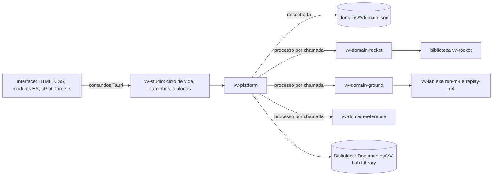

# M11: aplicação de secretária, Mission Control e plataforma modular

Estado: **candidato a versão de produto, ramo de desenvolvimento** (`feat/m11-desktop`, empilhado sobre o PR #15). A aplicação instala-se e corre no Windows 11 sem Rust, Python nem Node.js. Os modelos continuam a ser modelos de investigação idealizados; nada aqui é software de voo, de veículo ou de controlo de equipamento. O estado científico do M10 não muda com o M11: ver a secção [Estado científico](#estado-científico).

## O que é

V&V Lab Studio é uma aplicação Windows que junta, numa janela própria:

- preparação de missões (domínio, cenário, veículo, controlador, sementes, falhas, parâmetros), com demonstrações guiadas e cenários guardados;
- execução determinística em processos separados, com cena (3D para o foguetão, 2D para o veículo terrestre), telemetria sincronizada no tempo, linha de eventos e verificação;
- comparação de controladores com a mesma semente e as mesmas falhas;
- reprodução por recálculo, pacotes de evidência e uma biblioteca persistente de execuções, cenários e comparações.

A linha de comandos de desenvolvimento (`vv-lab`, `vv-rocket`, os scripts Python de campanhas e o Mission Control do M10 em `scripts/mission_control.py`) continua suportada e inalterada.

## Decisão de arquitetura

Opções avaliadas para a aplicação de secretária:

| Opção | A favor | Contra | Decisão |
| --- | --- | --- | --- |
| Tauri 2 (Rust, WebView2) | o resto do projeto é Rust; instalador NSIS incluído; executável pequeno; WebView2 já vem no Windows 11; comandos tipados entre interface e núcleo | depende do WebView2 do sistema | **escolhida** |
| Electron | ecossistema grande | Chromium e Node.js embutidos (cerca de 150 MB); um segundo ambiente de execução só para a interface; o núcleo continuaria a falar com Rust por processos | rejeitada |
| WebView2 com uma aplicação Win32 própria | controlo total | refazer o que o Tauri já dá (janela, IPC, instalador, ícones) | rejeitada |
| Interface Rust nativa (egui, iced, Bevy) | sem motor web | gráficos científicos, tabelas, acessibilidade e tipografia muito atrás das bibliotecas web; o protótipo `spikes/bevy-trace-viewer` mostrou o custo de cada vista | rejeitada para a interface principal |
| Python embutido com o Mission Control atual | reutiliza o código | um serviço HTTP local de longa duração, um segundo ambiente de execução e a interface presa a um servidor de página | rejeitada |

Consequências: a camada de adaptadores que vivia em Python (`sim_adapter.py`, `landing_adapter.py`, `workbench.py`) foi portada para Rust, com paridade verificada byte a byte contra o Python (ver [Testes](#testes)). Não há serviço HTTP: a interface chama comandos do Tauri e o núcleo arranca e para com a janela.

## Arquitetura



- **`desktop/platform` (`vv-platform`)**: o contrato `vv-domain` 1.0, a descoberta, a execução de anfitriões, a guarda das sementes, a validação genérica, a biblioteca, a reprodução e a evidência. Não conhece nenhum domínio.
- **Anfitriões de domínio**: um executável por domínio, ao lado de um `domain.json`. Correm num processo por chamada, sem janela, com limite de tempo e de saída; uma falha ou um bloqueio de um domínio não derruba a aplicação.
- **`desktop/studio` (`vv-studio`)**: a janela, os comandos expostos à interface, os caminhos do utilizador, o registo e um modo sem janela `--self-test`.
- **Espaço de trabalho isolado**: `desktop/Cargo.toml` tem o seu próprio `[workspace]`, como `crates/vv-rocket`. O pacote da raiz, o seu `Cargo.lock` e os hashes canónicos do M1 não mudam.

### O contrato `vv-domain` 1.0

Definido em `desktop/platform/src/contract.rs`. Cada documento tem um campo `schema` e os leitores recusam campos desconhecidos.

| Documento | Esquema | Quem o produz |
| --- | --- | --- |
| Manifesto estático | `vv-domain-manifest.v1` (`domain.json`) | o domínio, instalado ao lado do anfitrião |
| Catálogo | `vv-domain-catalog.v1` | `anfitrião describe` |
| Pedido | `vv-run-request.v1` | a interface; normalizado pela plataforma e pelo anfitrião |
| Registo de execução | `vv-run.v1` (`record.json`) | `anfitrião run` |
| Reprodução | `vv-run-replay.v1` | `anfitrião replay`, mais as verificações da plataforma |

O manifesto declara identificador, versão, versão do contrato (nome, maior, menor), executável, limites de tempo e de saída, capacidades (`run`, `replay`, `compare`, `evidence`, `faults`), visualizações (`scene.<tipo>`, `plots`, `requirements`, `timeline`, `events`), política de sementes (intervalo e intervalos protegidos com a razão), validade do modelo e se o domínio aparece na interface do produto.

O catálogo declara veículos, cenários (com os controladores e parâmetros que aceitam), controladores, parâmetros (unidade, intervalo, passo, valor por omissão, avançado ou não, explicação), falhas (alvo, magnitude, janela, restrição por controlador), número máximo de falhas, canais de telemetria, requisitos e demonstrações.

O registo normalizado separa o resultado da missão (`outcome`) da segurança (`safety`, julgada pelos invariantes sobre o estado real) e traz as bases de tempo, os canais (verdade, observação, estimativa, incerteza, comando, métrica, limite), os eventos (falha, controlador, verificador, verdade), os requisitos com o valor esperado, o observado e o instante decisivo, as métricas, a cena estática, as notas de validade e a proveniência (hash das fontes do simulador, lista de artefactos com SHA-256, comandos que reproduzem a execução na linha de comandos). O campo `domain.contract` tem a forma `vv-domain/1.0`.

Regras de compatibilidade: a versão maior tem de ser igual; uma versão menor acima da da plataforma é recusada ("needs a newer platform"); um nome de contrato diferente, um identificador inválido, um executável com caminho ou em falta, ou um identificador repetido são recusados com a razão, e a aplicação mostra-os nas definições. Nada é executado durante a descoberta.

### Identidade, reprodução e evidência

- **Identidade de uma execução**: os primeiros 16 dígitos do SHA-256 do JSON canónico de `{domínio, SHA-256 do executável do anfitrião, pedido normalizado}`. A mesma configuração com o mesmo build reutiliza a execução guardada; um build diferente produz outra execução.
- **Publicação**: cada execução é montada em `staging/` e publicada com um único `rename`. Um arranque depois de uma falha limpa o que ficou em `staging/`.
- **Reprodução**: a plataforma confirma que o pedido guardado é igual ao do registo e que a semente continua permitida; o anfitrião confirma os hashes dos artefactos, volta a validar o pedido, recalcula a execução numa pasta temporária e compara todos os ficheiros e o registo byte a byte. O anfitrião do foguetão junta a reprodução nativa do `vv-rocket` e o do veículo terrestre a do `vv-lab replay-m4`; antes disso, o SDK exige que a semente do ficheiro nativo (`run.json` ou `native/m4.json`) seja a do pedido validado, e o simulador nativo não chega a correr se não for. A plataforma só aceita "verified" se o anfitrião sair com o código 0, disser `verified` e reportar como aprovadas as duas verificações de recálculo do contrato, "the run is recomputed from its request" e "recomputed artifacts equal the stored artifacts byte for byte" (`RECOMPUTE_CHECKS` em `desktop/platform/src/service.rs`). Um anfitrião escrito sem o SDK tem de as reportar com estes nomes. Nenhum veredicto guardado é devolvido sem recálculo.
- **Evidência**: um zip com os ficheiros da execução, o pedido, um relatório de reprodução feito no momento, um manifesto SHA-256 e um README com os comandos. Membros ordenados e datas fixas: a mesma execução e a mesma reprodução dão os mesmos bytes (há um teste). As notas e datas da biblioteca ficam fora.

### Fronteiras científicas na aplicação

- **Sementes protegidas**: a plataforma recusa uma semente protegida antes de arrancar qualquer processo, e cada anfitrião recusa-a outra vez. Foguetão: 3000 a 3099 (avaliação do M10) e 6000 a 6099 (reserva). Veículo terrestre: 101 a 112 (conjunto de aceitação do M6, `heldout_seeds`). A interface mostra os intervalos e a razão. Um teste prova, com um registo de chamadas do anfitrião de referência, que uma semente protegida nunca chega ao anfitrião, nem numa comparação. A reprodução de uma execução guardada também volta a aplicar a guarda antes de recalcular.
- **Sem congelamento nem avaliação**: a aplicação não tem nenhuma operação de congelamento nem de avaliação do M10; as execuções das políticas M10 trazem a nota de que são de desenvolvimento.
- **Verdade e observação**: a cena e os gráficos marcam o que é verdade do simulador (só o verificador a vê), observação de sensor e estimativa ou declaração do controlador.

## Como acrescentar um domínio

1. Criar um pacote em `desktop/` (por exemplo `domain-novo`) que dependa de `vv-platform` e implemente `vv_platform::host_sdk::DomainHost`: `manifest`, `catalog`, `check` (regras próprias), `run` (escreve os artefactos nativos e devolve o `RunRecord`) e, opcionalmente, `native_replay` com `native_seed_file` (o ficheiro nativo cuja `seed` tem de ser a do pedido). O `main` é `host_main(&Anfitrião)`; o SDK trata da validação genérica, da guarda das sementes, da lista de artefactos e da reprodução por recálculo.
2. Escrever o `domain.json` (identificador, contrato `vv-domain` 1.0, executável, sementes, visualizações) e incluí-lo no executável com `include_str!`.
3. Acrescentar o pacote a `desktop/Cargo.toml` e uma linha a `$domains` em `desktop/build.ps1`.
4. Se o domínio precisa de uma cena própria, registar um desenhador para o seu `scene.kind` na interface; sem isso, o domínio funciona com gráficos, eventos, verificação, comparação, biblioteca, reprodução e evidência.

Não é preciso alterar a plataforma, o shell nem a navegação da interface. `desktop/domain-reference` (um oscilador de brinquedo, `user_facing: false`) é a prova: os testes em `desktop/domain-reference/tests/` instalam-no numa pasta de domínios como faria um instalador e verificam descoberta, remoção, recusa de manifestos incompatíveis, execuções, comparações, reprodução, deteção de adulteração, evidência determinística e a guarda das sementes. Na aplicação, a preferência "Show developer domains" mostra-o e ele usa os mesmos ecrãs, sem código próprio.

## Locais e dados

| O quê | Onde | Na desinstalação |
| --- | --- | --- |
| Aplicação e domínios | `%LOCALAPPDATA%\VV Lab Studio\` (instalação por utilizador, sem administrador) | removido |
| Biblioteca (execuções, cenários, comparações, exportações) | `Documentos\VV Lab Library\` | **mantida** |
| Preferências | `%APPDATA%\org.vvlab.studio\preferences.json` | mantidas, salvo se o utilizador marcar a opção de apagar os dados da aplicação |
| Registo | `%LOCALAPPDATA%\org.vvlab.studio\logs\studio.log` | idem |

A biblioteca nunca fica dentro da pasta de instalação nem nas pastas que o desinstalador pode apagar. Para desenvolvimento e testes, `VVLAB_DOMAINS`, `VVLAB_EXTRA_DOMAINS` e `VVLAB_LIBRARY` substituem estes caminhos.

## Construção

Requisitos de construção (não de instalação): a cadeia Rust de `rust-toolchain.toml` e o Node.js (só para a CLI do Tauri em `desktop/studio/node_modules`). A primeira construção do instalador descarrega o NSIS uma vez.

```powershell
cd desktop\studio; npm ci; cd ..\..
powershell -ExecutionPolicy Bypass -File desktop\build.ps1
```

O script constrói `vv-lab.exe` (pacote da raiz), os três anfitriões, monta `desktop\target\release\domains\`, corre `tauri build` e mostra o caminho e o SHA-256 do instalador em `desktop\target\release\bundle\nsis\`. A CLI do Tauri é chamada com `node` diretamente, porque o atalho `npx` falha em caminhos com `&`.

Verificações do espaço de trabalho do produto:

```sh
cd desktop
cargo fmt --check
cargo clippy --all-targets -- -D warnings
cargo test
```

`cargo test` precisa de `target/release/vv-lab.exe` na raiz (construído pelo script ou por `cargo build --release`).

## Guia de instalação e aceitação

Ver [m11-acceptance.md](m11-acceptance.md).

## Testes

Resumo; os números exatos e os comandos estão no guia de aceitação.

- `vv-platform`: guarda das sementes.
- `vv-domain-reference`: contrato de extensão (seis testes) e guarda das sementes antes do processo.
- `vv-domain-rocket`: paridade byte a byte com `LandingAdapter.case_for` em 13 pedidos, guarda das sementes, restrição das falhas M10, forma do registo, determinismo, reprodução, adulteração e as demonstrações.
- `vv-domain-ground`: paridade com o adaptador Python em 11 pedidos (entradas e as cinco saídas nativas), determinismo, reprodução, adulteração, 14 pedidos inválidos e as demonstrações.
- Interface: `desktop/studio/tests/ui_smoke.py` conduz a janela real do WebView2 através do protocolo de depuração.

## Estado científico

O M11 é trabalho de produto. Não altera o estimador, a configuração nem as hipóteses do M10, não corre sementes de avaliação nem de reserva e não congela nada. Os resultados das demonstrações do foguetão com as políticas M10 são de desenvolvimento (sementes 5000 a 5099) e podem mudar enquanto o estimador é afinado; continuam pendentes as decisões do dono registadas para o M10 e a avaliação final.

## Limitações

- O instalador não é assinado: o SmartScreen avisa num computador limpo. Não foi comprado certificado.
- O anfitrião do foguetão não permite alterar o estado inicial, a atmosfera nem os ruídos dos sensores: a biblioteca `vv-rocket` fixa-os nos valores registados e recusa outros. Os parâmetros expostos são ganhos do controlador.
- As execuções do veículo terrestre não dependem da semente nestas três missões (não há ruído nem falhas aleatórias); a semente só muda a identidade e o registo diz isso.
- Os eventos de saúde dos grupos do M10 vêm das amostras de 0,1 s do traço; o instante tem essa resolução.
- Não há cancelamento de uma execução em curso; cada chamada tem o limite de tempo do manifesto.
- A interface recusa sementes acima de 9 007 199 254 740 991 (2^53 − 1), porque os números de JavaScript não as representam exatamente; o domínio terrestre aceita até 2^63 − 1 pela linha de comandos.
- A cena do foguetão não desenha a deflexão do gimbal: o registo não declara a convenção de sinal, e a legenda di-lo.
- A faixa de falhas da linha de tempo mostra as janelas pedidas; as falhas já incluídas num cenário terrestre aparecem como eventos.
- A disposição da cena é escolhida ao abrir a execução; uma execução aberta numa janela pequena fica só com a vista 3D até ser reaberta.
- A janela "Guardar como" e o "Show in Explorer" não estão no teste automático da interface.
