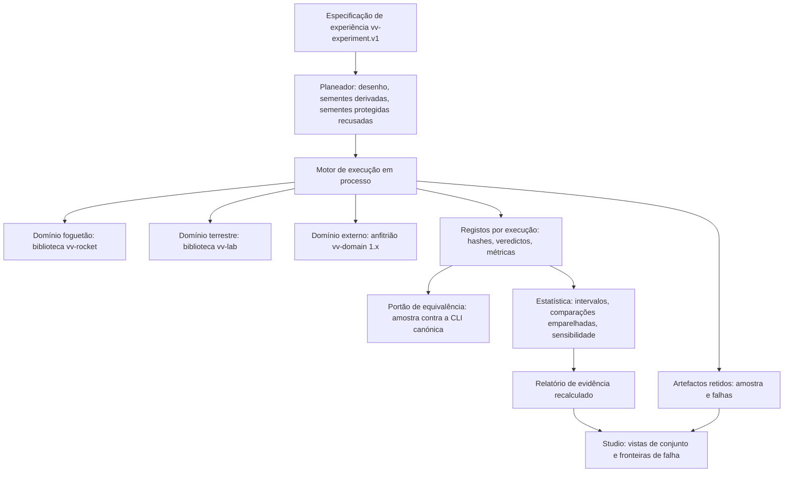

# Auditoria de desempenho e base técnica do M12

Estado: **investigação**. Este documento mede o laboratório atual e propõe o M12. Não altera o modelo, as sementes protegidas, as configurações aprovadas nem as evidências do M10. Nada aqui foi integrado em `main`.

## Âmbito, revisão e método

- **Revisão auditada:** `2bcc4ea` (ponta de `feat/m11-desktop`, PR 16, empilhada sobre a PR 15 do M10). O ramo da auditoria parte desse commit.
- **Máquina:** AMD Ryzen 7 7800X3D (8 núcleos, 16 fios), 32 GB DDR5 (31,7 GB visíveis), AMD Radeon RX 7700 XT 12 GB (controlador 32.0.31041.3013, Vulkan 1.4.349, controlador 26.9.1), Windows 11 Pro 10.0.26300, Rust 1.99.0, Python 3.14.6. Proteção em tempo real do Microsoft Defender ativa.
- **Estado da máquina durante as medições:** sessão de trabalho normal, com navegadores e aplicações de secretária abertos. Memória física disponível entre 3,3 e 6,8 GB. Os números incluem esse ruído; não são de uma máquina dedicada.
- **Ferramenta:** `spikes/m12-perf/jobrun.py` executa cada comando dentro de um Job Object do Windows. O job dá, para a árvore inteira de processos, o pico de memória comprometida (`PeakJobMemoryUsed`), o tempo de CPU de utilizador e de núcleo e o número de processos. Um teto de memória por job (4 a 12 GB) termina a árvore antes de esgotar a máquina. Um fio de amostragem regista a utilização global da CPU e a memória física disponível.
- **Simulação em processo:** `spikes/m12-perf/rocket-bench` liga `vv-rocket` como biblioteca e cronometra cada fase de uma execução. Antes de medir, compara o traço com o de `landing_run::artifacts` byte a byte.
- **GPU:** contadores `GPU Engine` e `GPU Process Memory` do Windows, com `spikes/m12-perf/gpu_sample.ps1` (uma amostra a cada 1,2 s, aproximadamente).
- **Sementes do foguetão:** não protegidas (5000 a 5959, 7000 a 9399). As ferramentas da auditoria recusam 3000 a 3099 e 6000 a 6099. Nenhuma semente de avaliação ou de reserva do M10 foi executada.
- **Sementes terrestres:** as do M1 (42, 1337, 2026) e, num ciclo de cronometragem escrito à mão, 100 a 129 com `scenarios/basic-mission.json`. Esse intervalo inclui 101 a 112, as sementes reservadas de `scenarios/m6/cancellation-dev.json`. Ver «Portões científicos preservados».
- **Evidências:** `docs/evidence/m12-perf/`, um JSON por medição, com o comando, os limites e as amostras. Os caminhos pessoais foram substituídos por `<repo>` e `<home>` (`spikes/m12-perf/collect.py`).

Não foi medido: energia (não há sensor acessível sem privilégios), bytes de E/S por job (o Job Object não preencheu os contadores nesta máquina; o campo foi retirado), desempenho de núcleos de GPU (não foi construído nenhum, ver a decisão).

## Resultados medidos

### Simulação do foguetão em processo

Uma execução de aterragem completa (preparação, simulação, verificação, serialização e SHA-256), 100 sementes de desenvolvimento, um fio:

| Caso | Execuções/s | Simulação | Verificação | Serialização | Hash | Total | Passos | Traço |
|---|---:|---:|---:|---:|---:|---:|---:|---:|
| `m10-nominal.json` (B+) | 278 | 2,47 ms | 0,39 ms | 0,47 ms | 0,20 ms | 3,55 ms | 2 327 | 483 KB |
| `altimeter-bias.json` (M9) | 464 | 1,35 ms | 0,23 ms | 0,36 ms | 0,14 ms | 2,10 ms | 2 190 | 345 KB |
| `gnss-bias-guarded.json` | 408 | 1,56 ms | 0,25 ms | 0,41 ms | 0,16 ms | 2,39 ms | 2 328 | 377 KB |

Escala com fios, `m10-nominal.json`, 960 sementes:

| Fios | 1 | 2 | 4 | 8 | 16 |
|---|---:|---:|---:|---:|---:|
| Execuções/s | 286 | 555 | 996 | 1 573 | 2 121 |
| Milhões de passos/s | 0,67 | 1,29 | 2,32 | 3,66 | 4,94 |

A simulação é cerca de 70 % do custo; cerca de 1 µs por passo. Escala quase linearmente até 8 fios e ganha 35 % com SMT.

### Custo de criar um processo

Mediana de 30 a 40 chamadas, a partir de Python:

| Comando | Mediana |
|---|---:|
| `C:\Windows\System32\hostname.exe` | 20,2 ms |
| `vv-rocket` sem argumentos (só criação e saída) | 21,8 ms |
| `vv-rocket land` (`m10-nominal.json`) | 30,3 ms |
| `vv-rocket replay` | 31,0 ms |
| `vv-lab` sem argumentos | 24,0 ms |
| `vv-lab run scenarios/basic-mission.json` | 28,7 ms |

Criar um processo custa 20 ms mesmo para um executável do sistema. Numa aterragem pela linha de comandos, cerca de 85 % do tempo é criação e saída do processo, não simulação. A causa está fora do repositório (filtros de segurança e o próprio Windows); a auditoria não tenta isolá-la mais.

### Campanhas atuais

| Medição | Execuções | Tempo | CPU | Núcleos ocupados | Pico de memória | Execuções/s |
|---|---:|---:|---:|---:|---:|---:|
| M10, F1, `m10_b_plus`, `--jobs 4` | 1 100 | 19,1 s | 41,4 s | 2,2 | 42 MB | 58 |
| M10, F1, `m10_b_plus`, `--jobs 8` | 1 100 | 13,5 s | 41,4 s | 3,1 | 55 MB | 81 |
| M10, `--jobs 12` (teto alterado) | 1 100 | 11,6 s | 43,4 s | 3,8 | 64 MB | 95 |
| M10, `--jobs 16` (teto alterado) | 1 100 | 9,4 s | 41,4 s | 4,4 | 68 MB | 117 |
| Campanha terrestre do `AGENTS.md` | 324 processos | 21,6 s | 14,0 s | 0,65 | 21 MB | 15 processos/s |

Comando do M10: `python scripts/m10_campaign.py --seeds 5000-5099 --scenarios F1 --arms m10_b_plus --jobs N`. Os resultados com 8 e 16 tarefas são iguais (`summary.json` e `records.json`, sem os campos de tempo e de caminho). A campanha gasta cerca de 38 ms de CPU por execução, dez vezes o trabalho da simulação. A campanha terrestre é sequencial e deixa a máquina quase parada.

### Executor em lote (protótipo)

`spikes/m12-perf/rocket-bench/src/bin/batch.rs` chama a função canónica `landing_run::write_landing` para muitas sementes num só processo. Escreve os mesmos quatro ficheiros que `vv-rocket land`.

- **Equivalência:** 30 sementes (5000 a 5029) de `m10-nominal.json`, 4 ficheiros cada, comparados com a saída de `vv-rocket land`: 0 diferenças. `vv-rocket replay` verifica uma execução do lote (`verified`).
- **Débito, 2 400 sementes com todos os ficheiros escritos:** 156 execuções/s com 1 fio, 428 com 8, 491 com 16; pico de 6, 26 e 44 MB; 8,9 ms de CPU por execução com 16 fios.
- **Limite seguinte:** escrever 1,2 GB de artefactos (9 600 ficheiros). Sem escrita, o mesmo trabalho faz 2 121 execuções/s.

### Compilação e testes

| Medição | Tempo | CPU | Núcleos | Pico de memória | Memória disponível mínima |
|---|---:|---:|---:|---:|---:|
| `cargo build --release` raiz, limpa | 20,7 s | 79 s | 3,8 | 1,4 GB | 4,6 GB |
| `vv-rocket` `--release`, limpa | 11,4 s | 28 s | 2,5 | 1,4 GB | 4,5 GB |
| `desktop`, dependências (falhou sem domínios preparados) | 64,6 s | 327 s | 5,1 | 4,7 GB | 3,4 GB |
| `desktop/build.ps1 -StageOnly` | 43,8 s | 138 s | 3,2 | 1,7 GB | 6,5 GB |
| `vv-studio` `release`, depois das dependências | 94,6 s | 134 s | 1,4 | 1,9 GB | 6,3 GB |
| `vv-studio` `release`, só `main.rs` alterado | 86,8 s | 118 s | 1,4 | 1,2 GB | 6,1 GB |
| `vv-studio` `dev-release`, só `main.rs` alterado | 8,1 s | 9 s | 1,1 | 0,8 GB | 6,2 GB |
| `cargo test` raiz | 47,9 s | 151 s | 3,2 | 2,8 GB | 5,5 GB |
| `cargo test --release` de `vv-rocket` | 9,4 s | 32 s | 3,4 | 0,8 GB | 6,5 GB |
| `cargo test` do `desktop` | 93,6 s | 322 s | 3,4 | 5,0 GB | 3,3 GB |
| Testes Python | 88,8 s | 46 s | 0,52 | 0,1 GB | 6,6 GB |

Notas: as compilações limpas reutilizam o registo local de crates. A compilação limpa do `desktop` está dividida em três medições, porque a primeira falhou no `build.rs` do Studio (falta `target/release/domains`; `build.ps1` prepara-o antes). A CI corre os testes de `vv-rocket` em `debug`; aqui foram medidos em `release`.

### Interface do Studio

Teste de interface `desktop/studio/tests/ui_smoke.py` (66 verificações, WebView2 real) contra o Studio instalado: 62,3 s, 0,4 núcleos, pico de 979 MB para a árvore inteira do job, que inclui o condutor Python, o WebView2 e os anfitriões de domínio (maior processo: 405 MB). GPU 3D do Studio: no máximo 1,8 %, média 0,3 %. Memória de vídeo atribuída ao Studio e ao WebView2: até cerca de 290 MB acima do repouso. A interface não é um estrangulamento.

## Diagnóstico

1. **A simulação não é o estrangulamento.** Um fio faz 286 aterragens B+ por segundo; 16 fazem 2 121. A campanha de desenvolvimento inteira do M10 (6 braços × 2 400 execuções = 14 400) representa cerca de 7 s de cálculo nesta máquina (estimativa a partir da taxa medida).
2. **As campanhas são limitadas pela criação de processos.** Cada execução é um processo de 20 a 30 ms e cada réplica outro. O teto de 8 tarefas deixava 12 dos 16 fios parados. A campanha terrestre é sequencial.
3. **O passo seguinte é a E/S de artefactos.** Um traço B+ tem 483 KB. A campanha escreve-o e apaga-o quando não o retém.
4. **A compilação local do Studio é dominada por uma ligação em série.** `codegen-units = 1` e LTO `thin` dão 87 s por alteração com 1,4 núcleos. Para distribuição é a escolha certa; para iterar não é.
5. **Os testes Python são sequenciais** e esperam por processos (0,52 núcleos durante 89 s).
6. **A memória do laboratório é pequena.** Campanhas até 68 MB, executor em lote 44 MB, Studio abaixo de 1 GB. Os picos vêm da compilação e dos testes do `desktop` (até 5 GB).

## Plano de remediação de memória

A medição de 3 de novembro de 2026 mostra a máquina com 5,2 GB livres e 48,8 de 63,7 GB de memória comprometida **antes** de qualquer trabalho do laboratório. Memória privada por aplicação, somando processos: `msedge` 6,3 GB (37 processos), ChatGPT 5,2 GB, `claude` 2,5 GB, `chrome` 1,9 GB, `codex` 1,6 GB, Orca 1,3 GB, `node` 1,1 GB. A pressão é externa ao laboratório.

1. **Durante compilações e testes do `desktop`, libertar memória fora do laboratório.** Fechar ou suspender separadores e aplicações de IA de secretária liberta mais de 10 GB, o dobro do pico do laboratório. É a ação com maior efeito e não exige código.
2. **Não sobrepor `cargo test` e `cargo build` do `desktop`.** Cada um chega a 5 GB e baixou a memória disponível para 3,3 GB. Com menos de 6 GB disponíveis, usar `CARGO_BUILD_JOBS=8` (ou `-j 8`), que reduz os rustc simultâneos.
3. **Iterar no Studio com `--profile dev-release`.** Pico de 0,8 GB contra 1,2 GB por religação, e 8 s contra 87 s.
4. **No M12, admitir trabalho pela memória.** O agendador lê a memória disponível (`GlobalMemoryStatusEx`, já usado em `jobrun.py`) antes de aumentar o paralelismo e corre cada grupo de trabalhadores num Job Object com teto. Abaixo de um limiar, reduz os trabalhadores em vez de paginar.
5. **Fechar os resíduos de memória do Studio registados no M11:** artefactos lidos inteiros para memória, `list_runs` com teto fixo de 5 000, traços completos enviados à interface. No M12: paginação, leitura em fluxo e traços decimados para visualização, com o traço canónico intacto em disco.
6. **Disco, não memória:** cada árvore de trabalho tem o seu `target` (1,4 GB na cópia principal). Partilhar `CARGO_TARGET_DIR` entre árvores poupa disco, mas obriga a recompilar ao trocar de ramo. Fica como opção do proprietário.

O custo de 20 ms por processo vem do sistema e dos filtros de segurança ativos. Exclusões no antivírus exigem privilégios de administrador e reduzem proteção; a auditoria não as recomenda. O M12 elimina o custo pela arquitetura (execução em processo), não pela configuração de segurança.

## Decisão sobre GPU: não avançar

**Decisão: não usar GPU no M12 para a simulação, nem como protótipo.** Nenhum núcleo de GPU foi escrito nem despachado. Não há, por isso, medições de débito, energia ou divergência numérica na GPU; esta secção não as substitui por estimativas.

Investigação feita:

- **Vulkan Compute:** disponível. `vulkaninfo` dá Vulkan 1.4.349, controlador proprietário AMD 26.9.1, `shaderFloat64 = true`, `shaderInt64 = true`. O `wgpu` 24 em cache local tem a capacidade `SHADER_F64` (só nativa, Vulkan), e o `naga` 24 aceita o tipo `f64` em WGSL. A documentação do `wgpu` avisa que operações `f64` são frequentemente 16 a 64 vezes mais lentas do que `f32`.
- **HIP:** o controlador instala `amdhip64_6.dll` e `amdhip64_7.dll`, mas não há HIP SDK (`HIP_PATH` vazio, sem `hipcc`). O suporte do HIP SDK para Windows a esta placa não foi verificado.
- **OpenCL:** `OpenCL.dll` presente; não avaliado, sem vantagem sobre Vulkan para este caso.

Razões, por ordem de peso:

1. **O trabalho não o justifica.** O cálculo da campanha de desenvolvimento completa do M10 cabe em cerca de 7 s de CPU em processo. O tempo perdido está na criação de processos e na E/S, que uma GPU não resolve.
2. **A forma do trabalho não serve a GPU.** Cada execução é uma cadeia sequencial de cerca de 2 300 passos RK4 em `f64`, com controlador, filtro de navegação, falhas e verificador cheios de ramos. Só há paralelismo entre execuções, e ramos divergentes desperdiçam a largura das unidades vetoriais.
3. **A GPU não reproduz os bytes canónicos.** Os artefactos são comparados byte a byte e por SHA-256. A atmosfera (`math.rs`) usa `exp` em `f64`; o `naga` traduz `exp` para a instrução `Exp` de `GLSL.std.450`, cuja disponibilidade e precisão em `f64` no Vulkan não estão garantidas iguais às da CPU (não verificado no controlador). A precisão de divisões e raízes e a contração em FMA também não são garantidas iguais às do Rust na CPU. Um motor em GPU seria sempre um segundo motor, validado estatisticamente, nunca uma substituição.
4. **Estabilidade:** o proprietário pediu para não carregar uma GPU instável. Sem ganho esperado, o risco não se justifica.

A decisão muda se, em conjunto:

- uma campanha precisar de pelo menos 10^6 a 10^7 trajetórias independentes de um modelo reduzido (ponto material ou substituto) e o motor da CPU em processo passar de cerca de 30 minutos;
- o proprietário aceitar um motor exploratório não canónico, com critérios de equivalência estatística pré-registados (distribuições de distância ao alvo e de velocidade no toque, não bytes);
- existir um banco de equivalência que compare esse motor com o canónico nas mesmas sementes de desenvolvimento.

Nesse caso, o protótipo seria `wgpu` com Vulkan, em `spikes/`, com o modelo reduzido em `f32` e `f64`, despachos curtos (abaixo de 100 ms, para não acionar o TDR do Windows) e medição de débito, memória de vídeo, divergência face à CPU e tempo de CPU poupado.

A GPU tem uso legítimo no M12 do lado da **visualização**: desenhar milhares de trajetórias de uma campanha com WebGL no Studio. Isso não toca no motor científico.

## Melhorias aplicadas nesta auditoria

- **`scripts/m10_campaign.py`: `MAX_JOBS` de 8 para 16.** Medido: 13,5 s para 9,4 s (1,44 vezes) em 1 100 execuções, resultados iguais, pico de 68 MB. A predefinição (`--jobs 4`) não muda; as evidências do M10 já publicadas não mudam, e os comandos com `--jobs 8` em `docs/m10-implementation.md` continuam válidos. O `m10_onset_sweep.py` herda o teto.
- **`desktop/Cargo.toml`: perfil `dev-release`.** Herda `release` com `codegen-units = 16`, sem LTO e incremental. Religação do Studio de 86,8 s para 8,1 s. A autoverificação headless do Studio construído com este perfil passa (4 de 4). O instalador, a CI e `build.ps1` continuam com `release`.
- **Ferramentas da auditoria em `spikes/m12-perf/`:** `jobrun.py` (medição com teto de memória), `gpu_sample.ps1` (contadores de GPU), `rocket-bench` (fases em processo e executor em lote, com recusa das sementes protegidas), `collect.py` (evidências sanitizadas).

Não aplicado, de propósito:

- **Modo em lote dentro de `vv-rocket`.** Mudar `main.rs` muda `source_sha256` em cada `run.json`, e todas as execuções guardadas do M10 deixariam de passar em `replay`. O executor fica num pacote separado que liga `vv-rocket` como biblioteca.
- **`VSCMD_SKIP_SENDTELEMETRY` em `build.ps1`.** A variável não impediu o `vctip.exe` de ficar vivo depois da ligação; não há evidência de ganho.
- **Execução paralela dos testes Python.** Mudaria o comando de verificação obrigatório; fica para o M12.

## Recomendação de arquitetura do M12

O ganho medido (de 81 para 2 121 execuções/s, 26 vezes) vem de uma única mudança: **executar os modelos em processo, como biblioteca, e escrever só o que se retém**, com os mesmos bytes da linha de comandos. Essa é a espinha do M12. Tudo o resto assenta nela.



Princípios:

1. **A CLI de cada domínio continua a ser a referência canónica.** O motor em processo chama as mesmas funções. Cada campanha reexecuta pela CLI uma amostra fixa de execuções e exige bytes iguais; uma diferença invalida a campanha.
2. **Ordem total e resultados independentes do paralelismo.** Trabalho distribuído dinamicamente; registos ordenados por (célula, braço, semente) antes de qualquer agregação. O número de fios muda o tempo, nunca os bytes.
3. **Sementes derivadas e protegidas.** Semente de cada réplica obtida da identidade da experiência, da célula e do índice, com algoritmo explícito. O registo de sementes protegidas (`desktop/platform/src/seeds.rs`) é aplicado pelo planeador, antes de qualquer execução.
4. **Retenção por política.** Tudo tem hash; o traço completo só fica para a amostra, as falhas e o que a política pedir. A E/S deixa de dominar.
5. **Agendador adaptativo medido.** Fios = mínimo de (fios lógicos, orçamento de memória a dividir pelo pico por trabalhador, orçamento de E/S). Reduz trabalhadores quando a memória disponível baixa de um limiar. Cada grupo num Job Object com teto. Os limites atuais de execuções, tempo e bytes ficam.
6. **Python para análise.** O motor e o planeador ficam em Rust, como pede o `AGENTS.md`. O Python lê registos e produz figuras e relatórios.
7. **O contrato `vv-domain` evolui, não é substituído.** Versão 1.1 com esquema de parâmetros (unidades, limites, distribuições), catálogo de falhas, observáveis e invariantes declarados, e um caminho em processo (traço Rust) ao lado do anfitrião fora de processo.

## Roteiro do M12

Cinco frentes, executadas por esta ordem porque cada uma depende da anterior. Cada uma tem critério de aceitação medido nesta máquina.

### 1. Motor de execução

- Pacote `vv-exec` num espaço de trabalho separado (como `desktop/`), com o traço de domínio em processo, o agendador adaptativo, a política de retenção e o portão de equivalência.
- Domínios do foguetão e terrestre ligados como bibliotecas, sem alterar `crates/vv-rocket`, o pacote raiz nem os hashes do M1.
- Retoma após interrupção a partir do registo de execuções concluídas.
- **Aceitação:** campanha de desenvolvimento completa do M10 (14 400 execuções, 6 braços) em menos de 30 s de ponta a ponta, com pico abaixo de 1 GB; amostra de equivalência com 0 diferenças; resultados agregados iguais aos de `m10_campaign.py` nas mesmas sementes.

### 2. Experiências configuráveis

- Esquema `vv-experiment.v1`: espaço de parâmetros físicos do caso (massa, empuxo, atmosfera, condições iniciais, ganhos), distribuições, grelhas de falhas (tipo, magnitude, início, duração, pares), desenhos fatorial, hipercubo latino e Sobol.
- Validação na fronteira: unidades, limites do modelo e combinações proibidas recusadas antes da execução, com mensagem que identifica o parâmetro.
- Cenários terrestres com o mesmo esquema.
- **Aceitação:** uma varredura de 10^5 execuções definida num só ficheiro, reproduzível a partir desse ficheiro e do binário, com o manifesto de hashes.

### 3. Estatística e evidência

- Intervalos de Wilson e de Clopper-Pearson para taxas, comparações emparelhadas com correção de Holm, paragem sequencial só quando pré-registada.
- Índices de sensibilidade de Sobol (estimador de Saltelli) com intervalos por bootstrap; mapas de fronteira de falha no espaço de parâmetros.
- Relatórios sempre recalculados a partir dos registos, nunca copiados de uma conclusão guardada.
- **Aceitação:** índices de Sobol verificados contra uma função de teste com solução analítica (Ishigami) antes de qualquer uso num modelo.

### 4. Fronteiras de fidelidade e de validade

- Envelope de validade declarado por modelo: regimes e intervalos de parâmetros em que as equações e os casos de referência do M8 se aplicam.
- Execuções fora do envelope marcadas como extrapolação em todos os relatórios.
- Testes de convergência temporal (passo a metade) e de sensibilidade numérica integrados no motor.
- **Aceitação:** cada relatório indica a fração de execuções dentro do envelope; a convergência com passo a metade fica dentro da tolerância declarada nos casos de referência.

### 5. Studio como ambiente de experiências

- Criar, validar e lançar experiências pelo motor, com progresso e cancelamento.
- Vistas de conjunto: leques de trajetórias, distribuições no toque, fronteiras de falha, coordenadas paralelas, índices de sensibilidade. Desenho com WebGL e traços decimados; o traço canónico fica em disco.
- Paginação e leitura em fluxo da biblioteca de execuções.
- **Aceitação:** uma experiência de 10^5 execuções inspecionável no Studio sem passar de 1,5 GB na árvore do Studio, com o teste de interface atualizado.

## Portões científicos preservados

- Nenhuma semente de avaliação (3000 a 3099) ou de reserva (6000 a 6099) do M10 foi executada. As ferramentas novas do foguetão recusam-nas.
- **Desvio declarado:** a cronometragem de `vv-lab run` usou as sementes 100 a 129 com `scenarios/basic-mission.json`, e esse intervalo inclui 101 a 112, reservadas no M6 (`scenarios/m6/cancellation-dev.json`). Foi um ciclo escrito à mão, sem a guarda de sementes da plataforma. O cenário não é do M6, as saídas ficaram em `runs/` (ignorado pelo Git) e foram descartadas, e nenhum veredicto foi lido; só o tempo foi medido. O M6 já está concluído. As medições terrestres do M12 devem usar sementes fora de todos os conjuntos reservados.
- Nenhuma configuração foi congelada; `m10-freeze.json` não existe.
- `crates/vv-rocket`, o pacote raiz, os casos e as evidências do M10 não foram alterados. Os hashes do M1 não mudam.
- O protótipo de lote e as ferramentas ficam em `spikes/m12-perf/`, fora de qualquer espaço de trabalho existente.
- Nenhuma PR foi integrada.

## Limitações

- Uma máquina, numa sessão com outras aplicações abertas. Os tempos variam com a carga externa; as razões entre configurações são mais estáveis do que os valores absolutos.
- O custo de criação de processos é específico desta máquina e da sua configuração de segurança.
- Os números do executor em lote cobrem o domínio do foguetão. O domínio terrestre ainda não tem caminho em processo.
- As estimativas de campanha completa derivam das taxas medidas; o motor do M12 terá de as confirmar.

## Reproduzir

```sh
python spikes/m12-perf/jobrun.py --label <nome> --cap-mb 8192 --out runs/m12-perf/<nome>.json -- <comando>
cargo build --release --manifest-path spikes/m12-perf/rocket-bench/Cargo.toml
spikes/m12-perf/rocket-bench/target/release/m12-rocket-bench crates/vv-rocket/landing/m10-nominal.json 5000 960 16
spikes/m12-perf/rocket-bench/target/release/batch crates/vv-rocket/landing/m10-nominal.json 7000 2400 runs/m12-perf/batch 16
python scripts/m10_campaign.py --seeds 5000-5099 --scenarios F1 --arms m10_b_plus --jobs 16 --output-root runs/m12-perf/m10
cargo build --profile dev-release --manifest-path desktop/Cargo.toml -p vv-studio
python spikes/m12-perf/collect.py
```
